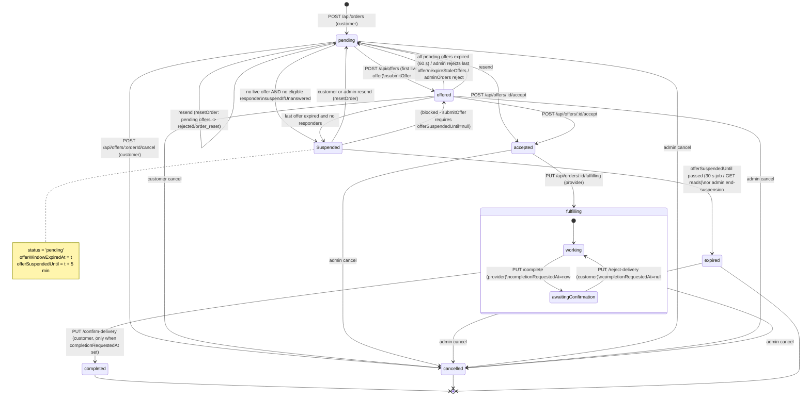
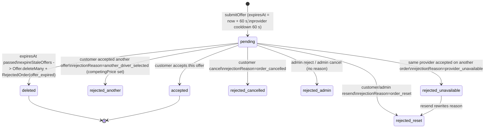
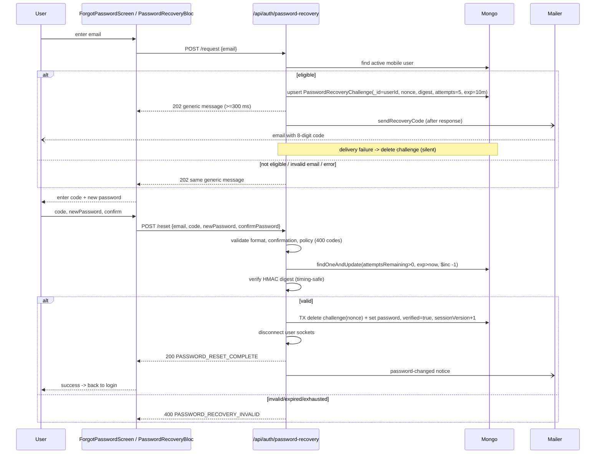

# Stars Delivery - Application Flows

This document reconstructs every end-to-end journey from source code on branch `docs/stars-delivery-audit` (commit `9b50ca3`). Nothing was executed.

- **NOT FOUND** means the feature was searched for and has no implementation.
- Endpoint details (validation, errors, tests) are in [API_INVENTORY.md](API_INVENTORY.md).
- Evidence levels: **Confirmed** (code), **Strongly suspected**, **Potential**, **Needs runtime**.

Roles:

- **customer** and **provider** (driver) use the Flutter app, authenticated with a JWT.
- **admin** uses the EJS/JS dashboard under `/admin`, authenticated with a Mongo-backed session, CSRF and optional TOTP.

---

## 0. State machines

### 0.1 Order status

`Order.status` enum: `pending, offered, accepted, fulfilling, completed, cancelled, expired` ([Order.js:15](../../stars_delivery_backend/src/models/Order.js#L15)).

Transitions live in [orderState.js](../../stars_delivery_backend/src/services/orderState.js) and [orderLifecycle.js](../../stars_delivery_backend/src/services/orderLifecycle.js). "Suspended" is not a status. It is `status='pending'` with `offerWindowExpiredAt` and `offerSuspendedUntil` set (5 min, [orderLifecycle.js:19](../../stars_delivery_backend/src/services/orderLifecycle.js#L19)). Delivery confirmation is a sub-state of `fulfilling`, marked by `completionRequestedAt`.



Notes:

- `transitionOrder(fulfilling→completed)` exists ([orderLifecycle.js:631-647](../../stars_delivery_backend/src/services/orderLifecycle.js#L631)) but **no route calls it with that pair**. Completion always goes through customer confirmation.
- There is no customer-side cancel after `accepted` (`canCancelOrResend` only allows `pending` and `offered`, [orderState.js:11-13](../../stars_delivery_backend/src/services/orderState.js#L11)).

### 0.2 Offer status

`Offer.status` enum: `pending, accepted, rejected` ([Offer.js:8](../../stars_delivery_backend/src/models/Offer.js#L8)), with `rejectionReason` free text. `RejectedOrder.reason` is `driver_rejected` or `offer_expired` ([RejectedOrder.js:8](../../stars_delivery_backend/src/models/RejectedOrder.js#L8)).



---

## 1. App launch and session restore

- **Trigger:** cold start.
- **Actors:** any device.

Steps:

1. `main()` calls `ApiConfig.init()` ([api_config.dart:294-317](../../lib/services/api_config.dart#L294)).
   - Production requires `STARS_SERVER_URL` (HTTPS).
   - Android debug falls back to a hard-coded LAN IP and probes `GET /api/config` (800 ms) or scans the /24 subnet.
2. `LocationService.initialize()` ([location_service.dart:9-20](../../lib/services/location_service.dart#L9)) requests location permission, gets a GPS fix (10 s limit), and maps it to the nearest Palestinian state from an asset JSON into `ApiConfig.detectedArea`.
3. Theme and locale are loaded. `runApp`, with `home: LoginScreen` ([main.dart:66](../../lib/main.dart#L66)).
4. `AuthBloc` fires `CheckAuthEvent` ([auth_bloc.dart:34-76](../../lib/bloc/auth/auth_bloc.dart#L34)):
   - it reads the token from secure storage, migrating it from legacy SharedPreferences ([session_storage.dart](../../lib/services/session_storage.dart));
   - it checks `JwtToken.isRestorable` locally (id, role, exp with 30 s skew);
   - it calls `GET /api/auth/me`.
5. `LoginScreen` listens for `AuthSuccess` ([login_screen.dart:430-460](../../lib/screens/login_screen.dart#L430)) and routes as follows:
   - `mustChangePassword` → `ForceChangePasswordScreen`;
   - provider → `ProviderHomeScreen`;
   - customer → `HomeScreen`.
6. Each home screen then:
   - connects the socket (`auth.token`, plus `query.area` for providers);
   - starts push and registers `POST /users/push-token`;
   - syncs location with `PUT /users/location`;
   - loads counters and notifications, and starts the polling timers.

Failures:

- `/me` returns 401 or 403: the token is cleared and the login form is shown.
- Network or 5xx error: `AuthError`. The token is **kept** and an error toast appears on the login form. There is no automatic retry. The user can log in again or restart.
- Location permission denied: `detectedArea` stays null, which is harmless because the registered area is authoritative server-side.

**Edge case:** `ApiConfig.init` throws a `StateError` for a missing or invalid `STARS_SERVER_URL`, crashing startup in release builds by design ([api_config.dart:61-67](../../lib/services/api_config.dart#L61)).

```mermaid
sequenceDiagram
    participant U as User
    participant App as Flutter (AuthBloc)
    participant SS as SecureStorage
    participant API as Express /api
    participant IO as Socket.io
    App->>SS: readToken()
    alt no token / not restorable
        App-->>U: LoginScreen form
        U->>App: LoginEvent(email,password,role)
        App->>API: POST /api/auth/login
        API-->>App: 200 {token,user} | 400 Invalid credentials | 403 ACCOUNT_INACTIVE | 429
        App->>SS: writeToken(token)
    else token present
        App->>API: GET /api/auth/me (Bearer)
        API-->>App: 200 {user} | 401 SESSION_INVALID/TOKEN_EXPIRED | 403
        Note over App: 401/403 -> clear token; network error -> keep token, show error
    end
    alt user.mustChangePassword
        App-->>U: ForceChangePasswordScreen
    else
        App-->>U: HomeScreen / ProviderHomeScreen
        App->>IO: connect(auth.token, query.area)
        IO->>API: verify JWT + sessionVersion + status
        IO-->>App: connect | connect_error "Invalid authentication" (-> forced logout)
        App->>API: POST /api/users/push-token
        App->>API: PUT /api/users/location
    end
    Note over IO,App: Server disconnects socket at JWT exp ("io server disconnect" -> client logout)
    U->>App: Logout button
    App->>API: POST /api/auth/logout (unawaited, 3 s)
    App->>API: DELETE /api/users/push-token (may race with revoke -> 401)
    App->>SS: clear()
```

---

## 2. Registration

### 2.1 Customer

- **Trigger:** `LoginScreen` register mode, with role `customer`.
- **Preconditions:** a valid email not used by a `User` or `PendingProvider`; password policy satisfied.

Steps:

1. The form collects name, email, phone, password and confirmation, plus governorate and village/city from `LocationCatalog`.
2. The Terms dialog is shown ([login_screen.dart:756-860](../../lib/screens/login_screen.dart#L756)).
3. `_doRegister` sends `RegisterEvent` and `POST /api/auth/register` ([auth.js:52-166](../../stars_delivery_backend/src/routes/auth.js#L52)). The server creates the `User` (with `publicId` and `phoneNumbers[0]` primary) and signs a 7-day JWT.

**Success:** `AuthSuccess`, then `HomeScreen`.

**Failures:**

- `400` email or password problems;
- `429 REGISTRATION_RATE_LIMITED`;
- `500` if `fullName` is missing (no server validation; the client validator prevents it).

### 2.2 Provider (driver)

- **Trigger:** register with role `provider`.
- **Additional input:** `serviceTypes` (at least one of product, people, goods; the client enforces it at [login_screen.dart:743-750](../../lib/screens/login_screen.dart#L743)).

Steps:

1. `POST /api/auth/register` creates a **`PendingProvider`** (hashed password, area, governorate, serviceTypes) and returns `201 {pending:true, message}` ([auth.js:105-121](../../stars_delivery_backend/src/routes/auth.js#L105)).
2. The client emits `AuthInitial` then `AuthError(message)` ([auth_bloc.dart:120-129](../../lib/bloc/auth/auth_bloc.dart#L120)). The success message is shown **as an error toast**. This is a **Confirmed** UX defect.
3. An admin approves the application (`POST /admin/drivers/pending/:id/approve`), which creates `User(role:provider, status:active)` in a transaction ([adminDrivers.js:1239-1364](../../stars_delivery_backend/src/routes/adminDrivers.js#L1239)). The applicant can log in from then on. **No notification or email is sent on approval or rejection.**

Documents and location:

- **Identity and license document upload is NOT FOUND in the current app/API.** It was removed in HEAD commit `9b50ca3` ("Remove image uploads…", which touched `login_screen.dart` and `auth_service.dart`).
- `providerDocumentStorage.persistProviderDocumentFiles` is unreferenced by any route.
- Admin document viewers only serve legacy data, and `POST /admin/drivers/pending/:id` returns 410.
- Registration location is only `governorate` plus `area` (village/city) chosen from the catalogue. GPS is not used for registration.

### 2.3 Admin-created driver

`POST /admin/drivers` ([adminDrivers.js:331](../../stars_delivery_backend/src/routes/adminDrivers.js#L331)) creates an active provider with `mustChangePassword:true`, which leads to the forced password change flow (§4).

---

## 3. Login and logout

- **Login:** see the §1 diagram. Role must match: `POST /api/auth/login` with `role` and a wrong role returns "Invalid credentials" ([auth.js:199](../../stars_delivery_backend/src/routes/auth.js#L199)). Rate limit is 10 per 15 min per IP and per account.
- **Logout (manual):** the home app-bar button confirms, then:
  1. `AuthService().revokeSession` (unawaited, which sends `POST /api/auth/logout` to bump `sessionVersion` and disconnect sockets);
  2. `SocketService.disconnect()`;
  3. `LogoutEvent`, which stops push (`DELETE /users/push-token`) and clears storage;
  4. navigation to `LoginScreen`.

  See [home_screen.dart:827-841](../../lib/screens/home_screen.dart#L827) and [provider_home_screen.dart:680-694](../../lib/screens/provider_home_screen.dart#L680).
- **Forced logout** (`_endSession`, [home_screen.dart:338-351](../../lib/screens/home_screen.dart#L338)) is triggered by:
  - HTTP 401 `AUTH_REQUIRED`, `SESSION_INVALID` or `TOKEN_EXPIRED`, or 403 `ACCOUNT_INACTIVE`, through `MobileSessionFailure`;
  - socket `account_deleted`;
  - socket disconnect reason `io server disconnect`;
  - socket `connect_error` containing "invalid authentication".

Defects:

- Push token unbinding races with revocation. **Strongly suspected.** See [API_INVENTORY.md §5.2](API_INVENTORY.md#52-expired-and-revoked-sessions).
- A DB outage during socket auth produces "Invalid authentication", which forces a logout. **Strongly suspected.**

---

## 4. Forced password change

- **Trigger:** `user.mustChangePassword == true`. This is set by an admin creating a driver or resetting a driver's or user's password ([adminDrivers.js:906](../../stars_delivery_backend/src/routes/adminDrivers.js#L906), [adminUsers.js:285](../../stars_delivery_backend/src/routes/adminUsers.js#L285)).
- **Server enforcement:** every mobile route except `PUT /users/password` and `GET /auth/me` returns `403 PASSWORD_CHANGE_REQUIRED` ([auth.js:115-132](../../stars_delivery_backend/src/middleware/auth.js#L115)). Socket connection is refused ([index.js:368-377](../../stars_delivery_backend/src/index.js#L368)).

Steps ([force_change_password_screen.dart:51-130](../../lib/screens/force_change_password_screen.dart#L51)):

1. `PUT /api/users/password` with `{currentPassword, newPassword, confirmPassword}`. The server sets `mustChangePassword=false`, increments `sessionVersion` (invalidating the token), and returns only `{message}`.
2. Because no token is returned, the client re-logs in with `POST /auth/login` using the new password.
3. `SessionUpdatedEvent` fires and the user is sent home.

Failures:

- `CURRENT_PASSWORD_INVALID` is localized.
- Other errors show the server's `error`.
- If the re-login fails, `password_change_session_failed` is shown.

The `_submitting` flag guards against double submits.

---

## 5. Password recovery

- **Trigger:** "Forgot password" on `LoginScreen`, which opens [forgot_password_screen.dart](../../lib/screens/forgot_password_screen.dart) with `PasswordRecoveryBloc` ([password_recovery_bloc.dart](../../lib/bloc/password_recovery/password_recovery_bloc.dart)). Stages are `requestEmail`, then `enterCode`, then `completed`. An `isLoading` guard prevents double submits.
- **Server:** [passwordRecovery.js](../../stars_delivery_backend/src/routes/passwordRecovery.js).
  - 8-digit code, 10-minute TTL, 5 attempts consumed atomically before comparison.
  - The code is HMAC-bound to `userId`, `email`, `sessionVersion` and `nonce`.
  - Responses take at least 300 ms. The request endpoint always returns 202.
  - Mail is sent through [passwordRecoveryMailer.js](../../stars_delivery_backend/src/services/passwordRecoveryMailer.js) after the response. On delivery failure, the challenge is deleted silently.



Edge cases:

- The reset **does not clear `mustChangePassword`** ([passwordRecovery.js:610-625](../../stars_delivery_backend/src/routes/passwordRecovery.js#L610)). An admin-reset account that recovers by email will still be forced to change its password after login. **Confirmed.**
- If mail config is missing, both endpoints return `503 PASSWORD_RECOVERY_UNAVAILABLE`.

---

## 6. Profile management

**Screen:** [profile_screen.dart](../../lib/screens/profile_screen.dart), opened from both homes.

| Action | API | Behaviour |
|---|---|---|
| Change name | `PUT /users/profile {fullName}` | The success toast shows, but the in-memory `UserModel` is not refreshed. Errors show raw `e.toString()`. |
| Change email | `PUT /users/email` (password re-prompt dialog) | Server bumps `sessionVersion` and disconnects sockets. Client shows a success message and dispatches `LogoutEvent` ([profile_screen.dart:272-320](../../lib/screens/profile_screen.dart#L272)). |
| Change password | `PUT /users/password` | Server revokes the session. The client relies on the socket `io server disconnect` or the next 401 to log out. It does not log out itself ([profile_screen.dart:322-372](../../lib/screens/profile_screen.dart#L322)). |
| Governorate and village | `PUT /users/area` | Returns the updated user via `onUserUpdated`. **Socket rooms are not updated until reconnect**, so a provider keeps receiving `new_order` for the old area. Polling (30 s) partially compensates. **Confirmed.** |
| Phone numbers | `GET/POST/DELETE /users/phones`, `PUT /users/phones/primary` | Errors are swallowed silently. No format validation on either side. |
| Governorate-level scope | `PUT /users/governorate-level` via [governorate_scope_card.dart:54](../../lib/widgets/governorate_scope_card.dart#L54) | Changes order visibility and responder matching ([orderVisibility.js](../../stars_delivery_backend/src/services/orderVisibility.js)). Provider socket rooms are again not refreshed. |
| Theme / language | local only ([settings_screen.dart](../../lib/screens/settings_screen.dart)) | - |

---

## 7. Create delivery order

- **Trigger:** customer home, then "new order", which opens [create_order_screen.dart](../../lib/screens/create_order_screen.dart) with `OrderBloc`.
- **Actors and permission:** customer only (`requireRole('customer')`).
- **Preconditions:** account active.

Inputs:

- `type` (product, people or goods);
- `description`;
- `location`: **free text** (`delivery_location`), with no map pin and no pickup/dropoff split;
- `phone`.

Area handling:

- `area` is sent as `ApiConfig.detectedArea` (GPS-derived state) but the **server overrides it** with the registered `user.area` ([orders.js:78](../../stars_delivery_backend/src/routes/orders.js#L78)).
- If governorate-level mode is on, a warning dialog asks the customer to confirm the scope ([create_order_screen.dart:291-314](../../lib/screens/create_order_screen.dart#L291)).

Steps:

1. `POST /api/orders` creates the order with `status='pending'`.
2. The server emits `new_order` to `area:<area>` (and to `governorate:<g>` when governorate-level).
3. The server sends an FCM `new_order` to eligible drivers ([orders.js:133-173](../../stars_delivery_backend/src/routes/orders.js#L133)).

**Success:** `OrderSuccess`, a toast, then the screen pops.

**Failures:** `400 INVALID_ORDER_INPUT`, `403` blocked, `429` (5 per 10 min).

**Edge cases:**

- No idempotency: a timeout after the commit, followed by a re-submit, creates a duplicate (**Potential**).
- With no eligible drivers, the next `GET /orders` or `GET /orders/:id` immediately suspends the order for 5 minutes, and it then expires (`suspendIfUnanswered`).

### 7.1 Fee calculation - NOT FOUND

There is no delivery fee, distance or zone pricing. The price is set entirely by driver offers (`Offer.price`, 0.01-100000).

The only computed money is the **platform commission at acceptance**: `calculateCommission(offer.price, config)`. It is either fixed (default 1, in shekels per the UI) or a percent from the `CommissionSetting` document, bounded to the offer price ([commissionSettings.js](../../stars_delivery_backend/src/services/commissionSettings.js), [orderLifecycle.js:305-312](../../stars_delivery_backend/src/services/orderLifecycle.js#L305)). The customer is never shown a fee.

---

## 8. Offer submission by drivers and the offer window

- **Trigger:**
  - a `new_order` socket event or FCM push (pushes only open the app);
  - polling of `GET /provider/pending-orders` (15-30 s);
  - the provider opening pending orders ([pending_orders_screen.dart](../../lib/screens/pending_orders_screen.dart)), then `SubmitOfferScreen` or `OrderDetailScreen`.
- **Actors:** provider, who must be active, not deleted, `isAvailable != false`, not `blockedUntil`, not in `offerCooldownUntil`, with matching service type and area visibility.

Steps:

1. The provider enters price and ETA (quick chips). `SubmitOfferEvent` sends `POST /api/offers`.
2. `submitOffer` runs as a transaction ([orderLifecycle.js:449-573](../../stars_delivery_backend/src/services/orderLifecycle.js#L449)):
   1. atomically claims the provider document (`offerSequence++`, `offerCooldownUntil=now+60s`);
   2. rejects the request if the provider has a `RejectedOrder` or an existing offer;
   3. sets the order to `offered` (only if `pending`/`offered`, not suspended, and visible);
   4. creates the `Offer` with `expiresAt=now+60s`.
3. Server emits socket `new_offer` and creates a `new_offer` notification (with push) for the customer.

**Success:** `OfferSuccess`, a toast, then the screen pops.

**Client mapping of 409 codes** ([offer_bloc.dart](../../lib/bloc/offer/offer_bloc.dart), [submit_offer_screen.dart:272-315](../../lib/screens/submit_offer_screen.dart#L272)):

| Code | Client behaviour |
|---|---|
| `OFFER_COOLDOWN` | Starts a countdown using `retryAfterSeconds` |
| `PROVIDER_BUSY` | Error toast |
| `PROVIDER_UNAVAILABLE` | Error toast |
| `OFFER_NOT_AVAILABLE` | "already submitted" warning, then the screen pops |
| `ORDER_NOT_AVAILABLE` | Generic error with the server message |

**Offer window / timer:**

- Each offer lives 60 s. The 30 s background job and every customer read call `expireStaleOffers`, which writes `RejectedOrder(offer_expired)` for the driver and **deletes** the offer ([orderLifecycle.js:146-222](../../stars_delivery_backend/src/services/orderLifecycle.js#L146)).
- If no live offers remain:
  - with no eligible responders, the order is suspended;
  - otherwise an `offered` order reverts to `pending`.
- The provider's own 60 s cooldown means one offer per minute across all orders.

**Edge case (Confirmed by code):**

- A driver whose offer expired gets a permanent `RejectedOrder` row for that order.
- `resetOrder` (resend) never removes those rows ([orderLifecycle.js:575-610](../../stars_delivery_backend/src/services/orderLifecycle.js#L575)).
- That driver therefore **can never offer again on that order**, even after the customer resends it. They are also excluded from responder counts, which accelerates suspension.

---

## 9. Customer reviewing, accepting and rejecting offers

**Screen:** [order_offers_screen.dart](../../lib/screens/order_offers_screen.dart) with `OfferBloc`. It opens automatically on `new_offer` while the customer is on the home screen ([home_screen.dart:131-139](../../lib/screens/home_screen.dart#L131), [195-224](../../lib/screens/home_screen.dart#L195)). It can also be opened from My Orders or a notification.

Steps:

1. `GET /api/offers/order/:orderId` returns the offers with provider name, category, rating, area, and whether they are outside the area.
2. A 1-second timer shows the countdown and reloads when an offer expires. A socket `new_offer` also triggers a reload.
3. **Accept:** if the provider is outside the area, a confirmation dialog appears first ([order_offers_screen.dart:1022-1052](../../lib/screens/order_offers_screen.dart#L1022)). Then `AcceptOfferEvent` sends `POST /api/offers/:id/accept`. `acceptOffer` runs as a transaction ([orderLifecycle.js:243-447](../../stars_delivery_backend/src/services/orderLifecycle.js#L243)) and:
   - blocks the provider for 15 minutes;
   - sets the order to `accepted`, with `price`, `platformCommission`, `providerEarning`, `estimatedTime` and `acceptedAt`;
   - marks the chosen offer `accepted`;
   - rejects competing offers with `another_driver_selected`;
   - rejects the provider's other pending offers with `provider_unavailable`.
4. Notifications after acceptance:
   - the provider gets `offer_accepted` (socket, notification and push);
   - each losing driver gets `offer_not_selected`;
   - other customers who had this driver's offer get `offer_cancelled` and `driver_taken`.

**Conflicts:**

- `PROVIDER_TAKEN`: a "driver taken" dialog, then a reload.
- Other conflicts: a dialog with the server message.

**Rejecting offers explicitly: NOT FOUND.** There is no customer endpoint to decline a single offer. The customer can:

- ignore offers, which expire after 60 s;
- **Resend** (`POST /offers/:orderId/resend`), which rejects all pending offers with `order_reset` and re-broadcasts `new_order`;
- **Cancel** the order (§13).

**Defect (Confirmed):** the offer's `providerPhone` is always empty, so the customer never sees the driver's phone. See [API_INVENTORY.md](API_INVENTORY.md#57-contract-mismatches-client-model--server-response) C1.

---

## 10. Driver assignment, order status transitions and delivery completion

**Assignment** happens through acceptance (§9). There is **no automatic dispatch**. The provider's `blockedUntil` is set to now plus 15 minutes ([orderLifecycle.js:16](../../stars_delivery_backend/src/services/orderLifecycle.js#L16), [276-284](../../stars_delivery_backend/src/services/orderLifecycle.js#L276)). It is cleared only on customer confirmation or admin cancel.

**Strongly suspected defect:** the block is not tied to the active order's lifetime. Fifteen minutes after acceptance, a provider with an `accepted` or `fulfilling` order passes `submitOffer` and `acceptOffer` checks again, and can win concurrent orders.

**Provider side:**

- On `offer_accepted`, `ProviderHomeScreen` auto-opens `OrderDetailScreen` ([provider_home_screen.dart:266-276](../../lib/screens/provider_home_screen.dart#L266)). Active orders are listed in [provider_active_orders_screen.dart](../../lib/screens/provider_active_orders_screen.dart).
- "Start", calling `PUT /orders/:id/fulfilling`, moves `accepted` to `fulfilling`. The customer gets socket `order_status_changed` and notification `order_pending`.
- "Delivered", calling `PUT /orders/:id/complete`, sets `completionRequestedAt`. The customer gets socket `delivery_confirmation_requested` and notification `delivery_confirmation`.

**Customer side:**

- On `delivery_confirmation_requested`, the home auto-opens My Orders filtered to `fulfilling` ([home_screen.dart:226-249](../../lib/screens/home_screen.dart#L226)).
- **Confirm**, calling `PUT /confirm-delivery`, moves the order to `completed` and clears the provider block. The provider gets `delivery_confirmation_result{approved:true}` and notification `delivery_confirmed`, and the client then prompts for a rating ([my_orders_screen.dart:181-200](../../lib/screens/my_orders_screen.dart#L181)).
- **Reject** (confirm dialog), calling `PUT /reject-delivery` with `reason:''` (the client never sends a reason), clears `completionRequestedAt`. The provider gets `delivery_confirmation_result{approved:false}` and notification `delivery_rejected`. The provider can request confirmation again.

**Failures:**

- 409 `INVALID_TRANSITION` shows a generic "Failed to …" message, because the client reads `error` and not `message`.
- 503 when transactions are unavailable.
- No in-flight guard on these buttons, so a double tap leads to an error toast after success.

**Edge case:** if the customer never confirms, the order stays `fulfilling` forever. There is no timeout or auto-complete (**Confirmed**: no job besides offers and suspension). The provider's block lapses after 15 minutes anyway.

---

## 11. Tracking and live location

**Provider location reporting:**

- `LocationService.syncToBackend` sends `PUT /users/location` with lat, lng, accuracy and isMocked.
- It runs at provider home start and resume, every 30 s while `activeOrdersCount > 0` ([provider_home_screen.dart:240-250](../../lib/screens/provider_home_screen.dart#L240)), and every 30 s on the active orders screen ([provider_active_orders_screen.dart:38-41](../../lib/screens/provider_active_orders_screen.dart#L38)).
- The server validates jumps and mock locations ([locationValidation.js](../../stars_delivery_backend/src/security/locationValidation.js)).

**Customer view:**

- [order_tracking_screen.dart](../../lib/screens/order_tracking_screen.dart) uses `flutter_map`. It polls `GET /orders/:id` every 15 s and reads `providerLocation` and `providerName`. These are present only while the order is `accepted` or `fulfilling` ([orders.js:326-348](../../stars_delivery_backend/src/routes/orders.js#L326)).
- There is **no socket location streaming**, so updates are at most every 30 s plus the 15 s poll.
- There is no customer or destination coordinate; the destination is free text.

**Failure:** location permission is off or the request fails silently. The map then shows "no location".

---

## 12. Notifications (in-app, socket, push)

- **Server:** `createUserNotification` ([mobileNotifications.js:14-49](../../stars_delivery_backend/src/services/mobileNotifications.js#L14)) creates a `Notification` (with `expireAt` TTL, mostly 7 days), emits socket `notification_count`, and sends FCM. Broadcasts and admin status changes insert pinned notifications directly, with a 24 h TTL and **no push**.
- **Client:** `NotificationBloc` (`GET /notifications` plus `/unread-count`) polls every 15 s on both homes, and reloads on `notification_count` (provider) or `broadcast`. [notifications_screen.dart](../../lib/screens/notifications_screen.dart) handles mark-read (a pinned notification is deleted when read) and mark-all.

Tap routing ([notifications_screen.dart:245-318](../../lib/screens/notifications_screen.dart#L245)):

| Notification type | Opens |
|---|---|
| `delivery_confirmation` | My Orders (fulfilling) |
| `offer_not_selected` | Rejected Orders |
| provider types | `OrderDetailScreen` |
| customer types | `OrderOffersScreen` |
| anything else | Detail dialog |

- **Push:** the token is registered at home start, and pushes arrive with `data.type` and `orderId`. **Tap-to-open routing is NOT FOUND** (no `onMessageOpenedApp` or `getInitialMessage`). Foreground pushes are only logged ([push_notification_service.dart:53-55](../../lib/services/push_notification_service.dart#L53)).
- **Socket:** the full event list is in [API_INVENTORY.md §3](API_INVENTORY.md#3-socketio-events).

---

## 13. Cancellation

| Who | When | API | Effects |
|---|---|---|---|
| Customer | `pending` or `offered` only | `POST /api/offers/:orderId/cancel` ([offers.js:178](../../stars_delivery_backend/src/routes/offers.js#L178)) | Order becomes `cancelled`. Pending offers become `rejected/order_cancelled`. **No socket or notification to drivers.** Their offered list drops it on the next poll. Hidden from the customer's `GET /orders`. |
| Customer | `accepted` or later | **NOT FOUND** | The UI exposes no cancel. The server refuses with 409. |
| Admin | any except `completed` or `cancelled` | `POST /admin/orders/:id/cancel` ([adminOrders.js:99](../../stars_delivery_backend/src/routes/adminOrders.js#L99)) | Pending offers are rejected (no reason) and the provider block is cleared. **No socket, notification or push to the customer or provider. Not transactional.** |
| Provider | - | **NOT FOUND** (a provider can only "reject" an unoffered order, §17) | - |

Client entry points: [my_orders_screen.dart:230-266](../../lib/screens/my_orders_screen.dart#L230) and [order_offers_screen.dart:879](../../lib/screens/order_offers_screen.dart#L879). Both show a destructive confirm dialog first.

---

## 14. Payment, cash and commission

- **Online payment (customer to driver or platform): NOT FOUND.** There is no payment SDK, payment route or payment model for customers. The driver is paid in cash or arranged offline, which is implied by the absence of any payment flow. `Order.price` is informational.
- **Commission ledger:**
  - The commission is fixed at acceptance (`platformCommission`, `providerEarning`).
  - The amount due is computed by [commissionLedger.js](../../stars_delivery_backend/src/services/commissionLedger.js). Orders with `acceptedAt` after `commissionPaidAt`, plus `commissionAdjustment`, count as unpaid.
  - Drivers see `totalCommissionDue` in `GET /provider/stats`.
- **Driver commission payment:** [commission_payment_screen.dart](../../lib/screens/commission_payment_screen.dart) shows the amount due and a hard-coded sales WhatsApp number with a copy button ([commission_payment_screen.dart:10](../../lib/screens/commission_payment_screen.dart#L10)). There is no API call.
- **Admin settlement:**
  - `PUT /admin/commissions/pay/:id` creates `CommissionPayment{manual_admin}` and sets `commissionPaidAt=now`.
  - `reset/:id` and `reset-all` zero the counters.
  - Settings are managed through `GET/PUT /admin/api/commission-settings`.
- **Enforcement: NOT FOUND.** Unpaid commission does not block offers or acceptance.

---

## 15. Ratings

- **Trigger:**
  - automatically after the customer confirms delivery ([my_orders_screen.dart:181-200](../../lib/screens/my_orders_screen.dart#L181));
  - manually from a completed order in My Orders when `myRating` is null.
- **API:** `POST /api/orders/:id/rating {rating 1-5, comment}`. The client never sends a comment ([order_service.dart:103-119](../../lib/services/order_service.dart#L103) defaults to `''`).
- **Server:**
  - only `completed` orders with a provider can be rated;
  - the unique `orderId` index means one rating per order;
  - emits `rating_received` (no client listener) and a `new_rating` notification with push.
- **Aggregates:**
  - `GET /provider/stats` returns `averageRating`, `ratingCount` and `ratingStars`;
  - offers carry `providerRating` (average, count, positiveCount for 4 stars and above), shown to customers when choosing.
- **Failures:** `409 RATING_EXISTS`, `409 ORDER_NOT_RATEABLE`. The client shows the server `error`.
- Providers cannot rate customers: **NOT FOUND**.

---

## 16. Order reports and complaints

- **Complaint / abuse report:**
  - [report_screen.dart](../../lib/screens/report_screen.dart) takes a `reportType` of driver or user. The user enters the other party's **publicId** and a description.
  - `POST /api/reports` validates that the target exists with the matching role.
  - History comes from `GET /api/reports/my` (last 10, with admin replies and status).
  - Admin side: list, detail, reply, status change and delete. Replies and status changes produce a `report_reply` notification with push.
  - Rate limit is 5 per hour.
  - Errors show raw `DioException` text (no mapping).
- **Order report (history/detail view):** [order_report_screen.dart](../../lib/screens/order_report_screen.dart) reads `GET /orders/:id` and `GET /offers/order/:id`. It shows the status narrative (cancelled, expired, suspended, offers list, masked phones).
- **Provider "orders report":** `GET /provider/rejected-orders` merges three kinds of record: rejected, delivered and not-selected ([provider.js:368-446](../../stars_delivery_backend/src/routes/provider.js#L368)). It is shown in [rejected_orders_screen.dart](../../lib/screens/rejected_orders_screen.dart) and refreshed every 30 s.

---

## 17. Rejected orders (provider declines)

- **Trigger:** provider taps reject on a pending order in [pending_orders_screen.dart:386-420](../../lib/screens/pending_orders_screen.dart#L386), after a confirm dialog.
- **API:** `POST /api/provider/orders/:orderId/reject`.
  - Requires a `pending` or `offered` order, provider visibility, and no existing offer from this provider.
  - Upserts `RejectedOrder(driver_rejected)`, then calls `suspendIfUnanswered`. If no other eligible driver remains, the order is suspended for 5 minutes and then expires.
- **Effects:** the order disappears from the provider's pending list permanently, and the customer sees `rejectedByDriversCount` on the offers screen.
- **Failures:** 409 (gone or already offered) or 403 (outside area). Each returns `{error}` without a code.

---

## 18. Support chat

- **Mobile (registered users):** [support_chat_screen.dart](../../lib/screens/support_chat_screen.dart) does the following:
  - loads `GET /chat/history` and polls every 10 s;
  - listens to socket `support_reply`;
  - marks messages read with `PUT /chat/read`;
  - sends with `POST /chat/send`. The message is optimistic (`pending`); failure marks the bubble `failed` with no retry.
  - Both homes show an unread badge from `GET /chat/unread-count`.
- **Guests:** the "contact us" dialog on `LoginScreen` sends `POST /api/chat/contact` (public, 5 per 15 min) and creates a `ContactRequest`. Admins can only answer by email or phone (`409 CONTACT_REPLY_EXTERNAL_ONLY`).
- **Admin:**
  - the admin socket joins `support` and receives `support_message`;
  - the API is `/api/chat/admin/*` (conversations, messages, read, reply, resolve). Resolve **hard-deletes** a user's chat.
  - Legacy `/admin/chat/*` is also present.
  - Admin replies emit `support_reply`, with **no push and no Notification**, so an offline user only learns about them on the next poll of the unread count.

---

## 19. Ads

- **Admin:** CRUD at `/admin/ads`, with multer image upload (`images[]`), audience (all, customers or providers), active flag, start and end window, and sort order.
- **Mobile:** `ad_banner_carousel` on both homes calls `GET /api/ads` (at most 5, filtered by audience and time). It resolves image URLs against the server origin and hides expired ads client-side (`AdModel.isActiveAt`). It is refreshed via `_adRefreshTick`.
- Tests: BT `ads.test.js`, FT `ads_ui_test.dart`.

---

## 20. Provider availability

- **Self:** the provider home switch calls `PUT /api/provider/availability {available}` ([provider_home_screen.dart:147-185](../../lib/screens/provider_home_screen.dart#L147)). A `_updatingAvailability` guard prevents double toggles.
- **Admin:** `PUT /admin/drivers/:id/availability`.
- **Effects when `isAvailable=false`:**
  - `GET /provider/pending-orders` returns `[]`;
  - `submitOffer` returns 409 `PROVIDER_UNAVAILABLE`;
  - the provider is excluded from `new_order` pushes, responder counts and the customer's available-driver count.
  - Socket `new_order` events are **still delivered** (room membership is unchanged); the client then reloads an empty list.
  - The `/provider/stats.pendingOrdersCount` counter ignores availability.
- **Implicit unavailability:**
  - `blockedUntil` is set for 15 minutes after acceptance;
  - `offerCooldownUntil` lasts 60 s after each offer;
  - the account is blocked or deleted.

---

## 21. Admin operations (web)

| Area | Operations (see [API_INVENTORY.md §2.12](API_INVENTORY.md#212-admin-web-pages-and-json-api-session--csrf-mounts-at-indexjs507-522)) |
|---|---|
| Auth | Login with optional TOTP or recovery code, rate-limited. Change password (revokes other sessions). Enable or disable 2FA. Logout. |
| Drivers | List and search. Create (forced password change). Edit profile, area and service types (socket `provider_profile_updated`, room re-join). Block or unblock (pinned notification, socket `broadcast`, disconnect). Reset password. Soft delete (`account_deleted`). Availability. Per-driver order report. Legacy documents. |
| Pending drivers | List, approve (creates User), reject (deletes). **No applicant notification.** |
| Customers | List and search, block or unblock, reset password, delete. |
| Orders | List with filters, detail with offers and rejections, cancel, resend (no `new_order` emit), end suspension (to `expired`), reject an individual offer. |
| Reports | List by type, detail, reply, set status, delete. |
| Commissions | Ledger per driver, record payment, reset one or all, commission settings. |
| Broadcast | To all drivers or all customers: pinned 24 h notification plus socket `broadcast` (no push). Archive list. |
| Support chat | Conversations (users and guests), reply, mark read, resolve. |
| Ads | CRUD and status. |
| Dashboard | `/admin/api/stats`, `top-driver`, `/admin/areas` statistics. |

All mutating admin requests pass CSRF and audit logging ([adminAuditLog.js](../../stars_delivery_backend/src/middleware/adminAuditLog.js)).

---

## 22. Offline queue and reconnection

- **Offline queue: NOT FOUND.** There is no persisted outbox, no retry and no connectivity package (`pubspec.yaml` has no `connectivity_plus`). Failed writes are reported to the user and lost.
- **Reconnection:**
  - socket.io auto-reconnect (library default);
  - an explicit reconnect on `AppLifecycleState.resumed`;
  - `onConnected` reloads state;
  - periodic polling everywhere (see [API_INVENTORY.md §5.3](API_INVENTORY.md#53-connectivity-loss-and-reconnection)).
- After a server-initiated disconnect (`io server disconnect`) the client deliberately does not reconnect and logs out instead.
- **Server-side DB reconnection:** exponential retry (5/10/20/30 s) with a 503 `DATABASE_UNAVAILABLE` guard ([index.js:248-296](../../stars_delivery_backend/src/index.js#L248)).

---

## 23. End-to-end sequence: create → offer → accept → deliver → rate

```mermaid
sequenceDiagram
    autonumber
    actor C as Customer app
    participant API as Express API
    participant LC as orderLifecycle (Mongo TX)
    participant IO as Socket.io
    participant FCM as FCM
    actor P as Provider app
    C->>API: POST /api/orders {type, description, phone, location}
    API->>API: Order.create(status=pending, area=user.area)
    API->>IO: new_order -> area:<area> / governorate:<g>
    API-)FCM: push new_order -> eligible drivers
    API-->>C: 201 order
    IO-->>P: new_order (reload pending list)
    P->>API: GET /api/provider/pending-orders
    P->>API: POST /api/offers {orderId, price, estimatedTime}
    API->>LC: submitOffer (cooldown 60 s, order->offered, offer exp 60 s)
    LC-->>API: offer
    API->>IO: new_offer -> user:<customer>
    API-)FCM: push new_offer (Notification)
    API-->>P: 201 offer
    IO-->>C: new_offer -> auto-open OrderOffersScreen
    C->>API: GET /api/offers/order/:orderId
    Note over C: 60 s countdown per offer; expired offers deleted server-side
    C->>API: POST /api/offers/:offerId/accept
    API->>LC: acceptOffer (provider blockedUntil +15 min, order->accepted,\ncommission computed, competitors rejected)
    API->>IO: offer_accepted -> provider; offer_not_selected -> competitors;\noffer_cancelled -> other customers
    API-)FCM: offer_accepted / offer_not_selected / driver_taken
    API-->>C: 200 {message}
    IO-->>P: offer_accepted -> open OrderDetailScreen
    P->>API: PUT /api/orders/:id/fulfilling
    API->>IO: order_status_changed{fulfilling} -> customer
    loop every 30 s while active
        P->>API: PUT /api/users/location
    end
    loop every 15 s on tracking screen
        C->>API: GET /api/orders/:id (providerLocation)
    end
    P->>API: PUT /api/orders/:id/complete
    API->>IO: delivery_confirmation_requested -> customer
    API-)FCM: delivery_confirmation
    alt customer approves
        C->>API: PUT /api/orders/:id/confirm-delivery
        API->>LC: status=completed, provider blockedUntil=null
        API->>IO: delivery_confirmation_result{approved:true} -> provider;\norder_status_changed{completed} -> customer
        C->>API: POST /api/orders/:id/rating {rating}
        API->>IO: rating_received -> provider (no client listener)
        API-)FCM: new_rating
    else customer rejects
        C->>API: PUT /api/orders/:id/reject-delivery
        API->>IO: delivery_confirmation_result{approved:false} -> provider
        Note over P,C: provider may request confirmation again
    end
```

---

## 24. Confirmed feature list and NOT FOUND list

**Confirmed:**

- session restore and revocation (sessionVersion);
- customer registration;
- provider registration with admin approval;
- login and logout;
- forced password change;
- email-code password recovery;
- profile name, email, password, area, phones and governorate-scope;
- free-text order creation;
- driver offers with a 60 s window and 60 s cooldown;
- customer accept, resend and cancel;
- 15-minute provider lock on acceptance;
- fulfilling and two-step delivery confirmation;
- polling-based live driver location on a map;
- in-app notifications, 15 socket events and 11 FCM push types;
- customer-only ratings;
- abuse reports with admin replies;
- support chat and the guest contact form;
- admin-managed ads;
- provider availability toggle;
- provider rejected/delivered/not-selected report;
- commission computation and manual settlement;
- full admin dashboard with TOTP.

**NOT FOUND:**

- delivery fee calculation;
- online payment;
- customer rejection of an individual offer;
- customer cancel after acceptance;
- provider cancellation;
- provider rating of customers;
- provider document upload (removed);
- map-based pickup/dropoff selection;
- push tap navigation;
- offline queue and HTTP retry;
- refresh tokens;
- delivery auto-completion or timeout;
- commission enforcement;
- applicant approval notification.
