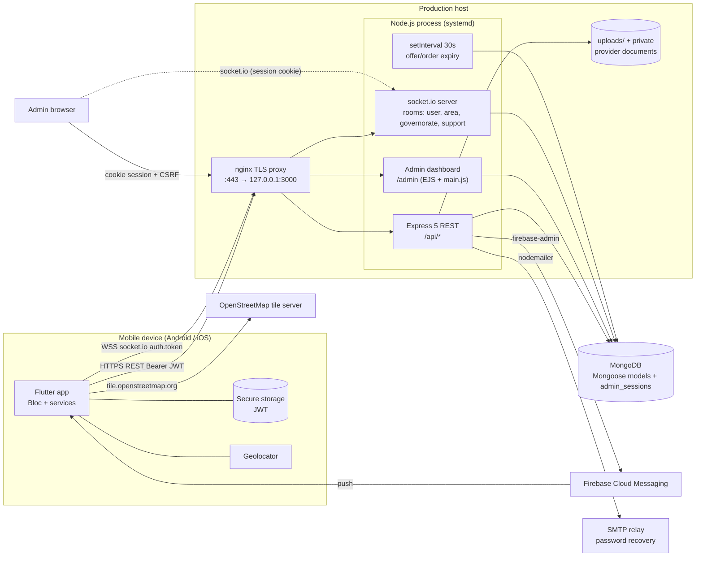
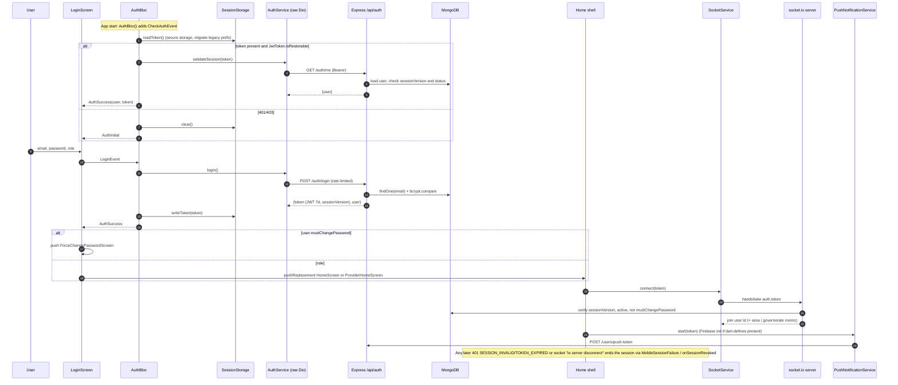
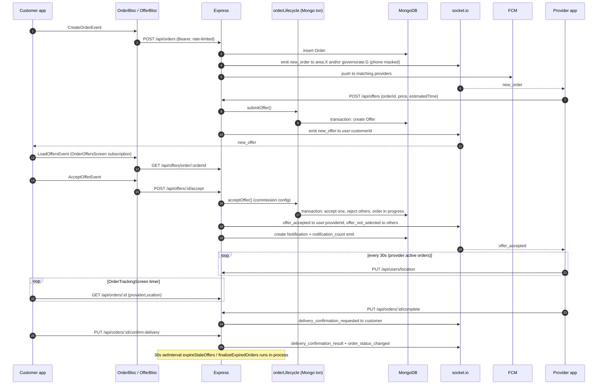

# Stars Delivery — Architecture

> Audit snapshot of branch `docs/stars-delivery-audit` (HEAD `9b50ca3`). Every statement below was confirmed by reading the cited file. Anything that could not be confirmed is marked **UNKNOWN**. Secret values are never reproduced; only file existence and key **names** are listed.

---

## 1. Application type, platforms, stack

### 1.1 What the system is

A two-sided delivery/errand marketplace for Palestine (Arabic-first UI, English secondary):

* **Customers** create delivery orders, receive price offers from **providers (drivers)** in real time, accept one, track the driver on a map, confirm delivery and rate.
* **Providers** receive new orders for their area/governorate over websockets, submit offers, fulfil orders, and pay commission.
* **Admins** run a server-rendered EJS dashboard (drivers, users, orders, commissions, ads, broadcasts, support chat, reports).

The repository is a monorepo holding:

| Part | Location | Kind |
|---|---|---|
| Mobile app | [lib/](../../lib), [pubspec.yaml](../../pubspec.yaml) | Flutter (Dart) |
| Backend API + realtime + admin dashboard | [stars_delivery_backend/](../../stars_delivery_backend) | Node.js / Express 5 / Mongoose / socket.io / EJS |
| Deployment templates | [deployment/](../../deployment) | nginx, systemd, env template, runbook |
| CI | [.github/workflows/ci.yml](../../.github/workflows/ci.yml) | GitHub Actions |
| Prior docs | [docs/notifications](../notifications), [docs/security](../security), [docs/ux](../ux) | Markdown |

### 1.2 Target platforms

| Platform folder | Present | Actually configured for the product? | Evidence |
|---|---|---|---|
| `android/` | yes | **Yes — primary target.** Permissions, FCM channel, release signing, debug-only cleartext. | [AndroidManifest.xml:2-5](../../android/app/src/main/AndroidManifest.xml#L2-L5), [build.gradle.kts:101-126](../../android/app/build.gradle.kts#L101-L126) |
| `ios/` | yes | **Yes — secondary target.** Location + push background mode, APNs entitlements, bundle id `com.starsdelivery.starsDelivery`, iOS 15.0. | [Info.plist:56-63](../../ios/Runner/Info.plist#L56-L63), [Release.entitlements](../../ios/Runner/Release.entitlements), [Podfile:1](../../ios/Podfile#L1) |
| `web/` | yes (Flutter template) | **No.** `ApiConfig.init()` calls `Platform.isAndroid` from `dart:io` ([api_config.dart:299](../../lib/services/api_config.dart#L299)), which throws on web; Firebase bootstrap only knows Android/iOS app IDs ([firebase_bootstrap.dart:36](../../lib/services/firebase_bootstrap.dart#L36)). |
| `macos/` | yes (template) | **No.** Release entitlements contain only `app-sandbox` — no `network.client` ([macos Release.entitlements](../../macos/Runner/Release.entitlements)), so HTTP would be blocked in release. No Firebase app id path. |
| `windows/`, `linux/` | yes (template) | **No** product configuration; would require `STARS_SERVER_URL` (HTTPS) to start ([api_config.dart:61-67](../../lib/services/api_config.dart#L61-L67)). Not built in CI. |

The desktop/web folders are untouched `flutter create` scaffolding (the analyzer even excludes them: [analysis_options.yaml](../../analysis_options.yaml)).

### 1.3 Languages, SDKs, toolchains

| Item | Declared | Resolved / pinned | Evidence |
|---|---|---|---|
| Dart SDK | `^3.12.2` | lock: `dart >=3.12.2 <4.0.0` | [pubspec.yaml:22](../../pubspec.yaml#L22), [pubspec.lock:933-935](../../pubspec.lock#L933-L935) |
| Flutter | lock: `>=3.44.0` | CI pins **3.47.4** stable | [ci.yml:76](../../.github/workflows/ci.yml#L76) |
| App version | `1.0.0+1` | — | [pubspec.yaml:19](../../pubspec.yaml#L19) |
| Node.js | no `engines` field in package.json | CI pins **24.13.1** | [ci.yml:30](../../.github/workflows/ci.yml#L30) |
| Android Gradle Plugin | 9.0.1 | Kotlin plugin 2.3.20 declared | [settings.gradle.kts:21-23](../../android/settings.gradle.kts#L21-L23) |
| Java/Kotlin target | 17 | — | [build.gradle.kts:85-88](../../android/app/build.gradle.kts#L85-L88), [:129-133](../../android/app/build.gradle.kts#L129-L133) |
| Android minSdk | `max(flutter.minSdkVersion, 23)` | compile/target = Flutter defaults | [build.gradle.kts:95-96](../../android/app/build.gradle.kts#L95-L96) |
| iOS deployment target | 15.0 | — | [Podfile:1](../../ios/Podfile#L1) |
| Admin UI | EJS templates + one vanilla-JS file + socket.io browser client | — | [views/admin/index.ejs:292-293](../../stars_delivery_backend/src/views/admin/index.ejs#L292-L293) |

**Build systems / package managers:** Flutter tool + `pub` (`pubspec.lock` committed and CI verifies it is unchanged); Gradle Kotlin DSL for Android; CocoaPods + Xcode for iOS; CMake for Windows/Linux templates; **npm** for the backend (`package-lock.json` lockfileVersion 3, `npm ci` in CI). There is no build step for the backend (plain CommonJS, `node src/index.js`).

---

## 2. Entry points & initialization

### 2.1 Flutter app

[lib/main.dart:15-24](../../lib/main.dart#L15-L24) runs, strictly sequentially and **before `runApp`**:

1. `WidgetsFlutterBinding.ensureInitialized()`.
2. `await ApiConfig.init()` — resolves the backend origin; on Android debug with no `STARS_SERVER_URL`, probes `/api/config` and may scan the whole /24 LAN ([api_config.dart:294-315](../../lib/services/api_config.dart#L294-L315), [:196-246](../../lib/services/api_config.dart#L196-L246)).
3. `await LocationService.initialize()` — requests location permission, gets a GPS fix (≤10 s timeout), then decodes the 46.5 MB `assets/countries+states+cities.json` to find the nearest Palestinian governorate ([location_service.dart:11-24](../../lib/services/location_service.dart#L11-L24), [:54-59](../../lib/services/location_service.dart#L54-L59)).
4. `ThemePreferences.load()` / `LocalePreferences.load()` (SharedPreferences).
5. `runApp(StarsDeliveryApp(...))`.

`StarsDeliveryApp` ([main.dart:40-70](../../lib/main.dart#L40-L70)) installs a root `MultiBlocProvider` with three app-wide blocs — `AuthBloc`, `AppBloc` (theme/locale), `NotificationBloc` — and a `MaterialApp` whose `home` is always `LoginScreen`. Supported locales: `ar`, `en`; default `ar`.

`AuthBloc`'s constructor immediately dispatches `CheckAuthEvent` ([auth_bloc.dart:29-31](../../lib/bloc/auth/auth_bloc.dart#L29-L31)), so session restore happens while `LoginScreen` is displayed; `LoginScreen`'s `BlocConsumer` navigates to the role home on `AuthSuccess` ([login_screen.dart:428-460](../../lib/screens/login_screen.dart#L428-L460)).

**Firebase is NOT initialized at startup.** [firebase_bootstrap.dart](../../lib/services/firebase_bootstrap.dart) is only invoked lazily from `PushNotificationService.start()` after login ([push_notification_service.dart:27-34](../../lib/services/push_notification_service.dart#L27-L34)), which itself is started from the home screens ([home_screen.dart:100](../../lib/screens/home_screen.dart#L100), [provider_home_screen.dart:205](../../lib/screens/provider_home_screen.dart#L205)). Socket connection is also started from the home screens ([home_screen.dart:99](../../lib/screens/home_screen.dart#L99), [provider_home_screen.dart:201](../../lib/screens/provider_home_screen.dart#L201)).

### 2.2 Backend

Entry: `npm start` → `node src/index.js` ([package.json](../../stars_delivery_backend/package.json)). Boot order in [src/index.js](../../stars_delivery_backend/src/index.js):

| Step | Lines |
|---|---|
| Require security helpers, then `dotenv.config()` (note: three `require`s precede dotenv; they don't read env at load, and `config.js` also calls dotenv itself) | [1-9](../../stars_delivery_backend/src/index.js#L1-L9), [config.js:1](../../stars_delivery_backend/src/config.js#L1) |
| `loadAppConfig()` — throws (process exits) if `JWT_SECRET`/`SESSION_SECRET`/`MONGODB_URI` missing or weak | [60](../../stars_delivery_backend/src/index.js#L60), [config.js:191-198](../../stars_delivery_backend/src/config.js#L191-L198) |
| `trust proxy` = 1 in production | [61](../../stars_delivery_backend/src/index.js#L61) |
| **Middleware stack:** `helmet` (CSP off globally) → origin guard → per-request `cors` → `express.json` → `urlencoded` → `cookieParser` → `/uploads` static (extension allow-list + sandbox CSP) → `/data` static → `public/` static → `/api` DB-readiness gate (503 unless Mongo connected; `/api/health` and `/api/config` exempt) → EJS view engine → `express-session` (Mongo store `admin_sessions`) → `/admin` browser security headers → `/admin` audit logger → `res.locals.currentUser` | [64-184](../../stars_delivery_backend/src/index.js#L64-L184) |
| Mongo connect with back-off retry (5/10/20/30 s); on success start 30 s `setInterval` offer/order expiry job and ensure indexes for 13 models | [201-300](../../stars_delivery_backend/src/index.js#L201-L300) |
| Dev-only `GET /api/config` (LAN IP discovery for Android debug) | [461-482](../../stars_delivery_backend/src/index.js#L461-L482) |
| `GET /api/health` | [484-495](../../stars_delivery_backend/src/index.js#L484-L495) |
| Mobile API routers under `/api/*` (9 routers) | [497-505](../../stars_delivery_backend/src/index.js#L497-L505) |
| Admin routers under `/admin/*`, each wrapped in `requireAdminSession` + `adminCsrfProtection` | [507-522](../../stars_delivery_backend/src/index.js#L507-L522) |
| Final error handler (DB-unavailable → 503, else generic 500) | [526-540](../../stars_delivery_backend/src/index.js#L526-L540) |
| `http.createServer` → `setupIO()` → `listen(PORT, '0.0.0.0')` with EADDRINUSE retry ×3; SIGTERM/SIGINT close | [544-589](../../stars_delivery_backend/src/index.js#L544-L589) |

**Socket.io setup** ([index.js:305-459](../../stars_delivery_backend/src/index.js#L305-L459)): CORS + `allowRequest` origin check; the Express session middleware is shared with the engine so admins authenticate by cookie; `io.use` authenticates either the admin session or a mobile JWT from `handshake.auth.token` ([authenticateSocket.js:7-58](../../stars_delivery_backend/src/socket/authenticateSocket.js#L7-L58)), re-checks `sessionVersion`/account status in Mongo, and schedules a forced disconnect at JWT expiry. Rooms: `support` + `admin:<id>` for admins; `area:<area>` (+ `governorate:<g>` if governorate-level) for providers; `user:<id>` for everyone ([index.js:423-451](../../stars_delivery_backend/src/index.js#L423-L451)). The `io` instance is published via `app.set('io', io)` and fetched by routes with `req.app.get('io')`.

---

## 3. Repository map

### 3.1 Top level

| Path | Responsibility |
|---|---|
| [lib/](../../lib) | Flutter source (≈19.8k lines across 78 Dart files) |
| [test/](../../test) | 51 Flutter test files (widget/UI/security tests + a mock API server harness) |
| [assets/countries+states+cities.json](../../assets) | **46,525,815-byte** world location dataset; only the Palestine (`iso2 == 'PS'`) entry is used ([location_catalog.dart:70-75](../../lib/services/location_catalog.dart#L70-L75)) |
| [android/](../../android), [ios/](../../ios) | Configured native shells |
| `web/`, `macos/`, `windows/`, `linux/` | Unconfigured Flutter templates |
| [stars_delivery_backend/](../../stars_delivery_backend) | Node API, realtime, admin dashboard, ops scripts, tests |
| [deployment/](../../deployment) | nginx reverse proxy, systemd unit, production env template, deployment runbook |
| [.github/workflows/ci.yml](../../.github/workflows/ci.yml) | CI |
| [docs/](../) | Prior audits/guides |
| [package-lock.json](../../package-lock.json) | **Orphan**: empty npm lockfile (`"packages": {}`) with no root `package.json` |
| [README.md](../../README.md) | Flutter template text + backup/restore runbook |

### 3.2 Flutter `lib/`

| Path | Responsibility |
|---|---|
| [main.dart](../../lib/main.dart) | Bootstrap + root providers |
| `bloc/<feature>/{*_bloc,*_event,*_state}.dart` | 7 blocs: `app` (theme/locale), `auth`, `notification`, `offer`, `order`, `password_recovery`, `provider` |
| `services/` — networking | [api_config.dart](../../lib/services/api_config.dart) (origin resolution), [mobile_api_client.dart](../../lib/services/mobile_api_client.dart) (Dio factory + session-failure interceptor), [mobile_session_failure.dart](../../lib/services/mobile_session_failure.dart) (global 401/403 broadcast), [socket_service.dart](../../lib/services/socket_service.dart) (socket.io singleton → typed broadcast streams) |
| `services/` — domain gateways | `auth_service`, `order_service`, `offer_service`, `provider_service`, `notification_service`, `report_service`, `support_chat_service` (class `ChatService`), `user_service`, `ad_service`, `password_recovery_service`, `push_notification_service` |
| `services/` — device/session | `session_storage` (secure token + legacy migration), `jwt_token` (local JWT decode), `location_service` (GPS + area detection + backend sync), `location_catalog` (governorate list), `firebase_bootstrap`, `theme_preferences`, `locale_preferences` |
| `services/` — UI infrastructure (misplaced in services) | `theme_service.dart` (724 lines: `AppColors`, `AppSpacing`, `AppRadius`, `AppTheme`…), `localization_service.dart` (989 lines: hand-rolled `AppLocalization.get(context, key)` string table), `responsive.dart` (a `StatelessWidget`), `validators.dart` |
| `models/` | 6 plain classes: `UserModel`, `OrderModel`, `OfferModel`, `NotificationModel`, `AdModel`, `ProviderStats` |
| `screens/` | 21 screens; two role "shells": [home_screen.dart](../../lib/screens/home_screen.dart) (customer, 965 lines) and [provider_home_screen.dart](../../lib/screens/provider_home_screen.dart) (provider, 1,534 lines) |
| [widgets/ui/](../../lib/widgets/ui) | 12 shared design-system widgets (1,391 lines): action tile, ad carousel, confirm dialog, feedback snackbars, notification bell, section header, state views, status badge/chip, tone, loading indicator, governorate-scope warning |
| [widgets/governorate_scope_card.dart](../../lib/widgets/governorate_scope_card.dart) | One shared widget living outside `ui/` (calls `UserService` directly) |

### 3.3 Backend `stars_delivery_backend/`

| Path | Responsibility |
|---|---|
| [src/index.js](../../stars_delivery_backend/src/index.js) | Composition root: middleware, Mongo, socket.io, routes, scheduler |
| [src/config.js](../../stars_delivery_backend/src/config.js) | Env validation (secrets ≥32 chars, not placeholders, distinct) |
| `src/routes/` | 9 mobile routers (`auth`, `orders`, `offers`, `provider`, `users`, `chat`, `notifications`, `reports`, `ads`) + `passwordRecovery` (mounted inside `auth`, [auth.js:247-249](../../stars_delivery_backend/src/routes/auth.js#L247-L249)) + 11 admin routers (`adminAuth`, `adminDrivers` 1,406 lines, `adminUsers`, `adminOrders`, `adminReports`, `adminCommissions`, `adminAreas`, `adminBroadcast`, `adminChat`, `adminAds`, `adminApi`) |
| `src/services/` | Domain logic: [orderLifecycle.js](../../stars_delivery_backend/src/services/orderLifecycle.js) (752 lines; offer/order state machine with Mongo transactions), `orderVisibility`, `orderState`, `commissionLedger`, `commissionSettings`, `pushNotifications` (firebase-admin), `mobileNotifications`, `mobileSession`, `registrationLocation`, `palestineCities`, `providerDocumentStorage`, `adImageStorage` (multer), `passwordRecoveryMailer` (nodemailer), `transaction`, stats helpers |
| `src/security/` | Origin policy/CORS, admin CSRF, admin browser headers, TOTP, rate limiters, password policy & recovery, input/location validation, error responses |
| `src/middleware/` | `auth` (mobile JWT), `requireRole`, `adminSession`, `requireAdminSession`, `adminAuditLog`, `mobileRole` |
| `src/models/` | 19 Mongoose models (User, Order, Offer, RejectedOrder, Rating, Notification, ChatMessage, ContactRequest, BroadcastMessage, CommissionPayment, CommissionSetting, PushToken, AdminAuditLog, Ad, Report, PendingProvider, PasswordRecoveryChallenge…) |
| `src/socket/authenticateSocket.js` | Socket identity resolution |
| `src/views/admin/` + `src/public/` | Admin dashboard: `index.ejs`, `login.ejs`, partials; **single 3,972-line** [public/js/main.js](../../stars_delivery_backend/src/public/js/main.js); `style.css`; `data/areas.json` |
| `src/scripts/` | Ops CLIs wired to npm scripts (admin bootstrap, backup/restore, audits, orphan cleanup); `regeneratePublicIds.js` is **not** wired to any npm script |
| `src/data/cities.js` | **Unreferenced** (no `require` anywhere in `src/`, `test/`, `integration/`) |
| `test/` (56 files), `integration/mobile-auth.integration.js` | `node --test` suites (supertest + mongodb-memory-server-core) |
| `uploads/`, `private/provider-documents/`, `.env`, `server.log` | Runtime data, git-ignored ([.gitignore](../../stars_delivery_backend/.gitignore)) |

---

## 4. Third-party dependencies

### 4.1 Flutter (direct)

| Package | Constraint → resolved | Purpose in this app |
|---|---|---|
| flutter_bloc / bloc | ^9.1.1 → 9.1.1 / 9.2.1 | State management (Bloc + BlocProvider) |
| equatable | ^2.1.0 → 2.1.0 | Value equality for events/states |
| dio | ^5.10.0 → 5.10.0 | HTTP client for all REST calls |
| socket_io_client | ^3.0.2 → 3.1.6 | Realtime order/offer/notification events |
| geolocator | ^14.0.3 → 14.0.3 | GPS fix, permission, mock-location flag |
| flutter_map + latlong2 | ^8.3.2 / ^0.10.1 → 8.3.2 / 0.10.1 | Driver tracking map with OSM tiles |
| firebase_core + firebase_messaging | ^5.1.0 / ^17.0.1 → 5.1.0 / 17.0.1 | FCM push (optional, dart-define configured) |
| flutter_secure_storage | ^10.3.1 → 10.3.1 | JWT storage (Keychain/Keystore) |
| shared_preferences | ^2.5.5 → 2.5.5 | Theme/locale persistence; legacy token migration |
| flutter_localizations (SDK) | — | Material/Cupertino localizations for ar/en |
| cupertino_icons | ^1.0.8 → 1.0.9 | Template default; usage not confirmed |
| flutter_lints (dev) | ^6.0.0 → 6.0.0 | Lint rules |

Versions from [pubspec.yaml:30-60](../../pubspec.yaml#L30-L60) and [pubspec.lock](../../pubspec.lock). `intl` 0.20.3 / `http` 1.6.0 are transitive only; the app does **not** use ARB/`intl` message generation.

### 4.2 Backend

| Package | Resolved | Purpose | Used? |
|---|---|---|---|
| express | 5.2.1 | HTTP framework | yes |
| mongoose | 8.24.1 | MongoDB ODM, transactions | yes |
| socket.io | 4.8.3 | Realtime server (mobile + admin) | yes |
| jsonwebtoken | 9.0.3 | Mobile JWT (7-day expiry, [auth.js:147-155](../../stars_delivery_backend/src/routes/auth.js#L147-L155)) | yes |
| bcryptjs | 2.4.3 | Password hashing | yes |
| express-session + connect-mongo | 1.19.0 / 6.0.0 | Admin cookie sessions in Mongo | yes |
| cookie-parser, cors, helmet | 1.4.7 / 2.8.6 / 8.3.0 | HTTP hardening | yes |
| express-rate-limit | 8.6.2 | Per-action/IP limits | yes |
| ejs | 6.0.1 | Admin views | yes |
| multer | 2.5.0 | Admin ad image upload ([adImageStorage.js](../../stars_delivery_backend/src/services/adImageStorage.js)) | yes |
| nodemailer | 10.4.0 | Password-recovery email (SMTP) | yes |
| firebase-admin | 14.5.0 | FCM sending, lazily required | yes |
| dotenv | 16.6.1 | `.env` loading | yes |
| **axios** | 1.21.0 | — | **No usage** in `src/`, `test/`, `integration/` → unused production dependency |
| supertest, mongodb-memory-server-core (dev) | 7.2.2 / 11.2.0 | Tests | yes |

---

## 5. Environment configuration

### 5.1 Mobile: API base URL

All resolution lives in [api_config.dart](../../lib/services/api_config.dart):

* Compile-time `--dart-define=STARS_SERVER_URL=<origin>` ([:8-10](../../lib/services/api_config.dart#L8-L10)). It must be scheme+host(+port) only ([:91-99](../../lib/services/api_config.dart#L91-L99)).
* **Rule** ([:54-73](../../lib/services/api_config.dart#L54-L73)): HTTP is allowed only when `kDebugMode && Platform.isAndroid`; everything else requires HTTPS, and a missing value outside Android debug throws `StateError` at startup.
* **Android debug without the define**: falls back to the hard-coded LAN address in `_defaultDevelopmentServerUrl` ([:12](../../lib/services/api_config.dart#L12)), then asks that server's `/api/config` for its LAN IP, or scans every /24 subnet of the device on the backend port ([:172-246](../../lib/services/api_config.dart#L172-L246)). The backend only exposes `/api/config` when `NODE_ENV !== 'production'` ([index.js:461](../../stars_delivery_backend/src/index.js#L461)).
* `apiUrl = serverUrl + '/api'`; socket.io connects to `serverUrl` ([socket_service.dart:90](../../lib/services/socket_service.dart#L90)).
* Release example from the runbook: `flutter build appbundle --release --dart-define=STARS_SERVER_URL=https://api.example.com` ([deployment/README.md:235](../../deployment/README.md#L235)).

There are **no flavors / product flavors / schemes** (Android `buildTypes` only customises `release` signing; iOS has default Debug/Profile/Release). "Local vs staging vs production" is determined solely by the `STARS_SERVER_URL` value supplied at build time — **no staging URL or staging config exists in the repo** (UNKNOWN whether a staging environment exists).

Other compile-time defines: `FIREBASE_API_KEY`, `FIREBASE_PROJECT_ID`, `FIREBASE_MESSAGING_SENDER_ID`, `FIREBASE_STORAGE_BUCKET`, `FIREBASE_ANDROID_APP_ID`, `FIREBASE_IOS_APP_ID`, `FIREBASE_IOS_BUNDLE_ID`, `FIREBASE_MEASUREMENT_ID` ([firebase_bootstrap.dart:7-22](../../lib/services/firebase_bootstrap.dart#L7-L22)). No `google-services.json` / `GoogleService-Info.plist` exist; Firebase is configured purely via dart-define (see [FIREBASE_SETUP.md](../notifications/FIREBASE_SETUP.md)).

### 5.2 Feature flags / conditional functionality

| Condition | Effect | Evidence |
|---|---|---|
| Firebase dart-defines absent | Push silently disabled (`isConfigured == false`) | [firebase_bootstrap.dart:26-34](../../lib/services/firebase_bootstrap.dart#L26-L34) |
| `kDebugMode && Android` | HTTP allowed + LAN discovery | [api_config.dart:59](../../lib/services/api_config.dart#L59), [:312-314](../../lib/services/api_config.dart#L312-L314) |
| Backend `NODE_ENV=production` | trust proxy, secure admin cookie, `/api/config` hidden, mock GPS rejected unless `ALLOW_MOCK_LOCATION=true`, absolute private `PROVIDER_DOCUMENTS_DIR` enforced | [index.js:61](../../stars_delivery_backend/src/index.js#L61), [adminSession.js:7](../../stars_delivery_backend/src/middleware/adminSession.js#L7), [users.js:161-162](../../stars_delivery_backend/src/routes/users.js#L161-L162), [providerDocumentStorage.js:116](../../stars_delivery_backend/src/services/providerDocumentStorage.js#L116) |
| Backend Firebase service account absent | API runs, push disabled | [pushNotifications.js:8-50](../../stars_delivery_backend/src/services/pushNotifications.js#L8-L50) |

No remote-config or runtime feature-flag system exists.

### 5.3 Backend environment variables (names only)

| Name | Required? | Read at |
|---|---|---|
| `JWT_SECRET`, `SESSION_SECRET` | **Required at boot**; ≥32 chars, not placeholder, must differ | [config.js:39-49](../../stars_delivery_backend/src/config.js#L39-L49); `JWT_SECRET` also read at module load in [auth.js:15-16](../../stars_delivery_backend/src/middleware/auth.js#L15-L16) and [totp.js:177](../../stars_delivery_backend/src/security/totp.js#L177) |
| `MONGODB_URI` | **Required at boot** | [config.js:195](../../stars_delivery_backend/src/config.js#L195) |
| `CORS_ALLOWED_ORIGINS` | Optional (comma list) | [config.js:196](../../stars_delivery_backend/src/config.js#L196) |
| `NODE_ENV`, `PORT` (default 3000) | Optional | [index.js:61-62](../../stars_delivery_backend/src/index.js#L61-L62), [:542](../../stars_delivery_backend/src/index.js#L542) |
| `PASSWORD_RECOVERY_SECRET`, `SMTP_HOST`, `SMTP_PORT`, `SMTP_SECURE`, `SMTP_FROM`, `SMTP_USER`+`SMTP_PASS` (pair) | Required **lazily per recovery request** (not at boot) | [config.js:101-189](../../stars_delivery_backend/src/config.js#L101-L189), [passwordRecovery.js:210-214](../../stars_delivery_backend/src/routes/passwordRecovery.js#L210-L214) |
| `ALLOW_MOCK_LOCATION` | Optional | [users.js:162](../../stars_delivery_backend/src/routes/users.js#L162) |
| `PROVIDER_DOCUMENTS_DIR` | Optional in dev, enforced in prod | [providerDocumentStorage.js:96-116](../../stars_delivery_backend/src/services/providerDocumentStorage.js#L96-L116) |
| `FIREBASE_SERVICE_ACCOUNT_JSON` / `FIREBASE_SERVICE_ACCOUNT_PATH` | Optional | [pushNotifications.js:8-26](../../stars_delivery_backend/src/services/pushNotifications.js#L8-L26) |
| `ADMIN_EMAIL`, `ADMIN_FULL_NAME`, `ADMIN_PASSWORD` | Only for `npm run admin:bootstrap` | [adminBootstrap.js:9-11](../../stars_delivery_backend/src/scripts/adminBootstrap.js#L9-L11) |
| `STARS_BACKUP_ROOT`, `STARS_BACKUP_QUIESCED`, `STARS_RESTORE_FROM`, `STARS_RESTORE_CONFIRM` | Only for ops scripts | [backupRestore.js](../../stars_delivery_backend/src/scripts/backupRestore.js), [README.md](../../README.md) |

**Env file drift** (key names only):

* [.env.example](../../stars_delivery_backend/.env.example) documents all of the above — it is the most complete source.
* [deployment/stars-delivery.env.example](../../deployment/stars-delivery.env.example) **omits** `ALLOW_MOCK_LOCATION`, `FIREBASE_SERVICE_ACCOUNT_*` and **includes `IMGBB_API_KEY`**, which no code reads.
* The local (git-ignored) `stars_delivery_backend/.env` exists with keys `PORT, MONGODB_URI, JWT_SECRET, IMGBB_API_KEY, SESSION_SECRET, CORS_ALLOWED_ORIGINS` — it lacks the password-recovery/SMTP keys, so recovery requests would fail locally.

### 5.4 Android release/signing

[build.gradle.kts:11-150](../../android/app/build.gradle.kts#L11-L150): reads `android/key.properties` (keys `storePassword`, `keyPassword`, `keyAlias`, `storeFile`; template at [key.properties.example](../../android/key.properties.example)); release tasks fail fast with `STARS_ANDROID_RELEASE_SIGNING_REQUIRED` if missing. `key.properties` and a `.jks` file exist locally under `android/` and are git-ignored ([android/.gitignore](../../android/.gitignore)). No `minifyEnabled`/R8/ProGuard or obfuscation configuration. iOS signing team: UNKNOWN (not inspected beyond entitlements).

---

## 6. Native integrations

| Area | Android | iOS |
|---|---|---|
| Permissions | `ACCESS_FINE_LOCATION`, `ACCESS_COARSE_LOCATION`, `INTERNET`, `POST_NOTIFICATIONS` ([AndroidManifest.xml:2-5](../../android/app/src/main/AndroidManifest.xml#L2-L5)) | `NSLocationWhenInUseUsageDescription`; `NSPhotoLibraryUsageDescription` ([Info.plist:56-59](../../ios/Runner/Info.plist#L56-L59)) — **stale**: no image-picker dependency exists after commit `9b50ca3` removed uploads |
| Cleartext / ATS | `usesCleartextTraffic="false"` in main ([:11](../../android/app/src/main/AndroidManifest.xml#L11)); overridden to `true` **only** in [debug manifest](../../android/app/src/debug/AndroidManifest.xml). No `network_security_config.xml` | No `NSAppTransportSecurity` exceptions (ATS default) |
| Backup | `allowBackup="false"` ([:7](../../android/app/src/main/AndroidManifest.xml#L7)) | — |
| Push | FCM default channel id `stars_delivery_default` ([:39-41](../../android/app/src/main/AndroidManifest.xml#L39-L41)); background handler registered in Dart ([push_notification_service.dart:12-15](../../lib/services/push_notification_service.dart#L12-L15)) | `UIBackgroundModes: remote-notification` ([Info.plist:60-63](../../ios/Runner/Info.plist#L60-L63)); `aps-environment` development/production entitlements |
| Push payload handling | Foreground messages are only `debugPrint`ed ([push_notification_service.dart:53-55](../../lib/services/push_notification_service.dart#L53-L55)); no `flutter_local_notifications`, no notification-tap routing (`onMessageOpenedApp`/`getInitialMessage` not used) | same |
| Background location / services | None. Location is foreground-only: on screen init + 30 s timer on the provider active-orders screen ([provider_active_orders_screen.dart:38](../../lib/screens/provider_active_orders_screen.dart#L38)) → `PUT /users/location` ([location_service.dart:122-150](../../lib/services/location_service.dart#L122-L150)) | same |
| Maps | OpenStreetMap public tiles `https://tile.openstreetmap.org/{z}/{x}/{y}.png` with `userAgentPackageName` ([order_tracking_screen.dart:138-140](../../lib/screens/order_tracking_screen.dart#L138-L140)); no API key, no attribution widget confirmed, subject to OSM tile usage policy | same |
| Secure storage | Keystore via flutter_secure_storage | Keychain (`keychain-access-groups` empty array in entitlements) |

---

## 7. Architecture as implemented

### 7.1 Flutter layering

```
Screens (StatefulWidget, setState, timers, socket subscriptions)
   ├─▶ Blocs (only for: auth, app prefs, notifications, offers, create-order, provider stats, password recovery)
   │      └─▶ Services (concrete classes, instantiated inline)
   └─▶ Services directly (most data screens)           ──▶ MobileApiClient.create() → Dio → REST /api
                                                        ──▶ SocketService.instance → socket.io
```

* **Bloc usage is partial.** 7 blocs exist, but many data-heavy screens bypass them and call services directly with `setState`: e.g. `my_orders_screen` (OrderService/OfferService), `pending_orders_screen`, `offered_orders_screen`, `rejected_orders_screen`, `order_detail_screen`, `provider_active_orders_screen`, `order_tracking_screen`, `support_chat_screen`, `report_screen`, `profile_screen` (import map in §9.2). `profile_screen`, `login_screen` and `force_change_password_screen` even build Dio clients inline ([profile_screen.dart:374](../../lib/screens/profile_screen.dart#L374), [login_screen.dart:655](../../lib/screens/login_screen.dart#L655), [force_change_password_screen.dart:58](../../lib/screens/force_change_password_screen.dart#L58)).
* **Bloc scoping:** 3 global blocs in `main.dart`; `OfferBloc` created per-route at push sites ([home_screen.dart:212](../../lib/screens/home_screen.dart#L212), etc.); `ProviderBloc` created in two places — [login_screen.dart:446](../../lib/screens/login_screen.dart#L446) and [force_change_password_screen.dart:155](../../lib/screens/force_change_password_screen.dart#L155) — duplicating role-routing logic.
* **DI / service location:** none (no get_it/Provider/RepositoryProvider). Blocs construct their services as field initialisers (`final OrderService _orderService = OrderService();` [order_bloc.dart:8](../../lib/bloc/order/order_bloc.dart#L8); same in Offer/Provider/Notification blocs). Only `AuthBloc` takes injectable constructor params (`AuthGateway`, `SessionStorage`) ([auth_bloc.dart:15-21](../../lib/bloc/auth/auth_bloc.dart#L15-L21)). Global singletons: `SocketService.instance` (with `testInstance` override), `PushNotificationService.instance`, `MobileSessionFailure.instance`; static-only classes: `ApiConfig`, `LocationService`, `LocationCatalog`, `JwtToken`. Tests swap transports via the static `MobileApiClient.testAdapter` hook ([mobile_api_client.dart:21-24](../../lib/services/mobile_api_client.dart#L21-L24)).
* **Auth token propagation:** not via an interceptor. The JWT is carried in widget constructors (`token:` on nearly every screen) and in every event/service method signature, then added per call as `Options(headers: {'Authorization': 'Bearer $token'})` (e.g. [order_service.dart:34](../../lib/services/order_service.dart#L34)). `ChatService` and `PushNotificationService` bake it into Dio default headers instead.
* **Abstractions/interfaces:** only two — `AuthGateway` ([auth_service.dart:18](../../lib/services/auth_service.dart#L18)) and `TokenVault` ([session_storage.dart:4](../../lib/services/session_storage.dart#L4)). All other services are concrete.
* **Models/serialization:** hand-written `factory X.fromJson(Map)`; only `UserModel` has `toJson`. No code generation (no json_serializable/freezed). Many services return raw `Map<String, dynamic>` / `List<Map<...>>` and screens index JSON keys directly (e.g. `my_orders_screen` has 28 `Map<String,dynamic>`/`['key']` occurrences). `OrderModel` is only used for `OrderBloc`'s success state.
* **Error handling:** each service catches `DioException` and rethrows `Exception(serverMessage)`; blocs `catch (e)` and emit `XError(message: e.toString().replaceFirst('Exception: ', ''))`. The pattern is copy-pasted per method (e.g. [order_service.dart:37-40](../../lib/services/order_service.dart#L37-L40)) and `AuthService` has its own richer variant ([auth_service.dart:158-181](../../lib/services/auth_service.dart#L158-L181)). Session invalidation is centralised: `MobileSessionInterceptor` reports 401 `AUTH_REQUIRED|SESSION_INVALID|TOKEN_EXPIRED` and 403 `ACCOUNT_INACTIVE` to `MobileSessionFailure.instance`, which the home shells subscribe to ([mobile_session_failure.dart:33-47](../../lib/services/mobile_session_failure.dart#L33-L47), [home_screen.dart:87-95](../../lib/screens/home_screen.dart#L87-L95)). `AuthService` and `PasswordRecoveryService` use a raw `Dio` without that interceptor (intentional for login). `NotificationBloc._onMarkRead/_onMarkAll` have no try/catch ([notification_bloc.dart:20-25](../../lib/bloc/notification/notification_bloc.dart#L20-L25)).
* **Async patterns:** `Future`/`async-await`; broadcast `StreamController`s in `SocketService` (15 streams) consumed via `StreamSubscription`s in screens; **pervasive `Timer.periodic` polling layered on top of sockets** — 15 s notifications, 30 s dashboards/orders, 1 s countdowns, 30 s location ([home_screen.dart:122](../../lib/screens/home_screen.dart#L122), [provider_home_screen.dart:231-240](../../lib/screens/provider_home_screen.dart#L231-L240), [my_orders_screen.dart:49-55](../../lib/screens/my_orders_screen.dart#L49-L55), [order_tracking_screen.dart:42](../../lib/screens/order_tracking_screen.dart#L42)). Driver tracking is poll-based (`GET /orders/:id` → `providerLocation`), not socket-based.
* **Shared UI:** `widgets/ui/*` plus design tokens in `services/theme_service.dart`; localisation via a single map in `services/localization_service.dart`.

### 7.2 Backend layering

`routes/*` (Express routers) → (`services/*` for lifecycle/visibility/commission/notifications) → `models/*` (Mongoose). In practice many routes query models directly and contain business rules (e.g. `adminDrivers.js` 1,406 lines, `users.js` 733 lines, `orders.js` 573 lines). Order/offer state transitions are concentrated in [orderLifecycle.js](../../stars_delivery_backend/src/services/orderLifecycle.js) and run in Mongo transactions ([:57-58](../../stars_delivery_backend/src/services/orderLifecycle.js#L57-L58), via [transaction.js](../../stars_delivery_backend/src/services/transaction.js)) — this requires a replica-set/Atlas deployment. Socket emission happens in routes through `req.app.get('io')` (service-locator via Express app). Mobile auth is per-router `router.use(auth, requireRole(...))` ([users.js:42](../../stars_delivery_backend/src/routes/users.js#L42), [provider.js:20](../../stars_delivery_backend/src/routes/provider.js#L20)); admin endpoints for support chat live inside the mobile `chat.js` router behind `requireAdminSession` ([chat.js:139-143](../../stars_delivery_backend/src/routes/chat.js#L139-L143)). Background work = in-process `setInterval` (no queue/worker; multiple instances would run it concurrently).

### 7.3 Event contract mismatch

Server emits `rating_received` ([orders.js:419](../../stars_delivery_backend/src/routes/orders.js#L419)) but `SocketService` has no listener for it ([socket_service.dart:123-201](../../lib/services/socket_service.dart#L123-L201)). Client listens for `provider_profile_updated`, which is emitted only by admin driver edits ([adminDrivers.js:698](../../stars_delivery_backend/src/routes/adminDrivers.js#L698)). Event names are string literals duplicated on both sides with no shared schema.

### 7.4 Duplicated / unused / dead code

| Finding | Evidence |
|---|---|
| Root `package-lock.json` is an empty stub with no `package.json` | [package-lock.json](../../package-lock.json) |
| 46.5 MB worldwide dataset bundled to use one country; decoded with `jsonDecode` on the UI isolate; `LocationService._findNearestArea` re-reads and re-decodes it on **every** `syncToBackend` call (no cache), while `LocationCatalog` caches its own separate parse | [location_service.dart:56-59](../../lib/services/location_service.dart#L56-L59), [location_catalog.dart:64-97](../../lib/services/location_catalog.dart#L64-L97) |
| Palestine location data duplicated four ways: app asset, backend `palestineCities.js`, `public/data/areas.json`, and unused `src/data/cities.js` | [palestineCities.js](../../stars_delivery_backend/src/services/palestineCities.js), [areas.json](../../stars_delivery_backend/src/public/data/areas.json), [data/cities.js](../../stars_delivery_backend/src/data/cities.js) |
| `axios` backend dependency unused | [package.json](../../stars_delivery_backend/package.json) |
| `IMGBB_API_KEY` in deployment env template, unused by code | [stars-delivery.env.example:29](../../deployment/stars-delivery.env.example#L29) |
| `regeneratePublicIds.js` not wired to npm scripts | [src/scripts/regeneratePublicIds.js](../../stars_delivery_backend/src/scripts/regeneratePublicIds.js) |
| Stale photo-library usage string; stale localisation keys `add_photos`, `max_3_photos`, … after upload removal | [Info.plist:56-57](../../ios/Runner/Info.plist#L56-L57), [localization_service.dart:251-256](../../lib/services/localization_service.dart#L251-L256) |
| Stale runbook: README backup section still describes "order-upload files" | [README.md](../../README.md) |
| Role-home routing duplicated in login and forced-password screens | [login_screen.dart:428-460](../../lib/screens/login_screen.dart#L428-L460), [force_change_password_screen.dart:154-155](../../lib/screens/force_change_password_screen.dart#L154-L155) |
| Session bootstrap (socket connect, push start, session-failure/account-deleted/revoked subscriptions, location sync, notification polling) duplicated across both home shells | [home_screen.dart:87-191](../../lib/screens/home_screen.dart#L87-L191), [provider_home_screen.dart:189-385](../../lib/screens/provider_home_screen.dart#L189-L385) |
| `print()` left in socket callbacks | [socket_service.dart:102](../../lib/services/socket_service.dart#L102), [:107](../../lib/services/socket_service.dart#L107) |
| Every Dart file in `lib/` is imported by at least one other file (no fully orphaned Dart file found); all backend `services/security/middleware/models` modules are required somewhere | import scan |

### 7.5 Maintainability hot-spots (largest files)

| File | Lines |
|---|---|
| [stars_delivery_backend/src/public/js/main.js](../../stars_delivery_backend/src/public/js/main.js) (whole admin SPA) | 3,972 |
| [lib/screens/provider_home_screen.dart](../../lib/screens/provider_home_screen.dart) (64 `BlocProvider`/`context.read` sites, 10+ subscriptions/timers) | 1,534 |
| [stars_delivery_backend/src/routes/adminDrivers.js](../../stars_delivery_backend/src/routes/adminDrivers.js) | 1,406 |
| [lib/screens/order_offers_screen.dart](../../lib/screens/order_offers_screen.dart) | 1,144 |
| [lib/screens/my_orders_screen.dart](../../lib/screens/my_orders_screen.dart) | 1,008 |
| [lib/screens/login_screen.dart](../../lib/screens/login_screen.dart) (login + register + contact dialog + routing) | 990 |
| [lib/services/localization_service.dart](../../lib/services/localization_service.dart) | 989 |
| [lib/screens/home_screen.dart](../../lib/screens/home_screen.dart) | 965 |

---

## 8. CI/CD

[.github/workflows/ci.yml](../../.github/workflows/ci.yml) — triggers on every push, PR, and manual dispatch; `contents: read`; actions pinned by SHA; per-ref concurrency cancellation.

| Job | Steps |
|---|---|
| `backend` (ubuntu-24.04, 15 min) | Node 24.13.1 → `npm ci` → assert `package-lock.json` unchanged → `npm run check` (`node --check src/index.js`) → `npm test` (`node --test`) → `npm run test:integration` → `npm audit --omit=dev --audit-level=high` ([:16-59](../../.github/workflows/ci.yml#L16-L59)) |
| `flutter` (ubuntu-24.04, 20 min) | Flutter 3.47.4 → `flutter pub get` → assert `pubspec.lock` unchanged → `flutter test` → `flutter analyze` must exit 1 with **exactly 12 non-error issues** (baseline ratchet) ([:61-128](../../.github/workflows/ci.yml#L61-L128)) |

**No CD:** no build of APK/AAB/IPA, no artifact upload, no deployment job, no store publishing. Deployment is manual per [deployment/README.md](../../deployment/README.md): systemd unit runs `node src/index.js` from `/opt/stars-delivery/current/stars_delivery_backend` with `EnvironmentFile=/etc/stars-delivery/stars-delivery.env` ([stars-delivery.service](../../deployment/systemd/stars-delivery.service)); nginx terminates TLS, proxies to `127.0.0.1:3000` with websocket upgrade headers, `client_max_body_size 20m` ([stars-delivery.conf:15](../../deployment/nginx/stars-delivery.conf#L15), [:46](../../deployment/nginx/stars-delivery.conf#L46)). Note the app itself binds `0.0.0.0` ([index.js:553](../../stars_delivery_backend/src/index.js#L553)), so host firewalling is required to keep port 3000 private.

---

## 9. Diagrams

### 9.1 High-level architecture



### 9.2 Flutter component dependency graph

```mermaid
flowchart TB
  subgraph Screens
    LOGIN[LoginScreen]
    FCP[ForceChangePasswordScreen]
    FORGOT[ForgotPasswordScreen]
    HOME[HomeScreen customer]
    PHOME[ProviderHomeScreen]
    CREATE[CreateOrderScreen]
    MYO[MyOrdersScreen]
    OFFERS[OrderOffersScreen]
    TRACK[OrderTrackingScreen]
    OREP[OrderReportScreen]
    NOTIF[NotificationsScreen]
    PEND[PendingOrdersScreen]
    OFFERED[OfferedOrdersScreen]
    REJ[RejectedOrdersScreen]
    ACTIVE[ProviderActiveOrdersScreen]
    DETAIL[OrderDetailScreen]
    SUBMIT[SubmitOfferScreen]
    PROFILE[ProfileScreen]
    CHAT[SupportChatScreen]
    REPORT[ReportScreen]
  end

  subgraph Blocs
    AUTHB[AuthBloc global]
    APPB[AppBloc global]
    NOTB[NotificationBloc global]
    OFFB[OfferBloc per-route]
    ORDB[OrderBloc]
    PROVB[ProviderBloc]
    PRB[PasswordRecoveryBloc]
  end

  subgraph Services
    AUTHS[AuthService]
    SESS[SessionStorage]
    ORDS[OrderService]
    OFFS[OfferService]
    PROVS[ProviderService]
    NOTS[NotificationService]
    CHATS[ChatService]
    REPS[ReportService]
    PRS[PasswordRecoveryService]
    PUSH[PushNotificationService singleton]
    SOCK[SocketService singleton]
    LOC[LocationService static]
    CAT[LocationCatalog static]
    MAC[MobileApiClient + MobileSessionFailure]
    CFG[ApiConfig static]
  end

  LOGIN --> AUTHB
  LOGIN --> PROVB
  LOGIN --> CAT
  LOGIN --> MAC
  FCP --> AUTHB
  FCP --> MAC
  FORGOT --> PRB --> PRS
  HOME --> AUTHB & NOTB & OFFB & ORDB
  HOME --> ORDS & CHATS & SOCK & PUSH & LOC
  PHOME --> AUTHB & NOTB & PROVB
  PHOME --> PROVS & CHATS & SOCK & PUSH & LOC
  CREATE --> ORDB
  MYO --> ORDS & OFFS & SOCK
  OFFERS --> OFFB
  OFFERS --> ORDS & SOCK
  TRACK --> ORDS
  OREP --> ORDS & OFFS
  NOTIF --> NOTB
  PEND --> PROVS & SOCK
  OFFERED --> PROVS & SOCK
  REJ --> PROVS
  ACTIVE --> PROVB
  ACTIVE --> PROVS & SOCK & LOC
  DETAIL --> ORDS & PROVS & SOCK
  SUBMIT --> OFFB
  PROFILE --> AUTHB
  PROFILE --> MAC & CAT & SOCK
  CHAT --> CHATS & SOCK
  REPORT --> REPS

  AUTHB --> AUTHS & SESS & SOCK & PUSH
  OFFB --> OFFS
  ORDB --> ORDS
  PROVB --> PROVS
  NOTB --> NOTS

  ORDS & OFFS & PROVS & NOTS & CHATS & REPS & PUSH & LOC --> MAC
  AUTHS & PRS --> CFG
  MAC --> CFG
  SOCK --> CFG
```



### 9.3 Flow A — login and session restore



### 9.4 Flow B — order creation, realtime offers, acceptance



---

## 10. Top architecture / maintainability concerns

1. **Blocking, heavyweight startup** — `main()` awaits permission prompt + GPS (≤10 s) + a 46.5 MB JSON decode on the UI isolate before the first frame; the same file is re-decoded on every location sync. [main.dart:17-18](../../lib/main.dart#L17-L18), [location_service.dart:54-59](../../lib/services/location_service.dart#L54-L59).
2. **Inconsistent state architecture & God widgets** — Bloc for some features, `setState` + direct service calls + inline Dio for others; role shells of 965/1,534 lines duplicate the whole session bootstrap. [provider_home_screen.dart](../../lib/screens/provider_home_screen.dart), [home_screen.dart](../../lib/screens/home_screen.dart).
3. **No DI, token prop-drilling, per-call auth headers** — services hard-instantiated in blocs/screens; JWT threaded through constructors/events/methods. [order_bloc.dart:8](../../lib/bloc/order/order_bloc.dart#L8), [order_service.dart:34](../../lib/services/order_service.dart#L34).
4. **Untyped JSON across the UI + duplicated error mapping** — screens consume `Map<String,dynamic>`; per-method copy-pasted `DioException` handling; socket event names duplicated as string literals with an unhandled `rating_received`. [socket_service.dart:123-201](../../lib/services/socket_service.dart#L123-L201), [orders.js:419](../../stars_delivery_backend/src/routes/orders.js#L419).
5. **Backend fat routes / monolithic admin frontend / in-process scheduler** — business logic in 700–1,400-line routers, 3,972-line admin `main.js`, `setInterval` job that is not safe for multiple instances. [adminDrivers.js](../../stars_delivery_backend/src/routes/adminDrivers.js), [main.js](../../stars_delivery_backend/src/public/js/main.js), [index.js:231-246](../../stars_delivery_backend/src/index.js#L231-L246).

Secondary: config drift (`IMGBB_API_KEY`, missing FCM/mock-location keys in deployment template), unused `axios` and `src/data/cities.js`, orphan root `package-lock.json`, stale iOS photo permission, no CD/release build in CI, hybrid sockets + polling.

## 11. Unknowns

* Whether a staging environment exists or what production `STARS_SERVER_URL` is (only `api.example.com` placeholders in repo).
* iOS signing team/provisioning, and whether iOS builds have ever been produced (no CI build).
* Whether MongoDB in production is a replica set (required for `withTransaction`). `orderLifecycle.js` defines `isTransactionUnavailable` ([:51-55](../../stars_delivery_backend/src/services/orderLifecycle.js#L51-L55)) but it is never called, so there is no non-transactional fallback — a standalone `mongod` would make offer submit/accept fail.
* Exact contents of the 12 accepted analyzer issues (CI only counts them).
* Whether `cupertino_icons` is actually used by any widget.
