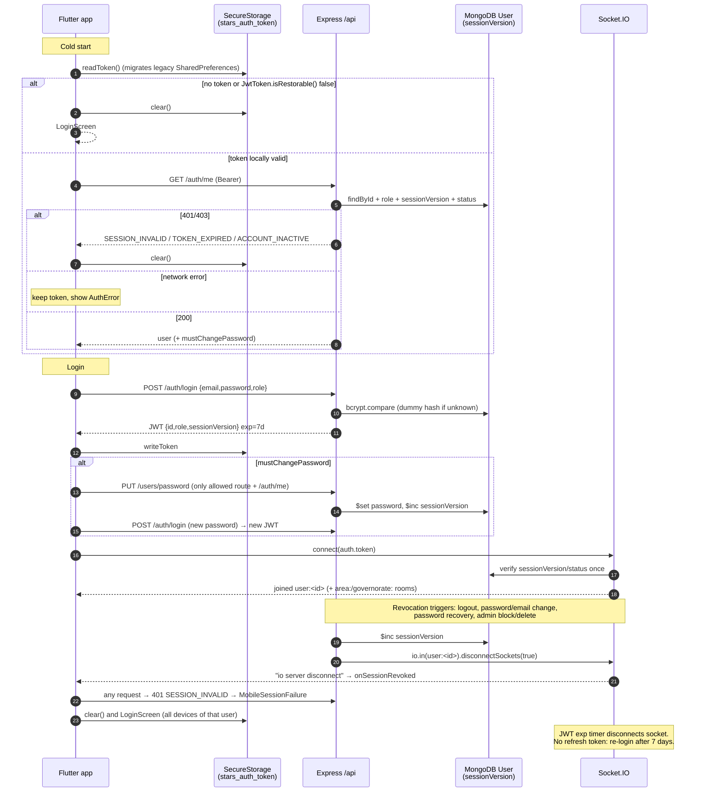

# Stars Delivery: Data and Security Audit

Branch: `docs/stars-delivery-audit`. Scope: Flutter app (`lib/`), platform configs, Node/Express backend (`stars_delivery_backend/src`), `deployment/`. This review only read code; nothing was changed. No secret values were opened or reproduced. Files that hold secrets are listed by name only.

How sure each statement is:

- **Confirmed**: the code shows it directly (file:line cited).
- **Suspected**: the code strongly implies it, but nobody ran it to check.
- **Unverified**: depends on how production is deployed or configured, which this review could not see.

Defects with a severity are in [QUALITY_RISK_REGISTER.md](QUALITY_RISK_REGISTER.md). This document cites them as `RISK-NNN`.

---

## 1. Secrets and sensitive files in the working tree

| Path | Exists locally | Git status | Notes |
|---|---|---|---|
| `stars_delivery_backend/.env` | yes | ignored ([.gitignore:1](../../stars_delivery_backend/.gitignore#L1)), not tracked | Values not read. Variable names come from `.env.example` (listed below) |
| `stars_delivery_backend/private/provider-documents/` | yes (4 entries) | ignored ([.gitignore:6](../../stars_delivery_backend/.gitignore#L6)), not tracked | Provider ID and licence images. Not opened |
| `stars_delivery_backend/uploads/` (3 root `*.jpg` + `ads/`) | yes | ignored ([.gitignore:4](../../stars_delivery_backend/.gitignore#L4)), not tracked | Root JPGs are legacy **order images** from the removed upload feature (see §3.3, RISK-009). Not opened |
| `stars_delivery_backend/server.log` | yes | ignored (`*.log`), not tracked | Not opened |
| `android/key.properties`, `android/app/stars-delivery-release.jks` | yes | ignored ([android/.gitignore](../../android/.gitignore)), not tracked | Release signing material |
| `android/local.properties` | yes | ignored | — |
| `google-services.json` / `GoogleService-Info.plist` / `firebase_options.dart` | **absent** | — | Firebase is set up at build time with `--dart-define` instead ([firebase_bootstrap.dart:7-22](../../lib/services/firebase_bootstrap.dart#L7-L22)) |

`git log --all --diff-filter=A` shows that none of the files above were ever committed. Only `*.example` templates are tracked.

**Backend environment variables** (names only, from `.env.example` and `deployment/stars-delivery.env.example`): `NODE_ENV`, `PORT`, `MONGODB_URI`, `JWT_SECRET`, `SESSION_SECRET`, `CORS_ALLOWED_ORIGINS`, `ALLOW_MOCK_LOCATION`, `PASSWORD_RECOVERY_SECRET`, `SMTP_HOST`, `SMTP_PORT`, `SMTP_SECURE`, `SMTP_USER`, `SMTP_PASS`, `SMTP_FROM`, `ADMIN_EMAIL`, `ADMIN_FULL_NAME`, `ADMIN_PASSWORD`, `PROVIDER_DOCUMENTS_DIR`, `FIREBASE_SERVICE_ACCOUNT_JSON`, `FIREBASE_SERVICE_ACCOUNT_PATH`, `IMGBB_API_KEY` (only in the deployment example; looks legacy), `STARS_BACKUP_ROOT`, `STARS_BACKUP_QUIESCED`.

Secret hygiene at startup (Confirmed): `JWT_SECRET` and `SESSION_SECRET` must each be at least 32 characters, must not match known placeholders, and must differ from each other ([config.js:25-49](../../stars_delivery_backend/src/config.js#L25-L49)). `PASSWORD_RECOVERY_SECRET` must differ from both ([config.js:101-128](../../stars_delivery_backend/src/config.js#L101-L128)).

---

## 2. Persistence: Flutter client

### 2.1 Key/value storage

| Store | Key | Content | Source |
|---|---|---|---|
| `flutter_secure_storage` (Keychain / Android keystore-backed) | `stars_auth_token` | Mobile JWT (the only credential kept on the device) | [session_storage.dart:33](../../lib/services/session_storage.dart#L33) |
| `SharedPreferences` (legacy, migrated then deleted) | `auth_token`, `auth_user` | JWT and user JSON from older releases | [session_storage.dart:36-37](../../lib/services/session_storage.dart#L36-L37), migration [44-68](../../lib/services/session_storage.dart#L44-L68) |
| `SharedPreferences` | `stars_theme_mode` | `light`/`dark`/`system` | [theme_preferences.dart:6](../../lib/services/theme_preferences.dart#L6) |
| `SharedPreferences` | `stars_locale` | `ar`/`en` | [locale_preferences.dart:7](../../lib/services/locale_preferences.dart#L7) |

- Migration order is safe (Confirmed). The token is written to secure storage before the legacy copy is deleted ([session_storage.dart:61-65](../../lib/services/session_storage.dart#L61-L65)).
- The user profile is **not** stored on the device. It is fetched again from `GET /api/auth/me` at every start ([auth_bloc.dart:54-67](../../lib/bloc/auth/auth_bloc.dart#L54-L67)).
- Android `allowBackup="false"` ([AndroidManifest.xml:7](../../android/app/src/main/AndroidManifest.xml#L7)) keeps app data out of cloud and adb backups.
- iOS Keychain items usually survive an app uninstall. A token that is still valid (up to 7 days) may come back after reinstall (Unverified, low impact).

### 2.2 Caches, offline queues, migrations

- No local database, HTTP cache, or offline write queue exists (Confirmed: no `sqflite`/`hive`/`drift` in [pubspec.yaml](../../pubspec.yaml)). Every mutation needs the network. Failed requests show an error and are not retried.
- `rootBundle.loadString` caches the **46.5 MB** `assets/countries+states+cities.json` in memory after the first load ([location_service.dart:56-58](../../lib/services/location_service.dart#L56-L58)). See RISK-001 and RISK-002.
- The only client-side "migration" is the token move from SharedPreferences to secure storage described above.
- Map tiles from `tile.openstreetmap.org` are cached by `flutter_map`'s default image cache only ([order_tracking_screen.dart:139-140](../../lib/screens/order_tracking_screen.dart#L139-L140)).

---

## 3. Persistence: backend

### 3.1 MongoDB models with sensitive fields

| Model | Sensitive fields | Protection |
|---|---|---|
| `User` ([User.js](../../stars_delivery_backend/src/models/User.js)) | `password` (bcrypt), `adminTotpSecret` (**plaintext base32**), `adminTotpRecoveryCodeHashes` (HMAC), `providerDocuments` (storage metadata), `email`, `phoneNumbers[]`, `lastLatitude`/`lastLongitude`/`lastLocationUpdate`/`lastLocationMocked`, `complaints`, `messages[]` | `select:false` on password, TOTP secret, recovery hashes, documents ([User.js:56-71](../../stars_delivery_backend/src/models/User.js#L56-L71)). The TOTP secret is not encrypted at rest. `governorate` is declared twice ([User.js:74](../../stars_delivery_backend/src/models/User.js#L74), [101](../../stars_delivery_backend/src/models/User.js#L101)), see RISK-022 |
| `PendingProvider` | `password` (bcrypt, `select:false`), email, phone, documents | [PendingProvider.js:45-56](../../stars_delivery_backend/src/models/PendingProvider.js#L45-L56) |
| `PasswordRecoveryChallenge` | `nonce`, `codeDigest` (HMAC-SHA256), both `select:false` | [PasswordRecoveryChallenge.js:29-39](../../stars_delivery_backend/src/models/PasswordRecoveryChallenge.js#L29-L39) |
| `Order` | `phone` (customer, full), `description`, `location` (free-text address) | Length-bounded ([Order.js:7-12](../../stars_delivery_backend/src/models/Order.js#L7-L12)) |
| `ChatMessage`, `ContactRequest` | Support chat text, guest name/phone/email | — |
| `PushToken` | FCM device token ↔ `userId` | unique token |
| `AdminAuditLog` | actor id/email, IP, UA, path, query, **body keys only** | [AdminAuditLog.js](../../stars_delivery_backend/src/models/AdminAuditLog.js) |

### 3.2 Indexes, TTLs, retention

| Collection | TTL / retention | Source |
|---|---|---|
| `notifications` | `expireAt` TTL (per-document, typically 7 days) | [Notification.js:17](../../stars_delivery_backend/src/models/Notification.js#L17) |
| `broadcastmessages` | `expireAt` TTL | [BroadcastMessage.js:21](../../stars_delivery_backend/src/models/BroadcastMessage.js#L21) |
| `passwordrecoverychallenges` | `expiresAt` TTL (10 min challenge) | [PasswordRecoveryChallenge.js:49-55](../../stars_delivery_backend/src/models/PasswordRecoveryChallenge.js#L49-L55) |
| `adminauditlogs` | 180 days | [AdminAuditLog.js:61-64](../../stars_delivery_backend/src/models/AdminAuditLog.js#L61-L64) |
| `admin_sessions` (connect-mongo) | 24 h | [adminSession.js:5](../../stars_delivery_backend/src/middleware/adminSession.js#L5) |
| `offers` | Expired pending offers are **deleted** by a 30 s sweeper | [orderLifecycle.js:185](../../stars_delivery_backend/src/services/orderLifecycle.js#L185), [index.js:231-246](../../stars_delivery_backend/src/index.js#L231-L246) |
| `orders`, `chatmessages`, `ratings`, `users` (incl. last GPS fix), `contactrequests`, `commissionpayments` | **No retention policy** (kept forever) | — |

- The offer index `{providerId, orderId}` is deliberately **non-unique**. Duplicate prevention relies on transaction serialisation ([Offer.js:18-21](../../stars_delivery_backend/src/models/Offer.js#L18-L21), [orderLifecycle.js:497-502](../../stars_delivery_backend/src/services/orderLifecycle.js#L497-L502)). `npm run offers:audit-duplicates` exists to check data before the index is made unique.
- `ensureMongoIndexes()` builds indexes for every model except `User`, `Report`, `PendingProvider` and `PasswordRecoveryChallenge` ([index.js:212-229](../../stars_delivery_backend/src/index.js#L212-L229)). Those depend on Mongoose `autoIndex` (on by default), so their unique/TTL indexes are created asynchronously and failures are silent (Unverified for production).

### 3.3 File storage

| Data | Location | Access | Source |
|---|---|---|---|
| Provider identity / licence documents | `PROVIDER_DOCUMENTS_DIR` (must be absolute and outside `uploads/`; default `private/provider-documents`). Dir `0700`, files `0600`. JPEG/PNG magic-byte sniffing, max 5 MB, SHA-256 recorded | Admin-only routes. Never served statically | [providerDocumentStorage.js:66-128](../../stars_delivery_backend/src/services/providerDocumentStorage.js#L66-L128), [145-185](../../stars_delivery_backend/src/services/providerDocumentStorage.js#L145-L185), [285-325](../../stars_delivery_backend/src/services/providerDocumentStorage.js#L285-L325) |
| Ad images | `uploads/ads/` with random filenames, uploaded by admin (multer) | **Public, no auth** at `/uploads/ads/*`, extension allow-list, `CSP: default-src 'none'; sandbox`, `nosniff` | [adImageStorage.js](../../stars_delivery_backend/src/services/adImageStorage.js), [index.js:109-127](../../stars_delivery_backend/src/index.js#L109-L127) |
| Legacy order images | `uploads/*.jpg` (3 files present locally) | **Still public, no auth** under `/uploads/` if they exist in production. The `Order` schema no longer references them (removed in commit `9b50ca3`) | [index.js:109-127](../../stars_delivery_backend/src/index.js#L109-L127). RISK-009 |

### 3.4 Backups

- `npm run ops:backup` / `ops:restore` ([backupRestore.js](../../stars_delivery_backend/src/scripts/backupRestore.js)) run `mongodump`, then copy `uploads/` and the provider-document directory into `STARS_BACKUP_ROOT`. They require `STARS_BACKUP_QUIESCED` as a manual acknowledgement that writes are stopped ([backupRestore.js:299-303](../../stars_delivery_backend/src/scripts/backupRestore.js#L299-L303)). Directories are created `0700` and private files `0600` ([331-345](../../stars_delivery_backend/src/scripts/backupRestore.js#L331-L345), [592-604](../../stars_delivery_backend/src/scripts/backupRestore.js#L592-L604)).
- Backups are **not encrypted** by the script (Confirmed: no cipher use). They contain bcrypt hashes, plaintext TOTP secrets, customer phones/addresses and provider ID documents. Encrypting them at rest is left to the operator ([deployment/README.md:207-227](../../deployment/README.md#L207-L227)).

---

## 4. Authentication

### 4.1 Mobile (customer / provider)

| Aspect | Behaviour | Source |
|---|---|---|
| Registration | Role must be `customer`/`provider`. Email normalised and validated; reserved guest emails refused. Password 12–128 chars, not a placeholder. Providers go to `PendingProvider` for admin approval. Customers get a JWT immediately. `fullName`/`phone` have **no server-side type, length or format check**, and `privacyPolicy` is not required to be `true` | [routes/auth.js:52-166](../../stars_delivery_backend/src/routes/auth.js#L52-L166) |
| Password hash | bcrypt cost **10** for mobile ([auth.js:102](../../stars_delivery_backend/src/routes/auth.js#L102), [users.js password](../../stars_delivery_backend/src/routes/users.js#L270)). Cost 12 for admin ([adminAuth.js:165](../../stars_delivery_backend/src/routes/adminAuth.js#L165)). The dummy hash for unknown users is cost 12 ([auth.js:40-41](../../stars_delivery_backend/src/routes/auth.js#L40-L41)), a measurable timing difference (RISK-025) |
| Password policy | Mobile: 12–128 chars, small deny-list ([passwordPolicy.js:35-43](../../stars_delivery_backend/src/security/passwordPolicy.js#L35-L43)). Client mirrors it ([validators.dart](../../lib/services/validators.dart)). No breached-password check |
| Login | Generic "Invalid credentials" for wrong password, unknown email or wrong role. Inactive or deleted accounts get 403 `ACCOUNT_INACTIVE` (only after a correct password) | [auth.js:168-245](../../stars_delivery_backend/src/routes/auth.js#L168-L245) |
| Token | HS256 JWT `{id, role, sessionVersion}`, **7 days**, no refresh token. When it expires the user must log in again | [auth.js:224-234](../../stars_delivery_backend/src/routes/auth.js#L224-L234) |
| Verification per request | Bearer header → `jwt.verify` → user loaded → role must match the token → `sessionVersion` must match → active/not-deleted → `mustChangePassword` gate (only `PUT /users/password` and `GET /auth/me` allowed) | [middleware/auth.js:28-140](../../stars_delivery_backend/src/middleware/auth.js#L28-L140) |
| Revocation | A single per-user `sessionVersion` counter. Logout, password change, email change, password recovery and admin block/delete all increment it and call `disconnectSockets` on room `user:<id>`. **Logging out on one device logs out every device** | [auth.js:252-305](../../stars_delivery_backend/src/routes/auth.js#L252-L305), [mobileSession.js:97-145](../../stars_delivery_backend/src/services/mobileSession.js#L97-L145), [adminDrivers.js:644-701](../../stars_delivery_backend/src/routes/adminDrivers.js#L644-L701), [adminUsers.js:144-209](../../stars_delivery_backend/src/routes/adminUsers.js#L144-L209) |
| Expiry handling (client) | On restore, local `exp` is checked with 30 s skew ([jwt_token.dart:29-49](../../lib/services/jwt_token.dart#L29-L49)), then the session is revalidated with `/auth/me`. A 401/403 clears the token. A network error **keeps** the token ([auth_bloc.dart:34-76](../../lib/bloc/auth/auth_bloc.dart#L34-L76)). At runtime, any Dio 401 with `AUTH_REQUIRED`/`SESSION_INVALID`/`TOKEN_EXPIRED`, or 403 `ACCOUNT_INACTIVE`, emits on `MobileSessionFailure.onRejected`, which the home screens use to force logout ([mobile_session_failure.dart:33-47](../../lib/services/mobile_session_failure.dart#L33-L47), [provider_home_screen.dart:189-197](../../lib/screens/provider_home_screen.dart#L189-L197)) |
| Client logout | Logout button: `revokeSession` (fire-and-forget, 3 s timeout), socket disconnect, `LogoutEvent` → push-token DELETE → clear secure storage ([home_screen.dart:833-835](../../lib/screens/home_screen.dart#L833-L835), [auth_bloc.dart:151-156](../../lib/bloc/auth/auth_bloc.dart#L151-L156)). The revoke and the push-token DELETE **race**: the DELETE often uses an already-revoked token (RISK-005) |
| Socket auth | `handshake.auth.token` verified with the same secret. `sessionVersion`, active state and `mustChangePassword` are re-checked against the DB **once, at connect** ([index.js:323-409](../../stars_delivery_backend/src/index.js#L323-L409), [authenticateSocket.js:7-58](../../stars_delivery_backend/src/socket/authenticateSocket.js#L7-L58)). A timer disconnects the socket at JWT `exp`. Revocation depends on the explicit `disconnectSockets` calls listed above |

### 4.2 Password recovery (mobile)

[routes/passwordRecovery.js](../../stars_delivery_backend/src/routes/passwordRecovery.js), [security/passwordRecovery.js](../../stars_delivery_backend/src/security/passwordRecovery.js) (Confirmed):

- The response is the same whether or not the account exists, and has a 300 ms minimum response time.
- 8-digit code from `crypto.randomInt`. Only an HMAC-SHA256 digest of (user, email, sessionVersion, nonce, code) is stored, keyed with `PASSWORD_RECOVERY_SECRET`.
- 10-minute TTL, 5 attempts, decremented atomically ([passwordRecovery.js:446-456](../../stars_delivery_backend/src/routes/passwordRecovery.js#L446-L456)). One active challenge per user (`_id = userId`).
- The challenge is tied to `sessionVersion`, so any session rotation invalidates it. A successful reset increments `sessionVersion` and disconnects sockets ([passwordRecovery.js:615-660](../../stars_delivery_backend/src/routes/passwordRecovery.js#L615-L660)).
- Rate limits: 10 requests per IP and 3 per account per 15 min, plus 20 resets per IP per 15 min ([mobileAuthRateLimit.js](../../stars_delivery_backend/src/security/mobileAuthRateLimit.js)).

### 4.3 Admin dashboard

| Aspect | Behaviour | Source |
|---|---|---|
| Session | `express-session` + connect-mongo, cookie `stars_admin.sid`, `httpOnly`, `SameSite=Lax`, `Secure` in production, 24 h TTL. `regenerate()` on login | [adminSession.js:5-38](../../stars_delivery_backend/src/middleware/adminSession.js#L5-L38), [adminAuth.js:127-140](../../stars_delivery_backend/src/routes/adminAuth.js#L127-L140) |
| Per-request check | Session admin id → DB lookup (active, role admin, not deleted) → `sessionVersion` match. On failure: destroy the session and disconnect admin sockets | [requireAdminSession.js:64-103](../../stars_delivery_backend/src/middleware/requireAdminSession.js#L64-L103) |
| CSRF | Synchronizer token in the session, 32 random bytes, accepted via `X-CSRF-Token` header or `_csrf` body field, compared with `timingSafeEqual`. Applied to every non-GET admin route **and** to the login form | [adminCsrf.js:84-134](../../stars_delivery_backend/src/security/adminCsrf.js#L84-L134), [index.js:509-522](../../stars_delivery_backend/src/index.js#L509-L522) |
| TOTP 2FA | RFC 6238, ±1 step window, 8 HMAC'd recovery codes. **Optional per admin** (not enforced, RISK-010). No replay tracking within the window (RISK-026). Recovery codes are HMAC'd with `JWT_SECRET`, with a hard-coded fallback key ([totp.js:175-187](../../stars_delivery_backend/src/security/totp.js#L175-L187), RISK-027) | [adminAuth.js:98-125](../../stars_delivery_backend/src/routes/adminAuth.js#L98-L125), [216-388](../../stars_delivery_backend/src/routes/adminAuth.js#L216-L388) |
| Rate limiting | 10 per IP and 5 per identifier per 15 min; successful requests not counted | [adminAuth.js:23-55](../../stars_delivery_backend/src/routes/adminAuth.js#L23-L55) |
| Password change | Needs the current password, at least 12 chars, bcrypt 12. Increments `sessionVersion` but keeps the current session | [adminAuth.js:146-183](../../stars_delivery_backend/src/routes/adminAuth.js#L146-L183) |
| Bootstrap | `npm run admin:bootstrap` from env vars. `admin123` and placeholders are rejected | [adminBootstrap.js](../../stars_delivery_backend/src/scripts/adminBootstrap.js), [passwordPolicy.js:1-33](../../stars_delivery_backend/src/security/passwordPolicy.js#L1-L33) |
| Audit | Every `/admin` request is logged: actor, IP, UA, path, query, body **keys only**. 180-day TTL | [adminAuditLog.js](../../stars_delivery_backend/src/middleware/adminAuditLog.js) |

### 4.4 Rate limiting summary

All limiters use `express-rate-limit` with the default **in-memory store** (Confirmed: no `store:` option). Counters reset on restart and are not shared between instances (RISK-028).

| Endpoint | Limit |
|---|---|
| Mobile login | 10/IP + 10/email per 15 min (failures only) |
| Register | 5/IP per 15 min |
| Password recovery | 10/IP + 3/account (request), 20/IP (reset) per 15 min |
| Admin login | 10/IP + 5/identifier per 15 min |
| Orders | 5/user + 20/IP per 10 min |
| Offers | 30/user + 90/IP per 10 min |
| Chat send | 30/user + 120/IP per min |
| Reports | 5/user + 20/IP per hour |
| Location | 120/user + 300/IP per min |
| Push token | 20/user + 60/IP per hour |
| Public contact | `publicContactLimiter` ([chat.js:399](../../stars_delivery_backend/src/routes/chat.js#L399)) |
| **Not limited** | `PUT /users/password` (current-password guessing with a valid token), `/users/phones`, `/users/frequent-items`, `/users/profile`, `/users/area`, accept/cancel/resend offers (resend shares the order-create limiter) |

### 4.5 Auth / session lifecycle

---

## 5. Authorization

| Control | Implementation | Assessment |
|---|---|---|
| Role middleware | `requireRole(...roles)` on `req.userRole`, which comes from the **DB user** (not only the token) ([requireRole.js](../../stars_delivery_backend/src/middleware/requireRole.js), [auth.js:132-136](../../stars_delivery_backend/src/middleware/auth.js#L132-L136)) | Confirmed sound |
| Mobile vs admin separation | Mobile JWT roles restricted to `customer`/`provider` ([mobileRole.js](../../stars_delivery_backend/src/middleware/mobileRole.js)). Admin uses only the session cookie. `/api/chat/admin/*` requires the admin session and CSRF ([chat.js:139-143](../../stars_delivery_backend/src/routes/chat.js#L139-L143)) | Confirmed |
| Order read | Customer must own the order. A provider must be assigned, **or** the order is pending/offered and visible by area/governorate. Unassigned providers see the phone with the last 3 digits masked ([orders.js:233-293](../../stars_delivery_backend/src/routes/orders.js#L233-L293)) | Confirmed. Masking reveals 7 of 10 digits, and the free-text `location` is visible before acceptance (RISK-019) |
| Offer list / accept / cancel / resend | Filtered by `customerId: req.userId` ([offers.js:192-195](../../stars_delivery_backend/src/routes/offers.js#L192-L195), [orderLifecycle.js:252-255](../../stars_delivery_backend/src/services/orderLifecycle.js#L252-L255), [575-628](../../stars_delivery_backend/src/services/orderLifecycle.js#L575-L628)) | Confirmed |
| Offer submit | Provider must be active, available, not blocked, past cooldown, not previously rejected for that order, and the order must match the visibility filter and service type. All checks run inside one transaction ([orderLifecycle.js:449-573](../../stars_delivery_backend/src/services/orderLifecycle.js#L449-L573)) | Confirmed |
| Status transitions | `findOneAndUpdate({_id, providerId, status: from})` / `{customerId, status:'fulfilling'}` ([orderLifecycle.js:631-752](../../stars_delivery_backend/src/services/orderLifecycle.js#L631-L752)) | Confirmed: compare-and-set, so a second identical request gets 409 |
| Provider reject | Re-checks area visibility ([provider.js:313-366](../../stars_delivery_backend/src/routes/provider.js#L313-L366)) | Confirmed |
| Notifications | `findOne({_id, userId})` ([notifications.js:24-42](../../stars_delivery_backend/src/routes/notifications.js#L24-L42)) | Confirmed |
| Chat (user side) | Messages scoped to `req.userId` (support conversation only) | Confirmed |
| Ratings | Customer owns the order, order `completed`, unique per order | Confirmed |
| Legacy providers with no `area` | See **all** orders ([orderVisibility.js:16-21](../../stars_delivery_backend/src/services/orderVisibility.js#L16-L21), [45](../../stars_delivery_backend/src/services/orderVisibility.js#L45)). Socket room taken from the client-supplied `handshake.query.area` ([index.js:437](../../stars_delivery_backend/src/index.js#L437)) | Suspected: intended for legacy accounts, but too broad (RISK-014) |
| Self-service area change | `PUT /users/area` lets a provider change their registered area/governorate at any time (validated against the catalogue), which changes which orders they see ([users.js:230-268](../../stars_delivery_backend/src/routes/users.js#L230-L268)) | Design note: no admin review |

### Client-side trust boundaries

- Price, commission, provider earnings, order status and offer validity are all **computed on the server** ([orderLifecycle.js:305-312](../../stars_delivery_backend/src/services/orderLifecycle.js#L305-L312)). The client sends only `price` (offer) and `rating`. No client-side role or price trust was found.
- **Mock-location detection is reported by the client** (`isMocked` from Geolocator) ([location_service.dart:144](../../lib/services/location_service.dart#L144), [locationValidation.js:62-63](../../stars_delivery_backend/src/security/locationValidation.js#L62-L63)). A modified client can simply send `false`. Server-side range and speed checks only partly compensate (documented residual risk).
- Offer expiry countdowns use the **device clock** against the server `expiresAt` ([order_offers_screen.dart:76-106](../../lib/screens/order_offers_screen.dart#L76-L106)). This is display only, since the server enforces expiry.

---

## 6. Sensitive data handling and logging

### 6.1 Logging (grep of `print`/`debugPrint`/`console.*`)

Flutter (Confirmed, no tokens or PII):
- `print('Socket connected'|'Socket disconnected')` ([socket_service.dart:102](../../lib/services/socket_service.dart#L102), [107](../../lib/services/socket_service.dart#L107)). This runs in release builds too, but the strings are static.
- `debugPrint` of exception text in [provider_bloc.dart:35,70,104](../../lib/bloc/provider/provider_bloc.dart#L35), Firebase and push setup errors, and the FCM `messageId`.
- No Dio `LogInterceptor` is installed. JWTs are never printed.

Backend:
- Logs user ObjectIds and area/governorate strings on order create, `/provider/stats`, `/provider/pending-orders` and socket connect ([orders.js:81](../../stars_delivery_backend/src/routes/orders.js#L81), [provider.js:194](../../stars_delivery_backend/src/routes/provider.js#L194), [provider.js:276](../../stars_delivery_backend/src/routes/provider.js#L276), [index.js:447-449](../../stars_delivery_backend/src/index.js#L447-L449)). These are pseudonymous identifiers and coarse location. No tokens, passwords, phones or emails are logged.
- `console.error('Unhandled error:', err)` dumps whole error objects ([index.js:538](../../stars_delivery_backend/src/index.js#L538)). Mongoose validation errors may include the rejected field values (Suspected: low PII exposure in the journal).
- Client error responses are generic ([errorResponse.js](../../stars_delivery_backend/src/security/errorResponse.js)). Stack traces are not returned.

### 6.2 PII flows

| Data | Who can see it |
|---|---|
| Customer full phone | Assigned provider only. Area providers see `***`-masked (last 3 digits) |
| Customer name/publicId | Area providers (populated `customerId` on pending orders) |
| Order description + free-text location | All eligible area providers before acceptance (socket broadcast and pending list) |
| Provider live GPS | Customer of an `accepted`/`fulfilling` order ([orders.js:330-348](../../stars_delivery_backend/src/routes/orders.js#L330-L348)) |
| Customer GPS | Collected on customer home ([home_screen.dart:97](../../lib/screens/home_screen.dart#L97)) and stored in `User.lastLatitude/Longitude` **with no consumer that this review found and no retention limit** (RISK-013) |
| Provider phone | `populate('providerId', '... phone ...')` and `provider.phone` refer to a field that does **not exist** on `User`, so the customer never receives it ([offers.js:202](../../stars_delivery_backend/src/routes/offers.js#L202), [orderLifecycle.js:571](../../stars_delivery_backend/src/services/orderLifecycle.js#L571)). See RISK-020 |
| Push payloads | Order description, area and status text. Shown on the lock screen. They can keep arriving after logout (RISK-005) |

---

## 7. Platform permissions

| Platform | Permission | Notes |
|---|---|---|
| Android | `ACCESS_FINE_LOCATION`, `ACCESS_COARSE_LOCATION`, `INTERNET`, `POST_NOTIFICATIONS` ([AndroidManifest.xml:2-5](../../android/app/src/main/AndroidManifest.xml#L2-L5)) | No background location. No deep-link intent filters. `exported=true` only on the launcher activity |
| iOS | `NSLocationWhenInUseUsageDescription`, `NSPhotoLibraryUsageDescription` (**stale**: photo upload was removed), `UIBackgroundModes=remote-notification`. `aps-environment` is development/production per build ([Info.plist:56-63](../../ios/Runner/Info.plist#L56-L63)) | RISK-034 |
| Runtime | The location permission is requested in `main()` **before the first frame and before login** ([main.dart:18](../../lib/main.dart#L18), [location_service.dart:11-37](../../lib/services/location_service.dart#L11-L37)). The notification permission is requested after login ([push_notification_service.dart:38](../../lib/services/push_notification_service.dart#L38)) | RISK-001 |

---

## 8. Network security

| Layer | Control | Source |
|---|---|---|
| Client base URL | `STARS_SERVER_URL` `--dart-define` must be an `https://` origin with no path, query or userinfo. Plain HTTP is allowed **only** in Android debug builds, which default to `http://192.168.1.7:3000` and LAN discovery. Non-Android-debug builds fail fast when the variable is missing | [api_config.dart:54-108](../../lib/services/api_config.dart#L54-L108), [294-315](../../lib/services/api_config.dart#L294-L315) |
| Android cleartext | `usesCleartextTraffic="false"` in main, overridden to `true` only in the `debug` manifest | [AndroidManifest.xml:11](../../android/app/src/main/AndroidManifest.xml#L11), [debug/AndroidManifest.xml:10-11](../../android/app/src/debug/AndroidManifest.xml#L10-L11) |
| iOS ATS | No `NSAppTransportSecurity` exceptions (Confirmed by grep) | [Info.plist](../../ios/Runner/Info.plist) |
| Certificate pinning | None | — |
| Debug LAN discovery | Android debug scans the /24 subnet over HTTP and trusts the first host answering `/api/config`. A rogue host on the LAN could receive debug-build credentials (debug only) | [api_config.dart:172-292](../../lib/services/api_config.dart#L172-L292) |
| CORS / Origin | An explicit allow-list from `CORS_ALLOWED_ORIGINS`, with wildcards refused. Same-origin is allowed. **Requests with no `Origin` are allowed** (native clients). A disallowed `Origin` gets 403 for every route, sockets included | [originPolicy.js:1-195](../../stars_delivery_backend/src/security/originPolicy.js#L1-L195), [index.js:90-102](../../stars_delivery_backend/src/index.js#L90-L102), [311-319](../../stars_delivery_backend/src/index.js#L311-L319) |
| Helmet (global) | HSTS, nosniff, frameguard and similar are on by default. **CSP is disabled globally** ([index.js:65-71](../../stars_delivery_backend/src/index.js#L65-L71)). The JSON API is not affected, but static `src/public` assets other than admin pages have no CSP |
| Admin CSP | `default-src 'self'`, `script-src 'self'`, `script-src-attr 'none'`, `style-src-attr 'none'`, `frame-ancestors 'none'`, `connect-src` = same-host ws/wss | [adminBrowserHeaders.js:45-108](../../stars_delivery_backend/src/security/adminBrowserHeaders.js#L45-L108) |
| Admin DOM | 69 `innerHTML` sinks in [main.js](../../stars_delivery_backend/src/public/js/main.js). Dynamic values pass through `escapeHtml`, and `admin-dom-injection-safety.test.js` covers this. The strict CSP blocks inline script as defence in depth (not every sink was reviewed by hand) |
| Uploads | `/uploads` serves an extension allow-list with `CSP: default-src 'none'; sandbox`, `nosniff`, `CORP: same-site` | [index.js:109-127](../../stars_delivery_backend/src/index.js#L109-L127) |
| TLS (nginx) | 80→301, TLS 1.2/1.3, HSTS `max-age=31536000` (no `includeSubDomains`), `client_max_body_size 20m`, WebSocket upgrade, XFF/X-Forwarded-Proto set | [stars-delivery.conf](../../deployment/nginx/stars-delivery.conf) |
| Proxy trust | `trust proxy 1` in production ([index.js:61](../../stars_delivery_backend/src/index.js#L61)), but the server **listens on `0.0.0.0`** ([index.js:553](../../stars_delivery_backend/src/index.js#L553)) while the docs say port 3000 must not be exposed. If 3000 is reachable, clients can spoof `X-Forwarded-For` and bypass IP rate limits, and can skip TLS (RISK-007, Unverified) |
| systemd | Runs as a dedicated user, `UMask=0077`, `NoNewPrivileges`, `PrivateTmp`. No `ProtectSystem`/`ProtectHome`/`ReadWritePaths` sandboxing | [stars-delivery.service](../../deployment/systemd/stars-delivery.service) |
| Dev endpoint | `/api/config` (LAN IP disclosure) is registered only when `NODE_ENV !== 'production'` | [index.js:461-482](../../stars_delivery_backend/src/index.js#L461-L482) |

---

## 9. Deep links and push routing

- No custom URL schemes, App Links or Universal Links are declared (Confirmed: no `<intent-filter>` other than LAUNCHER, and no `CFBundleURLTypes`).
- FCM: `onMessage` only logs. `onMessageOpenedApp` and `getInitialMessage` are **not handled**, so tapping a notification just opens the app and `data.orderId` is ignored (Confirmed by grep, RISK-033). This means there is no deep-link validation to get wrong.
- Opening an order from in-app notifications goes through the authorised `GET /api/orders/:id`, so the server enforces access.

---

## 10. Input validation

| Area | Status |
|---|---|
| Orders / offers / ratings / reports / chat / location | Bounded string and number helpers ([requestInput.js](../../stars_delivery_backend/src/security/requestInput.js)), ObjectId checks, enum checks. Confirmed |
| `PUT /users/profile` `fullName` | No type or length check. An object or a very long string is stored as-is ([users.js:574-640](../../stars_delivery_backend/src/routes/users.js#L574-L640)) |
| `/users/phones`, `/users/frequent-items` | No type, length, format or **count** limits, and no rate limit. A user can grow their own `User` document without bound ([users.js:651-731](../../stars_delivery_backend/src/routes/users.js#L651-L731)). RISK-011 |
| Register `fullName`, `phone`, PendingProvider fields | No server-side validation ([auth.js:54-63](../../stars_delivery_backend/src/routes/auth.js#L54-L63), [106-114](../../stars_delivery_backend/src/routes/auth.js#L106-L114)) |
| Body-less PUTs under Express 5 | `req.body` is `undefined` when no JSON body is sent. `req.body.enabled`, `req.body.governorate` and `hasOwnProperty.call(req.body, …)` then throw and return 500 instead of 400 (Suspected, RISK-023) |
| Invalid ObjectIds | `GET /offers/order/:orderId`, `POST /offers/:id/accept`, `PUT /notifications/:id/read` pass raw params to Mongoose. A `CastError` becomes a 500 (RISK-024) |
| Body size | `express.json()` default 100 kB. nginx allows 20 MB (multer handles uploads) |

---

## 11. Third-party SDKs and privacy

| SDK / service | Data sent | Notes |
|---|---|---|
| Firebase Core/Messaging (client), `firebase-admin` (server) | FCM device token, push payloads (order text) | Enabled only when the `FIREBASE_*` dart-defines and the server service account are set. Analytics is not included. `measurementId` is optional and passed through ([firebase_bootstrap.dart:40-52](../../lib/services/firebase_bootstrap.dart#L40-L52)) |
| OpenStreetMap tile server (`tile.openstreetmap.org`) | Customer device IP + viewed tile coordinates (≈ driver location) + UA `com.starsdelivery.stars_delivery` | The public OSM tile policy forbids heavy or commercial use without your own tile source. Attribution is shown ([order_tracking_screen.dart:139-173](../../lib/screens/order_tracking_screen.dart#L139-L173)). RISK-035 |
| Geolocator | GPS fixes (high accuracy) sent to your own backend only | Foreground only |
| SMTP provider | Recipient email + recovery code | Configured with `SMTP_*` |
| Google Fonts / cdnjs | Admin browser IP | Allowed by admin CSP for styles and fonts |
| ImgBB | — | Only `IMGBB_API_KEY` remains in the env example. No live code path found (legacy) |

---

## 12. Key security architecture facts (summary)

1. Two separate auth planes. Mobile uses a stateless HS256 JWT (7 days) revoked through a per-user `sessionVersion` that is checked against the DB on **every** request. Admin uses a server-side Mongo session cookie, CSRF synchronizer token, optional TOTP and a per-admin `sessionVersion`.
2. Revocation is all-devices. Logout, password/email change, recovery and admin block all increment `sessionVersion` and disconnect that user's sockets. There is no refresh token and no per-device session list.
3. The order/offer lifecycle (submit, accept, reset, cancel, transitions) runs in MongoDB multi-document transactions with compare-and-set filters. This needs a replica set (Atlas). On a standalone `mongod` every lifecycle call returns 503.
4. Secrets are validated at boot. Provider documents live outside the web root with `0700`/`0600` permissions. Admin CSP is strict. Client transport requires HTTPS outside Android debug.
5. The main gaps: push tokens are not purged on revocation (RISK-005), port 3000 is bound publicly (RISK-007), legacy public order images (RISK-009), optional admin 2FA (RISK-010), unbounded profile arrays (RISK-011), no data retention for GPS, chat and orders (RISK-013), unencrypted backups, and in-memory rate limiting.
