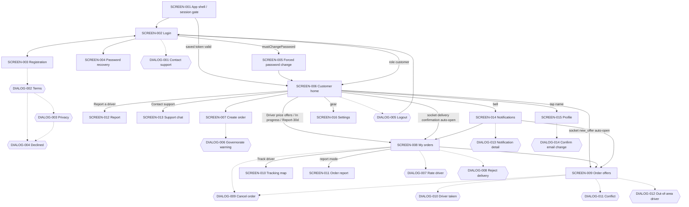
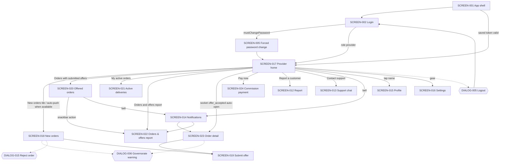
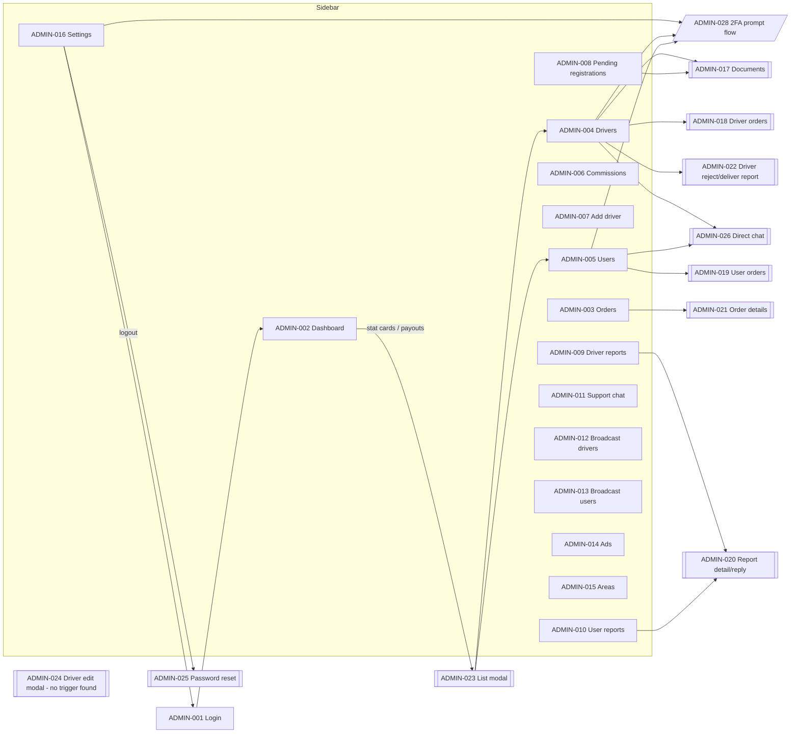

# Stars Delivery — Screen Inventory

**Branch:** `docs/stars-delivery-audit` (baseline commit `9b50ca3`)
**Method:** static, read-only source inspection of the Flutter app (`lib/`) and the EJS admin dashboard (`swifora_backend/src/views/admin`, `src/public/js/main.js`). No app was run; no screenshots exist yet. Everything below is evidenced by a source link unless marked **(inferred from code)**.
**Prior docs consulted:** [UX-02](../ux/UX-02-APP-WIDE-UI-UX-AUDIT-AND-ROADMAP.md), [UX-03](../ux/UX-03-SHARED-UI-FOUNDATION-IMPLEMENTATION.md). Several UX-02 findings (hard-coded `Colors.white` app bars, white-on-light button spinners) are **no longer present** in the current code; this inventory reflects the current branch only.

All links are relative to `docs/stars-delivery-audit/`.

---

## 1. Totals

| Category | Count | Notes |
|---|---:|---|
| Full mobile screens / screen states (`SCREEN-`) | **24** | From 22 screen files + app shell; `login_screen.dart` hosts two modes (Login, Registration). |
| Mobile dialogs (`DIALOG-`) | **15** | All `showDialog`/`AlertDialog`. **0** bottom sheets, **0** date/time pickers, **0** `TabBar`/`Stepper`; the only `PageView` is the ad carousel component. |
| Snackbar-type feedback patterns (`FB-`) | **6** | Catalogued in §6; not counted as dialogs. |
| Admin web pages (`ADMIN-001`–`ADMIN-016`) | **16** | Login + 15 single-page sections switched by the sidebar. |
| Admin modals / native-dialog flows (`ADMIN-017`–`ADMIN-028`) | **12** | 10 HTML modals + 2 native `confirm()`/`prompt()` flow groups. |
| **Total admin views** | **28** | |
| **Grand total UI surfaces** | **67** | 24 + 15 + 28 (feedback patterns excluded). |

Deep links: **none**. The Android manifest declares only the `MAIN/LAUNCHER` intent filter ([AndroidManifest.xml:29](../../android/app/src/main/AndroidManifest.xml#L29)); push handling registers only `onMessage` (log only) and a background handler — there is no `onMessageOpenedApp` / `getInitialMessage`, so tapping a push notification just opens the app at the auth gate ([push_notification_service.dart:53](../../lib/services/push_notification_service.dart#L53)). Navigation is entirely imperative `Navigator.push`/`MaterialPageRoute`; there is no `routes:` table or `onGenerateRoute` ([main.dart:68](../../lib/main.dart#L68)).

---

## 2. Summary table

Role: **C** = customer, **P** = provider/driver, **A** = admin, **Any** = unauthenticated or both roles.

| ID | Name | Role | Source (class) | Entry | Primary states |
|---|---|---|---|---|---|
| SCREEN-001 | App shell & session-restore gate | Any | `main.dart` `SwiforaApp` + `AuthBloc` | app launch | restoring, signed-out, restored → home, restore-error |
| SCREEN-002 | Login | Any | `login_screen.dart` `LoginScreen` (`_isLogin=true`) | `home:` of MaterialApp; logout; session end | default, loading, error |
| SCREEN-003 | Registration (customer / provider) | Any | `login_screen.dart` `LoginScreen` (`_isLogin=false`) | "Sign up" toggle on SCREEN-002 | default, provider variant, validation, loading, pending-review |
| SCREEN-004 | Password recovery (2 steps) | Any | `forgot_password_screen.dart` `ForgotPasswordScreen` | "Forgot password" on SCREEN-002 | step 1 email, step 2 code+password, loading, error, success |
| SCREEN-005 | Forced password change | C/P with `mustChangePassword` | `force_change_password_screen.dart` | auto after login | default, validation, submitting, error |
| SCREEN-006 | Customer home | C | `home_screen.dart` `HomeScreen` | after login (role ≠ provider) | default, pending banner, drivers banner, no-drivers |
| SCREEN-007 | Create order | C | `create_order_screen.dart` | primary card on SCREEN-006 | type-unselected, form, governorate banner, loading |
| SCREEN-008 | My orders (4 configurations) | C | `my_orders_screen.dart` `MyOrdersScreen` | tiles on SCREEN-006, notifications, socket | loading, empty, list, awaiting confirmation, suspended, expired |
| SCREEN-009 | Order offers | C | `order_offers_screen.dart` | SCREEN-008 tap, socket auto-open, notification | loading, waiting/empty, list, driver-taken, error |
| SCREEN-010 | Driver tracking map | C | `order_tracking_screen.dart` | "Track driver" on SCREEN-008 | loading, located, unavailable, error |
| SCREEN-011 | Order report (read-only) | C | `order_report_screen.dart` | SCREEN-008 in report mode | loading, error, populated, no offers |
| SCREEN-012 | Report a driver / customer | C/P | `report_screen.dart` | help tiles on SCREEN-006 / SCREEN-017 | form, sending, history loading/empty/populated |
| SCREEN-013 | Support chat | C/P | `support_chat_screen.dart` | support tiles | loading, empty, conversation, failed message |
| SCREEN-014 | Notifications | C/P | `notifications_screen.dart` | bell in app bars | loading, empty, list, error |
| SCREEN-015 | Profile | C/P | `profile_screen.dart` | tap name/avatar in app bar | default, phones loading, location loading/failed, saving |
| SCREEN-016 | Settings | C/P | `settings_screen.dart` | gear icon in app bars | default |
| SCREEN-017 | Provider home (dashboard) | P | `provider_home_screen.dart` | after login (role = provider) | initial (all-zero dashboard, not blank: verified, see RISK-044), available, unavailable/paused |
| SCREEN-018 | New (pending) orders | P | `pending_orders_screen.dart` | tile on SCREEN-017, auto-push | empty, list, cooldown, outside-area |
| SCREEN-019 | Submit offer | P | `submit_offer_screen.dart` | SCREEN-018 / SCREEN-023 | default, cooldown, loading, error variants |
| SCREEN-020 | Orders with submitted offers | P | `offered_orders_screen.dart` | tile on SCREEN-017 | empty, list |
| SCREEN-021 | Active deliveries | P | `provider_active_orders_screen.dart` | tile on SCREEN-017 | loading, error, empty, accepted, fulfilling, awaiting confirmation |
| SCREEN-022 | Orders & offers report (rejected/not selected/delivered) | P | `rejected_orders_screen.dart` | tile on SCREEN-017, snackbar action, notification | loading, error, empty, list |
| SCREEN-023 | Order detail (provider) | P | `order_detail_screen.dart` | socket auto-open on acceptance, notification | loading, error, pending/offered, accepted, fulfilling |
| SCREEN-024 | Commission payment instructions | P | `commission_payment_screen.dart` | "Pay now" on SCREEN-017 | default |
| DIALOG-001 | Contact support (pre-login) | Any | `login_screen.dart` `_showContactDialog` | SCREEN-002/003 | form, sending, success, error |
| DIALOG-002 | Terms of Service | Any | `login_screen.dart` `_showTermsOfService` | registration submit | default |
| DIALOG-003 | Privacy Policy | Any | `login_screen.dart` `_showPrivacyPolicy` | after DIALOG-002 agree | default |
| DIALOG-004 | Agreement required (declined) | Any | `login_screen.dart` `_showRejectDialog` | decline in DIALOG-002/003 | default |
| DIALOG-005 | Logout confirmation | C/P | `app_confirm_dialog.dart` `showLogoutConfirmation` | logout icon | default |
| DIALOG-006 | Governorate-scope warning (5 s wait) | C/P | `governorate_scope_warning.dart` | SCREEN-007, SCREEN-018, SCREEN-023 | counting, enabled |
| DIALOG-007 | Rate driver | C | `my_orders_screen.dart` `_showRatingPrompt` | approve delivery / "Rate driver" | default |
| DIALOG-008 | Reject delivery confirmation | C | `my_orders_screen.dart` `_rejectDelivery` | SCREEN-008 | default |
| DIALOG-009 | Cancel order confirmation | C | `showAppConfirmDialog` | SCREEN-008, SCREEN-009 | default |
| DIALOG-010 | Driver no longer available | C | `order_offers_screen.dart` `_showDriverTakenDialog` | socket / conflict | default |
| DIALOG-011 | Offer conflict (Arabic-only) | C | `order_offers_screen.dart` `_showConflictDialog` | accept conflict | default |
| DIALOG-012 | Accept out-of-area driver | C | `order_offers_screen.dart` `_confirmAcceptOffer` | accept on outside-area offer | default |
| DIALOG-013 | Notification detail | C/P | `notifications_screen.dart` `_showDetail` | tap notification without order link | default |
| DIALOG-014 | Confirm email change (password prompt) | C/P | `profile_screen.dart` | save email | default |
| DIALOG-015 | Reject order confirmation | P | `pending_orders_screen.dart` `_rejectOrder` | SCREEN-018 | default |
| ADMIN-001 | Admin login | A | `login.ejs` | `/admin/login` | default, error |
| ADMIN-002 | Dashboard | A | `index.ejs#page-dashboard` | default page / sidebar | loading clocks, populated |
| ADMIN-003 | Orders | A | `index.ejs#page-orders` | sidebar | filters, list, empty, error |
| ADMIN-004 | Drivers management | A | `index.ejs#page-drivers` | sidebar, list modal | list, search result, inline editor |
| ADMIN-005 | Users management | A | `index.ejs#page-users` | sidebar | list, search result |
| ADMIN-006 | Commissions | A | `index.ejs#page-commissions` | sidebar | table |
| ADMIN-007 | Add driver | A | `index.ejs#page-add-driver` | sidebar | form, success, error |
| ADMIN-008 | Pending provider registrations | A | `index.ejs#page-pending-providers` | sidebar (badge) | list, empty |
| ADMIN-009 | Driver reports | A | `index.ejs#page-driver-reports` | sidebar (badge) | list |
| ADMIN-010 | User reports | A | `index.ejs#page-user-reports` | sidebar (badge) | list |
| ADMIN-011 | Support conversations | A | `index.ejs#page-support-chat` | sidebar (badge) | list, open conversation |
| ADMIN-012 | Broadcast to drivers | A | `index.ejs#page-broadcast-drivers` | sidebar | form, result, archive |
| ADMIN-013 | Broadcast to users | A | `index.ejs#page-broadcast-users` | sidebar | form, result, archive |
| ADMIN-014 | Ads | A | `index.ejs#page-ads` | sidebar | form (create/edit), list |
| ADMIN-015 | Areas | A | `index.ejs#page-areas` | sidebar | governorates, detail |
| ADMIN-016 | Settings (logout, password, 2FA, commission) | A | `index.ejs#page-settings` | sidebar | default, message |
| ADMIN-017 | Driver documents modal | A | `modals.ejs#documentsModal` | drivers / pending providers | default |
| ADMIN-018 | Driver orders report modal | A | `modals.ejs#reportModal` | driver result | default |
| ADMIN-019 | User orders modal | A | `modals.ejs#userOrdersModal` | user result | default |
| ADMIN-020 | Report detail & reply modal | A | `modals.ejs#reportDetailModal` | report lists | thread, reply |
| ADMIN-021 | Order details modal | A | `modals.ejs#orderDetailsModal` | orders list | default |
| ADMIN-022 | Driver reject/delivery report modal | A | `modals.ejs#driverReportModal` | driver result | default |
| ADMIN-023 | List modal (stat drill-down / payouts) | A | `modals.ejs#listModal` | dashboard cards | loading, list |
| ADMIN-024 | Driver edit modal | A | `modals.ejs#driverEditModal` | **no trigger found** (inferred from code) | form |
| ADMIN-025 | Admin password reset modal | A | `modals.ejs#resetPasswordModal` | settings | default, message |
| ADMIN-026 | Direct chat modal (legacy) | A | `modals.ejs#chatModal` | driver/user result "chat" | default |
| ADMIN-027 | Native confirm() dialogs (15) | A | `main.js` | destructive actions | browser native |
| ADMIN-028 | Native prompt() flows (password change, 2FA) | A | `main.js` | drivers/users/settings | browser native |

---

## 3. Navigation graphs

### 3.1 Customer

### 3.2 Provider / driver

### 3.3 Admin web

---

## 4. Mobile screens

Shared conventions observed in almost every screen (cited once here):
- Localization via `AppLocalization.get(context, key)` with a 353-key ar/en map ([localization_service.dart:17](../../lib/services/localization_service.dart#L17)).
- Feedback via `AppFeedback.success/error/warning/info` snackbars ([app_feedback.dart:5](../../lib/widgets/ui/app_feedback.dart#L5)).
- In-button loading via `AppButtonLoadingIndicator` ([app_button_loading_indicator.dart](../../lib/widgets/ui/app_button_loading_indicator.dart)).
- Content capped by `ConstrainedBox(maxWidth: …)` and centered; no tablet/desktop layout variant.
- Platform differences: none are coded explicitly in screens (no `Platform.is*` / `defaultTargetPlatform` branches in `lib/screens`). iOS and Android share the same Material UI. Permissions differ only at the OS level (see SCREEN-001).

### SCREEN-001 — App shell & session-restore gate
- **Purpose:** bootstrap config, location, theme and locale; restore a saved session.
- **Source:** [main.dart:15](../../lib/main.dart#L15) `main()`, [main.dart:27](../../lib/main.dart#L27) `SwiforaApp`; [auth_bloc.dart:29](../../lib/bloc/auth/auth_bloc.dart#L29) dispatches `CheckAuthEvent` on construction.
- **Entry:** app launch. `home: const LoginScreen()` ([main.dart:68](../../lib/main.dart#L68)); the login screen doubles as the auth gate: its `BlocConsumer` listener routes `AuthSuccess` to the correct home ([login_screen.dart:428](../../lib/screens/login_screen.dart#L428)).
- **State/services:** `AuthBloc`, `AppBloc` (theme/locale), `NotificationBloc` provided globally ([main.dart:41](../../lib/main.dart#L41)); `ApiConfig.init`, `LocationService.initialize`, `ThemePreferences.load`, `LocalePreferences.load` awaited before `runApp` ([main.dart:17](../../lib/main.dart#L17)).
- **API:** `GET /auth/me` (session validation) ([auth_service.dart:113](../../lib/services/auth_service.dart#L113)).
- **States:** restoring (shows SCREEN-002 with the submit button spinner because `AuthLoading` is emitted, [auth_bloc.dart:38](../../lib/bloc/auth/auth_bloc.dart#L38)); no token → `AuthInitial`; valid token → `AuthSuccess` → home; network failure → `AuthError` snackbar while token is kept ([auth_bloc.dart:71](../../lib/bloc/auth/auth_bloc.dart#L71)).
- **Permissions:** location permission is requested **before the first frame** with no in-app rationale ([location_service.dart:11](https://github.com/Mohammad-Taha-Sartawi/stars-delivery/blob/9b50ca3/lib/services/location_service.dart#L11), [main.dart:18](../../lib/main.dart#L18)). iOS usage strings exist ([Info.plist:58](../../ios/Runner/Info.plist#L58)); `NSPhotoLibraryUsageDescription` still mentions document upload ([Info.plist:56](../../ios/Runner/Info.plist#L56)) although no Flutter screen picks images (inferred from code).
- **Default locale:** Arabic (`Locale('ar')`), supported `ar`, `en` ([main.dart:36](../../lib/main.dart#L36), [main.dart:62](../../lib/main.dart#L62)). Default theme light.
- **Usability problems:** no dedicated splash; a restoring session renders a full login form with a spinner, then jumps (inferred from code). Startup is blocked on GPS/permission (inferred from code).
- **Screenshots:** `SCREEN-001-restoring.png`, `SCREEN-001-restore-error.png` — NOT CAPTURED. The reason and a procedure are in [SCREENSHOT_MANIFEST.md](SCREENSHOT_MANIFEST.md#not-captured-reasons-and-reproducible-procedures).

### SCREEN-002 — Login
- **Purpose:** sign in as customer or provider.
- **Source:** [login_screen.dart:24](../../lib/screens/login_screen.dart#L24) `LoginScreen` / `_LoginScreenState`, `_isLogin = true` ([login_screen.dart:40](../../lib/screens/login_screen.dart#L40)).
- **Entry:** MaterialApp home; `pushAndRemoveUntil` on logout/session revocation from SCREEN-006/017 ([home_screen.dart:348](../../lib/screens/home_screen.dart#L348), [provider_home_screen.dart:425](../../lib/screens/provider_home_screen.dart#L425)).
- **Controls:** language toggle `EN`/`ع` ([login_screen.dart:125](../../lib/screens/login_screen.dart#L125)); brand header; role cards Customer / Provider ([login_screen.dart:187](../../lib/screens/login_screen.dart#L187)) — shown in login mode too, and the role is sent with the login ([login_screen.dart:731](../../lib/screens/login_screen.dart#L731)); email, password; "Forgot password" ([login_screen.dart:394](../../lib/screens/login_screen.dart#L394)); Sign in; "No account? Sign up" toggle ([login_screen.dart:487](../../lib/screens/login_screen.dart#L487)); "Contact support" → DIALOG-001 ([login_screen.dart:513](../../lib/screens/login_screen.dart#L513)).
- **Validation:** email and password **required only** (no format check in login) ([login_screen.dart:360](../../lib/screens/login_screen.dart#L360), [login_screen.dart:378](../../lib/screens/login_screen.dart#L378)).
- **API:** `POST /auth/login` via `AuthBloc.LoginEvent` ([auth_service.dart:57](../../lib/services/auth_service.dart#L57)).
- **States:** loading = disabled button + `AppButtonLoadingIndicator` ([login_screen.dart:466](../../lib/screens/login_screen.dart#L466)); error = `AppFeedback.error(state.message)` ([login_screen.dart:462](../../lib/screens/login_screen.dart#L462)); success → `pushReplacement` to SCREEN-006 or SCREEN-017, or `pushAndRemoveUntil` to SCREEN-005 if `mustChangePassword` ([login_screen.dart:430](../../lib/screens/login_screen.dart#L430)).
- **Reusable widgets:** `_RoleCard` with `Semantics(selected, button)` and a check icon ([login_screen.dart:884](../../lib/screens/login_screen.dart#L884)).
- **Usability problems:** role choice is required at sign-in although the server knows the account's role (friction, inferred from code); raw server error strings shown.
- **Screenshots:** `SCREEN-002-default.png`, `-loading`, `-error`, `-dark`, `-en` — CAPTURED: 6 file(s), default (ar-dark), default (ar-light), default (en-light), driver-role (ar-light), driver-role (en-light), validation (ar-light). Files are listed in [SCREENSHOT_MANIFEST.md](SCREENSHOT_MANIFEST.md); the planned names above were superseded by the manifest names.

### SCREEN-003 — Registration (customer / provider)
- **Purpose:** create a customer account, or apply as a provider.
- **Source:** same class, `_isLogin = false` ([login_screen.dart:225](../../lib/screens/login_screen.dart#L225)).
- **Entry:** "Sign up" toggle on SCREEN-002 ([login_screen.dart:715](../../lib/screens/login_screen.dart#L715)).
- **Form fields & validation:** full name — required ([login_screen.dart:226](../../lib/screens/login_screen.dart#L226)); phone — required only, `Validators.phone` not used ([login_screen.dart:239](../../lib/screens/login_screen.dart#L239)); governorate dropdown — required ([login_screen.dart:254](../../lib/screens/login_screen.dart#L254)); city/village dropdown (cleared when governorate changes; first item "From <governorate> itself") — required ([login_screen.dart:284](../../lib/screens/login_screen.dart#L284)); provider only: service-type `FilterChip`s product/people/goods, at least one ([login_screen.dart:320](../../lib/screens/login_screen.dart#L320), [login_screen.dart:743](../../lib/screens/login_screen.dart#L743)); email — required only ([login_screen.dart:350](../../lib/screens/login_screen.dart#L350)); password — `Validators.password`: 12–128 chars and not a known placeholder ([validators.dart:2](../../lib/services/validators.dart#L2), [validators.dart:22](../../lib/services/validators.dart#L22)); confirm password — must match ([login_screen.dart:407](../../lib/screens/login_screen.dart#L407)).
- **Flow:** submit → DIALOG-002 Terms → DIALOG-003 Privacy → `RegisterEvent` ([login_screen.dart:752](../../lib/screens/login_screen.dart#L752), [login_screen.dart:864](../../lib/screens/login_screen.dart#L864)).
- **API:** `GET` location catalog via `LocationCatalog.load()` ([login_screen.dart:70](../../lib/screens/login_screen.dart#L70)); `POST /auth/register` ([auth_service.dart:99](../../lib/services/auth_service.dart#L99)).
- **States:** location catalog failure is swallowed → empty governorate dropdown with no message ([login_screen.dart:76](../../lib/screens/login_screen.dart#L76)); loading in button; **pending review (providers)** is emitted as `AuthError` with a hard-coded Arabic fallback message, i.e. shown in the red error snackbar ([auth_bloc.dart:120](../../lib/bloc/auth/auth_bloc.dart#L120)).
- **Role requirement:** none; provider variant adds service types.
- **Usability problems:** long single-page form; required-only validation for email/phone; success-for-provider displayed as an error; two sequential blocking legal dialogs.
- **Screenshots:** `SCREEN-003-customer.png`, `-provider.png`, `-validation.png`, `-pending-review.png` — CAPTURED: 12 file(s), customer-default (ar-light), customer-default (en-light), customer-scrolled (ar-light), customer-scrolled (en-light), customer-validation (ar-light), customer-validation (en-light), driver-default (ar-light), driver-default (en-light), driver-scrolled (ar-light), driver-scrolled (en-light), driver-validation (ar-light), driver-validation (en-light). Files are listed in [SCREENSHOT_MANIFEST.md](SCREENSHOT_MANIFEST.md); the planned names above were superseded by the manifest names.

### SCREEN-004 — Password recovery (2 steps)
- **Purpose:** request an 8-digit code by email, then set a new password.
- **Source:** [forgot_password_screen.dart:13](../../lib/screens/forgot_password_screen.dart#L13) `ForgotPasswordScreen` → `_ForgotPasswordView`; `PasswordRecoveryBloc`.
- **Entry:** `Navigator.push<String>` from SCREEN-002 prefilled with the typed email; returns the email on success ([login_screen.dart:538](../../lib/screens/login_screen.dart#L538)).
- **Step 1 fields:** email — `Validators.email` ([forgot_password_screen.dart:204](../../lib/screens/forgot_password_screen.dart#L204)); "Send recovery code".
- **Step 2 fields:** code — digits only, exactly 8 ([forgot_password_screen.dart:239](../../lib/screens/forgot_password_screen.dart#L239)); new password — `Validators.password` ([forgot_password_screen.dart:274](../../lib/screens/forgot_password_screen.dart#L274)); confirm — must match ([forgot_password_screen.dart:287](../../lib/screens/forgot_password_screen.dart#L287)); "Change recovery email" restarts ([forgot_password_screen.dart:310](../../lib/screens/forgot_password_screen.dart#L310)).
- **API:** `POST /auth/password-recovery/request`, `POST /auth/password-recovery/reset` ([password_recovery_service.dart:50](../../lib/services/password_recovery_service.dart#L50)).
- **States:** loading in button; error codes mapped to localized copy (invalid, rate-limited, unavailable, mismatch, policy) ([forgot_password_screen.dart:64](../../lib/screens/forgot_password_screen.dart#L64)); success → raw `SnackBar` + pop ([forgot_password_screen.dart:137](../../lib/screens/forgot_password_screen.dart#L137)).
- **Usability problems:** validator messages from `Validators` are bilingual "Arabic / English" strings regardless of locale.
- **Screenshots:** `SCREEN-004-step1.png`, `-step2.png`, `-error.png` — CAPTURED: 5 file(s), populated (ar-dark), populated (ar-light), populated (en-light), validation (ar-light), validation (en-light). Files are listed in [SCREENSHOT_MANIFEST.md](SCREENSHOT_MANIFEST.md); the planned names above were superseded by the manifest names.

### SCREEN-005 — Forced password change
- **Purpose:** block app use until a temporary/admin-set password is replaced.
- **Source:** [force_change_password_screen.dart:21](../../lib/screens/force_change_password_screen.dart#L21).
- **Entry:** `pushAndRemoveUntil` from SCREEN-002 when `user.mustChangePassword` ([login_screen.dart:431](../../lib/screens/login_screen.dart#L431)).
- **Gating:** `PopScope(canPop: false)` with warning snackbar ([force_change_password_screen.dart:173](../../lib/screens/force_change_password_screen.dart#L173)); no back button ([force_change_password_screen.dart:185](../../lib/screens/force_change_password_screen.dart#L185)); after success the server user must have `mustChangePassword=false` or an error is shown ([force_change_password_screen.dart:112](../../lib/screens/force_change_password_screen.dart#L112)).
- **Fields:** current password (required), new password (`Validators.password`), confirm (match) ([force_change_password_screen.dart:238](../../lib/screens/force_change_password_screen.dart#L238)).
- **API:** `PUT /users/password`, fallback `POST /auth/login` if the response lacks a token ([force_change_password_screen.dart:68](../../lib/screens/force_change_password_screen.dart#L68), [force_change_password_screen.dart:91](../../lib/screens/force_change_password_screen.dart#L91)).
- **States:** submitting (button spinner), error (`CURRENT_PASSWORD_INVALID` localized, others raw) ([force_change_password_screen.dart:128](../../lib/screens/force_change_password_screen.dart#L128)), success → role home.
- **Usability problems:** no logout/escape hatch if the user does not know the current password (inferred from code).
- **Screenshots:** `SCREEN-005-default.png`, `-error.png` — CAPTURED: 3 file(s), populated (ar-dark), populated (ar-light), populated (en-light). Files are listed in [SCREENSHOT_MANIFEST.md](SCREENSHOT_MANIFEST.md); the planned names above were superseded by the manifest names.

### SCREEN-006 — Customer home
- **Purpose:** hub for creating orders and tracking order groups.
- **Source:** [home_screen.dart:42](../../lib/screens/home_screen.dart#L42) `HomeScreen`.
- **Entry:** `pushReplacement` from SCREEN-002/SCREEN-005 for non-provider roles ([login_screen.dart:452](../../lib/screens/login_screen.dart#L452)).
- **Controls:** app bar title = avatar + name → SCREEN-015 ([home_screen.dart:682](../../lib/screens/home_screen.dart#L682)); five actions: notifications bell with count ([home_screen.dart:739](../../lib/screens/home_screen.dart#L739)), theme toggle ([home_screen.dart:792](../../lib/screens/home_screen.dart#L792)), language toggle ([home_screen.dart:804](../../lib/screens/home_screen.dart#L804)), settings ([home_screen.dart:814](../../lib/screens/home_screen.dart#L814)), logout → DIALOG-005 ([home_screen.dart:824](../../lib/screens/home_screen.dart#L824)). Body: ad carousel ([home_screen.dart:433](../../lib/screens/home_screen.dart#L433)); welcome text; pending-items banner → SCREEN-008 ([home_screen.dart:847](../../lib/screens/home_screen.dart#L847)); "New order" primary card → SCREEN-007 ([home_screen.dart:601](../../lib/screens/home_screen.dart#L601)); available-drivers banner ([home_screen.dart:898](../../lib/screens/home_screen.dart#L898)); "My orders" tiles: Driver Price Offers, Orders in Progress, Orders Report – Last 30 Days ([home_screen.dart:463](../../lib/screens/home_screen.dart#L463)); governorate-scope switch ([home_screen.dart:508](../../lib/screens/home_screen.dart#L508)); Help: Report a driver → SCREEN-012, Contact support → SCREEN-013 ([home_screen.dart:527](../../lib/screens/home_screen.dart#L527)). Pull-to-refresh ([home_screen.dart:413](../../lib/screens/home_screen.dart#L413)).
- **Background behaviour:** socket connect + push registration ([home_screen.dart:99](../../lib/screens/home_screen.dart#L99)); 15 s polling of notifications, counts, drivers, support unread ([home_screen.dart:122](../../lib/screens/home_screen.dart#L122)); **auto-navigation**: new offer → SCREEN-009 ([home_screen.dart:131](../../lib/screens/home_screen.dart#L131), [home_screen.dart:195](../../lib/screens/home_screen.dart#L195)); delivery-confirmation request → SCREEN-008 (fulfilling) ([home_screen.dart:141](../../lib/screens/home_screen.dart#L141), [home_screen.dart:226](../../lib/screens/home_screen.dart#L226)); account deleted / session revoked → SCREEN-002 ([home_screen.dart:186](../../lib/screens/home_screen.dart#L186)).
- **API:** `GET /orders`, `GET /users/available-providers`, `GET /chat/unread-count`, notifications endpoints, `GET /ads`, `PUT /users/governorate-level`, `POST /auth/logout`.
- **States:** counts silently fail to 0 (`catch (_) {}`) ([home_screen.dart:277](../../lib/screens/home_screen.dart#L277)); no loading skeleton; no error state.
- **Reusable widgets:** `AdBannerCarousel`, `AppActionTile`/`AppActionWrap`, `AppSectionHeader`, `GovernorateScopeCard`, `appToneStyle`.
- **Usability problems:** profile only reachable by tapping the title (no visible affordance besides tooltip); 5 app-bar actions on phones; theme/language duplicated in app bar and Settings; app-bar avatar initial reads `widget.user`, not the updated `_user` ([home_screen.dart:716](../../lib/screens/home_screen.dart#L716)); duplicated bell implementation instead of `AppNotificationBell`.
- **Screenshots:** `SCREEN-006-default.png`, `-pending-banner.png`, `-no-drivers.png`, `-dark.png`, `-en.png` — CAPTURED: 9 file(s), empty (ar-light), error (ar-light), loading (ar-light), populated (ar-dark), populated (ar-light), populated (en-light), scrolled (ar-light), scrolled (en-light), textscale160 (ar-light). Files are listed in [SCREENSHOT_MANIFEST.md](SCREENSHOT_MANIFEST.md); the planned names above were superseded by the manifest names.

### SCREEN-007 — Create order
- **Purpose:** choose order type and describe a delivery request.
- **Source:** [create_order_screen.dart:16](https://github.com/Mohammad-Taha-Sartawi/stars-delivery/blob/9b50ca3/lib/screens/create_order_screen.dart#L16); `OrderBloc`.
- **Entry:** primary card on SCREEN-006 ([home_screen.dart:585](../../lib/screens/home_screen.dart#L585)).
- **Controls/fields:** type cards product/people/goods with selected semantics ([create_order_screen.dart:79](https://github.com/Mohammad-Taha-Sartawi/stars-delivery/blob/9b50ca3/lib/screens/create_order_screen.dart#L79), [create_order_screen.dart:349](https://github.com/Mohammad-Taha-Sartawi/stars-delivery/blob/9b50ca3/lib/screens/create_order_screen.dart#L349)); after selection: description (label varies by type) — non-empty, **untrimmed** ([create_order_screen.dart:141](https://github.com/Mohammad-Taha-Sartawi/stars-delivery/blob/9b50ca3/lib/screens/create_order_screen.dart#L141)); delivery location — non-empty ([create_order_screen.dart:165](https://github.com/Mohammad-Taha-Sartawi/stars-delivery/blob/9b50ca3/lib/screens/create_order_screen.dart#L165)); phone — non-empty, no format check ([create_order_screen.dart:188](https://github.com/Mohammad-Taha-Sartawi/stars-delivery/blob/9b50ca3/lib/screens/create_order_screen.dart#L188)); submit.
- **Flow:** if governorate-level mode → DIALOG-006 first ([create_order_screen.dart:291](https://github.com/Mohammad-Taha-Sartawi/stars-delivery/blob/9b50ca3/lib/screens/create_order_screen.dart#L291)); `CreateOrderEvent` with `area: ApiConfig.detectedArea` (GPS-derived) ([create_order_screen.dart:322](https://github.com/Mohammad-Taha-Sartawi/stars-delivery/blob/9b50ca3/lib/screens/create_order_screen.dart#L322)).
- **API:** `POST /orders` ([order_service.dart:25](../../lib/services/order_service.dart#L25)).
- **States:** governorate banner ([create_order_screen.dart:249](https://github.com/Mohammad-Taha-Sartawi/stars-delivery/blob/9b50ca3/lib/screens/create_order_screen.dart#L249)); loading button; success snackbar + pop; error snackbar ([create_order_screen.dart:193](https://github.com/Mohammad-Taha-Sartawi/stars-delivery/blob/9b50ca3/lib/screens/create_order_screen.dart#L193)).
- **Usability problems:** form hidden until a type is chosen (progressive, but no hint); phone not prefilled from profile (inferred from code); no map/location picker.
- **Screenshots:** `SCREEN-007-default.png`, `-form.png`, `-governorate.png`, `-loading.png` — CAPTURED: 7 file(s), populated (ar-dark), populated (ar-light), populated (en-light), type-selected (ar-light), type-selected (en-light), validation (ar-light), validation (en-light). Files are listed in [SCREENSHOT_MANIFEST.md](SCREENSHOT_MANIFEST.md); the planned names above were superseded by the manifest names.

### SCREEN-008 — My orders (configurable list)
- **Purpose:** one list class used in four configurations.
- **Source:** [my_orders_screen.dart:20](../../lib/screens/my_orders_screen.dart#L20) (`statuses`, `titleKey`, `readOnlyReport`).
- **Configurations / entry:** (a) "Driver Price Offers" `{pending, offered}` ([home_screen.dart:304](../../lib/screens/home_screen.dart#L304)); (b) "Orders in Progress" `{accepted, fulfilling}` ([home_screen.dart:321](../../lib/screens/home_screen.dart#L321)); (c) delivery confirmation `{fulfilling}` from socket or notification ([home_screen.dart:234](../../lib/screens/home_screen.dart#L234), [notifications_screen.dart:265](https://github.com/Mohammad-Taha-Sartawi/stars-delivery/blob/9b50ca3/lib/screens/notifications_screen.dart#L265)); (d) "Orders Report – Last 30 Days" `readOnlyReport` (all statuses) ([home_screen.dart:487](../../lib/screens/home_screen.dart#L487)).
- **Per-card actions:** tap → SCREEN-009 or (report mode) SCREEN-011 ([my_orders_screen.dart:475](../../lib/screens/my_orders_screen.dart#L475)); "Track driver" → SCREEN-010 ([my_orders_screen.dart:503](../../lib/screens/my_orders_screen.dart#L503)); delivery progress bar/overdue ([my_orders_screen.dart:605](../../lib/screens/my_orders_screen.dart#L605)); awaiting-confirmation panel with Approve / Reject ([my_orders_screen.dart:733](../../lib/screens/my_orders_screen.dart#L733)); rating ([my_orders_screen.dart:864](../../lib/screens/my_orders_screen.dart#L864)); Resend (offers view only, after window expiry) and Cancel for pending ([my_orders_screen.dart:917](../../lib/screens/my_orders_screen.dart#L917)).
- **Dialogs:** DIALOG-007, DIALOG-008, DIALOG-009.
- **API:** `GET /orders`, `PUT /orders/:id/confirm-delivery`, `PUT /orders/:id/reject-delivery`, `POST /orders/:id/rating`, `POST /offers/:id/cancel`, `POST /offers/:id/resend`.
- **Refresh:** 10 s clock repaint, 30 s reload, 6 socket streams ([my_orders_screen.dart:49](../../lib/screens/my_orders_screen.dart#L49)).
- **States:** loading spinner ([my_orders_screen.dart:343](../../lib/screens/my_orders_screen.dart#L343)); empty text "No orders" ([my_orders_screen.dart:345](../../lib/screens/my_orders_screen.dart#L345)); **load errors are swallowed and render as the empty state** ([my_orders_screen.dart:102](../../lib/screens/my_orders_screen.dart#L102)); suspended / expired / awaiting confirmation / overdue rows.
- **Usability problems:** Approve delivery is a one-tap irreversible action without confirmation (Reject has one); empty state has no CTA; status meaning sometimes conveyed by chip color + text (OK).
- **Screenshots:** `SCREEN-008-offers.png`, `-in-progress.png`, `-awaiting-confirmation.png`, `-report.png`, `-empty.png`, `-loading.png` — CAPTURED: 6 file(s), empty (ar-light), error (ar-light), loading (ar-light), populated (ar-dark), populated (ar-light), populated (en-light). Files are listed in [SCREENSHOT_MANIFEST.md](SCREENSHOT_MANIFEST.md); the planned names above were superseded by the manifest names.

### SCREEN-009 — Order offers
- **Purpose:** compare driver offers for one order and accept one.
- **Source:** [order_offers_screen.dart:18](../../lib/screens/order_offers_screen.dart#L18); `OfferBloc`.
- **Entry:** SCREEN-008 tap; socket auto-open from SCREEN-006; notifications of type `new_offer`, `order_pending`, `order_completed`, `driver_taken` ([notifications_screen.dart:258](https://github.com/Mohammad-Taha-Sartawi/stars-delivery/blob/9b50ca3/lib/screens/notifications_screen.dart#L258)).
- **Controls:** per-offer card: driver name, outside-area badge, public ID, price, star rating + counts + driver category ([order_offers_screen.dart:738](../../lib/screens/order_offers_screen.dart#L738)), masked phone until accepted ([order_offers_screen.dart:858](../../lib/screens/order_offers_screen.dart#L858)), ETA, live expiry countdown, Accept ([order_offers_screen.dart:1119](../../lib/screens/order_offers_screen.dart#L1119)); empty-state Resend / Cancel ([order_offers_screen.dart:263](../../lib/screens/order_offers_screen.dart#L263)); driver-taken banner with Resend ([order_offers_screen.dart:341](../../lib/screens/order_offers_screen.dart#L341)); pull-to-refresh.
- **Dialogs:** DIALOG-009, DIALOG-010, DIALOG-011, DIALOG-012.
- **API:** `GET /offers/order/:orderId`, `POST /offers/:id/accept`, `POST /offers/:orderId/resend`, `POST /offers/:orderId/cancel`, `GET /orders/:id` ([offer_service.dart:53](../../lib/services/offer_service.dart#L53)).
- **States:** loading spinner on **every** reload, including socket- and timer-triggered reloads (`OfferLoading` emitted first, [offer_bloc.dart:44](../../lib/bloc/offer/offer_bloc.dart#L44); render at [order_offers_screen.dart:223](../../lib/screens/order_offers_screen.dart#L223)); waiting/empty with rejected-by-drivers count ([order_offers_screen.dart:236](../../lib/screens/order_offers_screen.dart#L236)); error = plain text, no retry ([order_offers_screen.dart:719](../../lib/screens/order_offers_screen.dart#L719)); accepted / rejected / driver-taken / expired chips ([order_offers_screen.dart:1055](../../lib/screens/order_offers_screen.dart#L1055)).
- **Usability problems:** list flashes to a spinner when any offer arrives (inferred from code); Accept inside the customer's own area has no confirmation; 1 s timer rebuilds whole screen.
- **Screenshots:** `SCREEN-009-loading.png`, `-waiting.png`, `-populated.png`, `-driver-taken.png`, `-error.png` — CAPTURED: 9 file(s), empty (ar-light), error (ar-light), loading (ar-light), opened-from-008-card-tap (ar-light), outside-area (ar-light), outside-area (en-light), populated (ar-dark), populated (ar-light), populated (en-light). Files are listed in [SCREENSHOT_MANIFEST.md](SCREENSHOT_MANIFEST.md); the planned names above were superseded by the manifest names.

### SCREEN-010 — Driver tracking map
- **Source:** [order_tracking_screen.dart:12](../../lib/screens/order_tracking_screen.dart#L12) (`flutter_map`, OSM tiles).
- **Entry:** "Track driver" on SCREEN-008 ([my_orders_screen.dart:107](../../lib/screens/my_orders_screen.dart#L107)).
- **Behaviour:** polls `GET /orders/:id` every 15 s ([order_tracking_screen.dart:42](../../lib/screens/order_tracking_screen.dart#L42)); marker for provider location; default center fixed coordinates ([order_tracking_screen.dart:27](../../lib/screens/order_tracking_screen.dart#L27)); OSM attribution ([order_tracking_screen.dart:173](../../lib/screens/order_tracking_screen.dart#L173)).
- **States:** loading in overlay card; location unavailable; updated-at time; error + Retry ([order_tracking_screen.dart:247](../../lib/screens/order_tracking_screen.dart#L247)).
- **Usability problems:** no customer/destination marker or ETA; no call-driver action; attribution text at 10 px ([order_tracking_screen.dart:175](../../lib/screens/order_tracking_screen.dart#L175)).
- **Screenshots:** `SCREEN-010-located.png`, `-unavailable.png`, `-error.png` — CAPTURED: 6 file(s), empty (ar-light), error (ar-light), loading (ar-light), location-unavailable (ar-dark), location-unavailable (ar-light), location-unavailable (en-light). Files are listed in [SCREENSHOT_MANIFEST.md](SCREENSHOT_MANIFEST.md); the planned names above were superseded by the manifest names.

### SCREEN-011 — Order report (read-only)
- **Source:** [order_report_screen.dart:12](../../lib/screens/order_report_screen.dart#L12).
- **Entry:** card tap in SCREEN-008 report mode ([my_orders_screen.dart:477](../../lib/screens/my_orders_screen.dart#L477)).
- **Content:** outcome banner (completed, cancelled, suspended, rejected-by-drivers, …) ([order_report_screen.dart:89](../../lib/screens/order_report_screen.dart#L89)); order info rows; offers history with masked phones ([order_report_screen.dart:398](../../lib/screens/order_report_screen.dart#L398)).
- **API:** `GET /orders/:id`, `GET /offers/order/:id` (failure silently yields empty history, [order_report_screen.dart:51](../../lib/screens/order_report_screen.dart#L51)).
- **States:** loading, error text (no retry), populated, "no offers".
- **Screenshots:** `SCREEN-011-populated.png`, `-no-offers.png`, `-error.png` — CAPTURED: 6 file(s), empty (ar-light), error (ar-light), loading (ar-light), populated (ar-dark), populated (ar-light), populated (en-light). Files are listed in [SCREENSHOT_MANIFEST.md](SCREENSHOT_MANIFEST.md); the planned names above were superseded by the manifest names.

### SCREEN-012 — Report a driver / Report a customer
- **Source:** [report_screen.dart:10](../../lib/screens/report_screen.dart#L10) (`reportType` `driver` | `user`).
- **Entry:** SCREEN-006 "Report a driver" ([home_screen.dart:537](../../lib/screens/home_screen.dart#L537)); SCREEN-017 "Report a customer" ([provider_home_screen.dart:982](../../lib/screens/provider_home_screen.dart#L982)).
- **Fields:** reported public ID — numeric keyboard, required ([report_screen.dart:138](../../lib/screens/report_screen.dart#L138)); problem description — required ([report_screen.dart:152](../../lib/screens/report_screen.dart#L152)).
- **API:** `POST /reports`, `GET /reports/my` ([report_service.dart:23](../../lib/services/report_service.dart#L23)).
- **States:** sending button; success snackbar; history loading / empty / list with status chips and admin replies ([report_screen.dart:198](../../lib/screens/report_screen.dart#L198)); history load error silently shows empty.
- **Localization:** labels, hints, status labels, success message and "Required" are **hard-coded Arabic** (17 literals) ([report_screen.dart:69](../../lib/screens/report_screen.dart#L69), [report_screen.dart:143](../../lib/screens/report_screen.dart#L143)).
- **Usability problems:** user must know the other party's numeric public ID; no link from an order to "report this order" (inferred from code).
- **Screenshots:** `SCREEN-012-driver.png`, `-customer.png`, `-history.png`, `-empty.png` — CAPTURED: 3 file(s), populated (ar-dark), populated (ar-light), populated (en-light). Files are listed in [SCREENSHOT_MANIFEST.md](SCREENSHOT_MANIFEST.md); the planned names above were superseded by the manifest names.

### SCREEN-013 — Support chat
- **Source:** [support_chat_screen.dart:9](../../lib/screens/support_chat_screen.dart#L9).
- **Entry:** support tiles on SCREEN-006 / SCREEN-017.
- **Behaviour:** 10 s history polling + `onSupportReply` socket ([support_chat_screen.dart:32](../../lib/screens/support_chat_screen.dart#L32)); optimistic send ([support_chat_screen.dart:93](../../lib/screens/support_chat_screen.dart#L93)); marks admin messages read.
- **API:** `GET /chat/history`, `POST /chat/send`, `PUT /chat/read`, `GET /chat/unread-count`.
- **States:** loading, empty ("start a conversation", hard-coded Arabic), messages, failed bubble with error icon ([support_chat_screen.dart:218](../../lib/screens/support_chat_screen.dart#L218)).
- **Usability problems:** failed messages cannot be retried; no timestamps rendered; title/hint hard-coded Arabic ([support_chat_screen.dart:148](../../lib/screens/support_chat_screen.dart#L148), [support_chat_screen.dart:260](../../lib/screens/support_chat_screen.dart#L260)); bubble width fixed at 280 dp.
- **Screenshots:** `SCREEN-013-empty.png`, `-conversation.png`, `-failed.png` — CAPTURED: 6 file(s), empty (ar-light), error (ar-light), loading (ar-light), populated (ar-dark), populated (ar-light), populated (en-light). Files are listed in [SCREENSHOT_MANIFEST.md](SCREENSHOT_MANIFEST.md); the planned names above were superseded by the manifest names.

### SCREEN-014 — Notifications
- **Source:** [notifications_screen.dart:19](https://github.com/Mohammad-Taha-Sartawi/stars-delivery/blob/9b50ca3/lib/screens/notifications_screen.dart#L19); global `NotificationBloc`.
- **Entry:** bell in SCREEN-006 ([home_screen.dart:750](../../lib/screens/home_screen.dart#L750)), `AppNotificationBell` in SCREEN-017 and SCREEN-020 ([app_notification_bell.dart:28](../../lib/widgets/ui/app_notification_bell.dart#L28)).
- **Controls:** "Mark all read" ([notifications_screen.dart:62](https://github.com/Mohammad-Taha-Sartawi/stars-delivery/blob/9b50ca3/lib/screens/notifications_screen.dart#L62)); tap marks read and routes by type ([notifications_screen.dart:245](https://github.com/Mohammad-Taha-Sartawi/stars-delivery/blob/9b50ca3/lib/screens/notifications_screen.dart#L245)): delivery confirmation → SCREEN-008, offer not selected → SCREEN-022, provider types → SCREEN-023, customer types → SCREEN-009, else DIALOG-013.
- **API:** `GET /notifications`, `GET /notifications/unread-count`, `PUT /notifications/:id/read`, `PUT /notifications/read-all`.
- **States:** loading, empty, list (pinned / unread badge), error text.
- **Usability problems:** the 15 s refresh dispatches `LoadNotifications`, which emits `NotificationLoading` and replaces the list with a spinner every 15 s ([notifications_screen.dart:35](https://github.com/Mohammad-Taha-Sartawi/stars-delivery/blob/9b50ca3/lib/screens/notifications_screen.dart#L35), [notification_bloc.dart:14](../../lib/bloc/notification/notification_bloc.dart#L14)) — scroll position and taps can be lost (inferred from code). Role routing is by notification type only, not by user role.
- **Screenshots:** `SCREEN-014-list.png`, `-empty.png`, `-loading.png` — CAPTURED: 6 file(s), empty (ar-light), error (ar-light), loading (ar-light), populated (ar-dark), populated (ar-light), populated (en-light). Files are listed in [SCREENSHOT_MANIFEST.md](SCREENSHOT_MANIFEST.md); the planned names above were superseded by the manifest names.

### SCREEN-015 — Profile
- **Source:** [profile_screen.dart:17](../../lib/screens/profile_screen.dart#L17).
- **Entry:** tap the app-bar title on SCREEN-006 / SCREEN-017 ([home_screen.dart:686](../../lib/screens/home_screen.dart#L686), [provider_home_screen.dart:577](../../lib/screens/provider_home_screen.dart#L577)).
- **Sections/fields:** name + save icon (`PUT /users/profile`, non-empty) ([profile_screen.dart:213](../../lib/screens/profile_screen.dart#L213)); email + save → DIALOG-014 → `PUT /users/email` → logout event ([profile_screen.dart:272](../../lib/screens/profile_screen.dart#L272)); governorate + city dropdowns + Save (`PUT /users/area`) ([profile_screen.dart:571](../../lib/screens/profile_screen.dart#L571)); phones list: add (`POST /users/phones`), set primary (`PUT /users/phones/primary`), delete (`DELETE /users/phones`) ([profile_screen.dart:170](../../lib/screens/profile_screen.dart#L170)); change password: current / new (`Validators.password`) / confirm (`PUT /users/password`) ([profile_screen.dart:322](../../lib/screens/profile_screen.dart#L322)).
- **States:** phones loading, location loading / catalog failed text ([profile_screen.dart:614](../../lib/screens/profile_screen.dart#L614)), "Saving…" label; phone add/remove/primary failures are **silently swallowed** ([profile_screen.dart:196](../../lib/screens/profile_screen.dart#L196)); live update from `onProviderProfileUpdated` ([profile_screen.dart:59](../../lib/screens/profile_screen.dart#L59)).
- **Localization:** 32 hard-coded Arabic literals — the whole screen is Arabic under English ([profile_screen.dart:389](../../lib/screens/profile_screen.dart#L389)).
- **Usability problems:** delete phone has no confirmation; separate per-field save icons; password fields are plain `TextField`s validated via snackbars; avatar uses `fullName[0]` (empty name would throw, [profile_screen.dart:407](../../lib/screens/profile_screen.dart#L407)); after email change the screen dispatches `LogoutEvent` but does not navigate itself (relies on socket revocation, inferred from code).
- **Screenshots:** `SCREEN-015-default.png`, `-loading.png`, `-en.png` — CAPTURED: 5 file(s), populated (ar-dark), populated (ar-light), populated (en-light), scrolled (ar-light), scrolled (en-light). Files are listed in [SCREENSHOT_MANIFEST.md](SCREENSHOT_MANIFEST.md); the planned names above were superseded by the manifest names.

### SCREEN-016 — Settings
- **Source:** [settings_screen.dart:7](../../lib/screens/settings_screen.dart#L7).
- **Entry:** gear icon in SCREEN-006 / SCREEN-017.
- **Controls:** language dropdown العربية/English ([settings_screen.dart:28](../../lib/screens/settings_screen.dart#L28)); theme dropdown light/dark — no "system" option ([settings_screen.dart:45](../../lib/screens/settings_screen.dart#L45)).
- **State:** `AppBloc` (`SetLocale`, `SetTheme`), persisted via `ThemePreferences`/`LocalePreferences`.
- **Usability problems:** only two settings, both already in the app bar; no notification, account or about/legal entries.
- **Screenshots:** `SCREEN-016-default.png`, `-dark.png` — CAPTURED: 3 file(s), populated (ar-dark), populated (ar-light), populated (en-light). Files are listed in [SCREENSHOT_MANIFEST.md](SCREENSHOT_MANIFEST.md); the planned names above were superseded by the manifest names.

### SCREEN-017 — Provider home (dashboard)
- **Source:** [provider_home_screen.dart:49](../../lib/screens/provider_home_screen.dart#L49); `ProviderBloc` (created at login, [login_screen.dart:445](../../lib/screens/login_screen.dart#L445)).
- **Entry:** after login with `role == 'provider'`.
- **Controls:** app bar like SCREEN-006 with `AppNotificationBell` ([provider_home_screen.dart:643](../../lib/screens/provider_home_screen.dart#L643)); ad carousel; availability toggle card (Semantics `toggled`) ([provider_home_screen.dart:1119](../../lib/screens/provider_home_screen.dart#L1119)); orders-paused card when unavailable ([provider_home_screen.dart:1014](../../lib/screens/provider_home_screen.dart#L1014)); order tiles (disabled at 38 % opacity when unavailable, [provider_home_screen.dart:753](../../lib/screens/provider_home_screen.dart#L753)): New Orders Awaiting Your Offer → SCREEN-018, Orders With Submitted Offers → SCREEN-020, My Active Orders → SCREEN-021, Orders and Offers Report → SCREEN-022 ([provider_home_screen.dart:772](../../lib/screens/provider_home_screen.dart#L772)); daily/monthly earnings ([provider_home_screen.dart:1240](../../lib/screens/provider_home_screen.dart#L1240)); platform commission + "Pay now" → SCREEN-024 ([provider_home_screen.dart:1442](../../lib/screens/provider_home_screen.dart#L1442)); rating card; governorate-scope switch ([provider_home_screen.dart:939](../../lib/screens/provider_home_screen.dart#L939)); Report a customer; Contact support.
- **Background behaviour:** socket (with GPS area), push, 15 s notification poll, 30 s dashboard poll + location sync ([provider_home_screen.dart:231](../../lib/screens/provider_home_screen.dart#L231)); **auto-push of SCREEN-018** whenever pending orders go from empty to non-empty while available ([provider_home_screen.dart:500](../../lib/screens/provider_home_screen.dart#L500)); auto-open SCREEN-023 on offer accepted ([provider_home_screen.dart:266](../../lib/screens/provider_home_screen.dart#L266)); "another driver selected" snackbar with action ([provider_home_screen.dart:289](../../lib/screens/provider_home_screen.dart#L289)); temporary block auto-refresh ([provider_home_screen.dart:390](../../lib/screens/provider_home_screen.dart#L390)).
- **API:** `GET /provider/stats`, `/provider/pending-orders`, `/provider/offered-orders`, `PUT /provider/availability`, `GET /auth/me`, chat/notification/ads endpoints.
- **States:** builder handles `ProviderLoading` → `AppLoadingState` and `ProviderError` → `AppErrorState` ([provider_home_screen.dart:546](../../lib/screens/provider_home_screen.dart#L546)), **but `ProviderBloc` never emits either state** (no `emit(ProviderLoading…)`/`emit(ProviderError…)` in [provider_bloc.dart](../../lib/bloc/provider/provider_bloc.dart)); the initial `ProviderInitial` renders `SizedBox.shrink()` ([provider_home_screen.dart:560](../../lib/screens/provider_home_screen.dart#L560)) → blank body until stats arrive, and indefinitely if the first stats call fails (inferred from code). **Runtime check:** the "initial blank" state does not happen. `ProviderBloc` starts as a zero-stats `ProviderStatsLoaded`, so drivers see an all-zero dashboard, and on errors it stays that way because `ProviderError` is never emitted (RISK-044).
- **Usability problems:** tapping New/Offered tiles when the cached list is empty/null only dispatches a reload with no feedback ([provider_home_screen.dart:816](../../lib/screens/provider_home_screen.dart#L816), [provider_home_screen.dart:859](../../lib/screens/provider_home_screen.dart#L859)); the stats handler re-emits without `offeredOrders` ([provider_bloc.dart:30](../../lib/bloc/provider/provider_bloc.dart#L30)), so the Offered tile can appear to do nothing depending on response order (inferred from code, needs runtime check); currency shown as hard-coded "ILS" ([provider_home_screen.dart:1244](../../lib/screens/provider_home_screen.dart#L1244)).
- **Screenshots:** `SCREEN-017-available.png`, `-unavailable.png`, `-initial-blank.png`, `-commission-due.png`, `-dark.png`, `-ar-rtl.png` — CAPTURED: 8 file(s), empty (ar-light), error (ar-light), loading (ar-light), populated (ar-light), populated (en-light), populated-320w (ar-light), unavailable (ar-light), unavailable (en-light). Files are listed in [SCREENSHOT_MANIFEST.md](SCREENSHOT_MANIFEST.md); the planned names above were superseded by the manifest names.

### SCREEN-018 — New (pending) orders
- **Source:** [pending_orders_screen.dart:18](../../lib/screens/pending_orders_screen.dart#L18).
- **Entry:** tile or auto-push from SCREEN-017 (receives the cached list) ([provider_home_screen.dart:789](../../lib/screens/provider_home_screen.dart#L789)).
- **Controls:** per order: type, outside-area warning ([pending_orders_screen.dart:289](../../lib/screens/pending_orders_screen.dart#L289)), description, customer name + ID, phone, area; "Submit offer" → DIALOG-006 (if outside area) → SCREEN-019 ([pending_orders_screen.dart:341](../../lib/screens/pending_orders_screen.dart#L341)); "Reject" → DIALOG-015 ([pending_orders_screen.dart:386](../../lib/screens/pending_orders_screen.dart#L386)). Pull-to-refresh, 15 s poll, sockets.
- **API:** `GET /provider/pending-orders`, `GET /provider/stats` (cooldown), `POST /provider/orders/:id/reject`.
- **States:** empty with inbox icon ([pending_orders_screen.dart:459](../../lib/screens/pending_orders_screen.dart#L459)); cooldown banner with live seconds ([pending_orders_screen.dart:164](../../lib/screens/pending_orders_screen.dart#L164)); refresh errors silently ignored ([pending_orders_screen.dart:135](../../lib/screens/pending_orders_screen.dart#L135)); no initial loading state (inherits cached list).
- **Usability problems:** if another order is accepted for this provider, the entire list is cleared ([pending_orders_screen.dart:88](../../lib/screens/pending_orders_screen.dart#L88)); auto-pushed screen interrupts whatever the provider was doing on the dashboard.
- **Screenshots:** `SCREEN-018-list.png`, `-empty.png`, `-cooldown.png`, `-outside-area.png` — CAPTURED: 9 file(s), autopushed-from-017 (ar-dark), autopushed-from-017 (ar-light), autopushed-from-017 (en-light), empty (ar-dark), empty (ar-light), empty (en-light), populated (ar-dark), populated (ar-light), populated (en-light). Files are listed in [SCREENSHOT_MANIFEST.md](SCREENSHOT_MANIFEST.md); the planned names above were superseded by the manifest names.

### SCREEN-019 — Submit offer
- **Source:** [submit_offer_screen.dart:15](../../lib/screens/submit_offer_screen.dart#L15); `OfferBloc`.
- **Entry:** SCREEN-018 or SCREEN-023 (`push<bool>`).
- **Fields:** quick price `ChoiceChip`s 5/10/15/20 "ILS" ([submit_offer_screen.dart:163](../../lib/screens/submit_offer_screen.dart#L163)); price — required, number > 0 ([submit_offer_screen.dart:193](../../lib/screens/submit_offer_screen.dart#L193)); quick time chips 5/10/15/20 min; custom time — required, integer > 0 ([submit_offer_screen.dart:254](../../lib/screens/submit_offer_screen.dart#L254)).
- **API:** `POST /offers` ([offer_service.dart:33](../../lib/services/offer_service.dart#L33)).
- **States:** cooldown banner + disabled button ([submit_offer_screen.dart:107](../../lib/screens/submit_offer_screen.dart#L107)); loading; provider busy / unavailable / already submitted / success / error snackbars ([submit_offer_screen.dart:272](../../lib/screens/submit_offer_screen.dart#L272)).
- **Usability problems:** no order summary on the screen (provider must remember which order); price keyboard is `TextInputType.number` without decimal formatter (inferred from code).
- **Screenshots:** `SCREEN-019-default.png`, `-cooldown.png`, `-loading.png`, `-error.png` — CAPTURED: 5 file(s), populated (ar-dark), populated (ar-light), populated (en-light), validation (ar-light), validation (en-light). Files are listed in [SCREENSHOT_MANIFEST.md](SCREENSHOT_MANIFEST.md); the planned names above were superseded by the manifest names.

### SCREEN-020 — Orders with submitted offers
- **Source:** [offered_orders_screen.dart:18](../../lib/screens/offered_orders_screen.dart#L18).
- **Entry:** tile on SCREEN-017 with cached list ([provider_home_screen.dart:838](../../lib/screens/provider_home_screen.dart#L838)).
- **Content:** order card with "awaiting response" chip and "your price / your time" highlight ([offered_orders_screen.dart:446](../../lib/screens/offered_orders_screen.dart#L446)); bell in app bar.
- **Feedback:** "another driver selected" `SnackBar` with action → SCREEN-022 ([offered_orders_screen.dart:69](../../lib/screens/offered_orders_screen.dart#L69)).
- **API:** `GET /provider/offered-orders` (15 s).
- **States:** empty; list; errors silently ignored. No withdraw-offer action.
- **Screenshots:** `SCREEN-020-list.png`, `-empty.png` — CAPTURED: 6 file(s), empty (ar-dark), empty (ar-light), empty (en-light), populated (ar-dark), populated (ar-light), populated (en-light). Files are listed in [SCREENSHOT_MANIFEST.md](SCREENSHOT_MANIFEST.md); the planned names above were superseded by the manifest names.

### SCREEN-021 — Active deliveries
- **Source:** [provider_active_orders_screen.dart:17](../../lib/screens/provider_active_orders_screen.dart#L17).
- **Entry:** tile on SCREEN-017 ([provider_home_screen.dart:875](../../lib/screens/provider_home_screen.dart#L875)).
- **Controls:** "Start delivery" (accepted) ([provider_active_orders_screen.dart:381](../../lib/screens/provider_active_orders_screen.dart#L381)); "Confirm delivery" (fulfilling) ([provider_active_orders_screen.dart:454](../../lib/screens/provider_active_orders_screen.dart#L454)); awaiting-customer-confirmation note; phone/area revealed when fulfilling.
- **API:** `GET /provider/orders`, `PUT /orders/:id/fulfilling`, `PUT /orders/:id/complete`; location sync every 30 s.
- **States:** loading; error text (no retry button); empty; non-active orders are rendered as `SizedBox.shrink()` inside the list ([provider_active_orders_screen.dart:275](../../lib/screens/provider_active_orders_screen.dart#L275)) — if all returned orders are completed the screen is blank rather than showing the empty state (inferred from code).
- **Usability problems:** status buttons have no loading/disabled state → double taps possible; no confirmation; no "navigate"/call shortcuts.
- **Screenshots:** `SCREEN-021-accepted.png`, `-fulfilling.png`, `-awaiting.png`, `-empty.png`, `-error.png` — CAPTURED: 6 file(s), empty (ar-light), error (ar-light), loading (ar-light), populated (ar-dark), populated (ar-light), populated (en-light). Files are listed in [SCREENSHOT_MANIFEST.md](SCREENSHOT_MANIFEST.md); the planned names above were superseded by the manifest names.

### SCREEN-022 — Orders & offers report (provider)
- **Source:** [rejected_orders_screen.dart:12](../../lib/screens/rejected_orders_screen.dart#L12) — class name says "rejected" but the title is "Orders and Offers Report" and it lists delivered, not-selected and rejected records ([rejected_orders_screen.dart:152](../../lib/screens/rejected_orders_screen.dart#L152)).
- **Entry:** tile on SCREEN-017, snackbar actions, `offer_not_selected` notifications.
- **API:** `GET /provider/rejected-orders` (30 s refresh).
- **States:** loading, error (scrollable text), empty, list with outcome chips and price comparison ([rejected_orders_screen.dart:290](../../lib/screens/rejected_orders_screen.dart#L290)).
- **Screenshots:** `SCREEN-022-list.png`, `-empty.png`, `-error.png` — CAPTURED: 6 file(s), empty (ar-light), error (ar-light), loading (ar-light), populated (ar-dark), populated (ar-light), populated (en-light). Files are listed in [SCREENSHOT_MANIFEST.md](SCREENSHOT_MANIFEST.md); the planned names above were superseded by the manifest names.

### SCREEN-023 — Order detail (provider)
- **Source:** [order_detail_screen.dart:18](../../lib/screens/order_detail_screen.dart#L18).
- **Entry:** auto-open on `offer_accepted` from SCREEN-017 ([provider_home_screen.dart:118](../../lib/screens/provider_home_screen.dart#L118)); provider notification types ([notifications_screen.dart:289](https://github.com/Mohammad-Taha-Sartawi/stars-delivery/blob/9b50ca3/lib/screens/notifications_screen.dart#L289)). Not reachable from any list screen by tap (inferred from code).
- **Controls:** Submit offer (pending/offered, no prior offer) → DIALOG-006 → SCREEN-019 ([order_detail_screen.dart:204](../../lib/screens/order_detail_screen.dart#L204)); Start delivery; Confirm delivery ([order_detail_screen.dart:510](../../lib/screens/order_detail_screen.dart#L510)).
- **API:** `GET /orders/:id`, `PUT /orders/:id/fulfilling`, `PUT /orders/:id/complete`.
- **States:** loading (also on every socket event), error text, populated, rejected label.
- **Screenshots:** `SCREEN-023-pending.png`, `-accepted.png`, `-fulfilling.png`, `-error.png` — CAPTURED: 6 file(s), empty (ar-light), error (ar-light), loading (ar-light), populated (ar-dark), populated (ar-light), populated (en-light). Files are listed in [SCREENSHOT_MANIFEST.md](SCREENSHOT_MANIFEST.md); the planned names above were superseded by the manifest names.

### SCREEN-024 — Commission payment instructions
- **Source:** [commission_payment_screen.dart:9](../../lib/screens/commission_payment_screen.dart#L9).
- **Entry:** "Pay now" on SCREEN-017 when commission due > 0 ([provider_home_screen.dart:1482](../../lib/screens/provider_home_screen.dart#L1482)).
- **Content:** amount due; instructions to contact sales via WhatsApp; selectable number; "Copy WhatsApp number" ([commission_payment_screen.dart:136](../../lib/screens/commission_payment_screen.dart#L136)). The phone number is a hard-coded constant in source ([commission_payment_screen.dart:10](../../lib/screens/commission_payment_screen.dart#L10)) — not reproduced here.
- **Usability problems:** copy-only; no "open WhatsApp" deep link; no payment status.
- **Screenshots:** `SCREEN-024-default.png` — CAPTURED: 3 file(s), populated (ar-dark), populated (ar-light), populated (en-light). Files are listed in [SCREENSHOT_MANIFEST.md](SCREENSHOT_MANIFEST.md); the planned names above were superseded by the manifest names.

---

## 5. Mobile dialogs

| ID | Name / purpose | Source | Opened from | Controls | Notes |
|---|---|---|---|---|---|
| DIALOG-001 | Contact support before login | [login_screen.dart:553](../../lib/screens/login_screen.dart#L553) | SCREEN-002/003 | name, email, phone, message (all required-only); Cancel / Send | `POST /chat/contact` ([login_screen.dart:659](../../lib/screens/login_screen.dart#L659)); success/error snackbars; email/phone not format-validated. Screenshot `DIALOG-001-default.png` CAPTURED: 2 file(s), default (ar-light), default (en-light). Files are listed in [SCREENSHOT_MANIFEST.md](SCREENSHOT_MANIFEST.md); the planned names above were superseded by the manifest names. |
| DIALOG-002 | Terms of Service | [login_screen.dart:756](../../lib/screens/login_screen.dart#L756) | registration submit | Decline / Agree; `barrierDismissible: false` | Body is a long Arabic-only legal text with forced RTL ([login_screen.dart:769](../../lib/screens/login_screen.dart#L769)); contains a personal contact e-mail. `DIALOG-002-default.png` NOT CAPTURED. The reason and a procedure are in [SCREENSHOT_MANIFEST.md](SCREENSHOT_MANIFEST.md#not-captured-reasons-and-reproducible-procedures). |
| DIALOG-003 | Privacy Policy | [login_screen.dart:797](../../lib/screens/login_screen.dart#L797) | DIALOG-002 Agree | Decline / Agree → register | Arabic-only body ([login_screen.dart:810](../../lib/screens/login_screen.dart#L810)). `DIALOG-003-default.png` NOT CAPTURED. The reason and a procedure are in [SCREENSHOT_MANIFEST.md](SCREENSHOT_MANIFEST.md#not-captured-reasons-and-reproducible-procedures). |
| DIALOG-004 | Agreement required | [login_screen.dart:838](../../lib/screens/login_screen.dart#L838) | Decline in 002/003 | OK | Localized. `DIALOG-004-default.png` NOT CAPTURED. The reason and a procedure are in [SCREENSHOT_MANIFEST.md](SCREENSHOT_MANIFEST.md#not-captured-reasons-and-reproducible-procedures). |
| DIALOG-005 | Logout confirmation | [app_confirm_dialog.dart:52](../../lib/widgets/ui/app_confirm_dialog.dart#L52) | SCREEN-006/017 app bar | Cancel / Log out (destructive) | Localized. `DIALOG-005-default.png` CAPTURED: 3 file(s), default (ar-dark), default (ar-light), default (en-light). Files are listed in [SCREENSHOT_MANIFEST.md](SCREENSHOT_MANIFEST.md); the planned names above were superseded by the manifest names. |
| DIALOG-006 | Governorate-scope warning | [governorate_scope_warning.dart:10](../../lib/widgets/ui/governorate_scope_warning.dart#L10) | SCREEN-007, 018, 023 | Cancel / Continue (enabled after 5 s countdown, [governorate_scope_warning.dart:50](../../lib/widgets/ui/governorate_scope_warning.dart#L50)) | Non-dismissible. `DIALOG-006-counting.png`, `-enabled.png` NOT CAPTURED. The reason and a procedure are in [SCREENSHOT_MANIFEST.md](SCREENSHOT_MANIFEST.md#not-captured-reasons-and-reproducible-procedures). |
| DIALOG-007 | Rate driver | [my_orders_screen.dart:117](../../lib/screens/my_orders_screen.dart#L117) | after Approve delivery; "Rate driver" | 5 star `IconButton`s (36 px, tooltip "n / 5"); Cancel | `POST /orders/:id/rating`. `DIALOG-007-default.png` CAPTURED: 2 file(s), default (ar-light), default (en-light). Files are listed in [SCREENSHOT_MANIFEST.md](SCREENSHOT_MANIFEST.md); the planned names above were superseded by the manifest names. |
| DIALOG-008 | Reject delivery confirmation | [my_orders_screen.dart:203](../../lib/screens/my_orders_screen.dart#L203) | SCREEN-008 | Cancel / Reject delivery | Not marked destructive. `DIALOG-008-default.png` CAPTURED: 2 file(s), default (ar-light), default (en-light). Files are listed in [SCREENSHOT_MANIFEST.md](SCREENSHOT_MANIFEST.md); the planned names above were superseded by the manifest names. |
| DIALOG-009 | Cancel order confirmation | [my_orders_screen.dart:231](../../lib/screens/my_orders_screen.dart#L231), [order_offers_screen.dart:864](../../lib/screens/order_offers_screen.dart#L864) | SCREEN-008, 009 | Cancel / Confirm (destructive) | Same copy at both sites. `DIALOG-009-default.png` CAPTURED: 2 file(s), default (ar-light), default (en-light). Files are listed in [SCREENSHOT_MANIFEST.md](SCREENSHOT_MANIFEST.md); the planned names above were superseded by the manifest names. |
| DIALOG-010 | Driver no longer available | [order_offers_screen.dart:883](../../lib/screens/order_offers_screen.dart#L883) | `onOfferCancelled` socket, `PROVIDER_TAKEN` conflict | Continue viewing offers / Resend order | Guarded against duplicates. `DIALOG-010-default.png` NOT CAPTURED. The reason and a procedure are in [SCREENSHOT_MANIFEST.md](SCREENSHOT_MANIFEST.md#not-captured-reasons-and-reproducible-procedures). |
| DIALOG-011 | Offer conflict | [order_offers_screen.dart:923](../../lib/screens/order_offers_screen.dart#L923) | other accept conflicts | "No, delete the order" / "Yes, resend" | **Hard-coded Arabic** title/buttons + forced RTL; the negative button cancels the order with no further confirmation. `DIALOG-011-default.png` CAPTURED: 2 file(s), default (ar-light), default (en-light). Files are listed in [SCREENSHOT_MANIFEST.md](SCREENSHOT_MANIFEST.md); the planned names above were superseded by the manifest names. |
| DIALOG-012 | Accept out-of-area driver | [order_offers_screen.dart:1029](../../lib/screens/order_offers_screen.dart#L1029) | Accept on outside-area offer | Cancel / Accept offer | Localized. `DIALOG-012-default.png` CAPTURED: 2 file(s), default (ar-light), default (en-light). Files are listed in [SCREENSHOT_MANIFEST.md](SCREENSHOT_MANIFEST.md); the planned names above were superseded by the manifest names. |
| DIALOG-013 | Notification detail | [notifications_screen.dart:321](https://github.com/Mohammad-Taha-Sartawi/stars-delivery/blob/9b50ca3/lib/screens/notifications_screen.dart#L321) | notifications without order link / unknown type | OK | Title font fixed at 16 px. `DIALOG-013-default.png` CAPTURED: 2 file(s), default (ar-light), default (en-light). Files are listed in [SCREENSHOT_MANIFEST.md](SCREENSHOT_MANIFEST.md); the planned names above were superseded by the manifest names. |
| DIALOG-014 | Confirm email change | [profile_screen.dart:227](../../lib/screens/profile_screen.dart#L227) | Profile email save | current password; إلغاء / تأكيد | **Hard-coded Arabic**. `DIALOG-014-default.png` NOT CAPTURED. The reason and a procedure are in [SCREENSHOT_MANIFEST.md](SCREENSHOT_MANIFEST.md#not-captured-reasons-and-reproducible-procedures). |
| DIALOG-015 | Reject order confirmation | [pending_orders_screen.dart:387](../../lib/screens/pending_orders_screen.dart#L387) | SCREEN-018 | Cancel / Confirm (destructive) | Localized. `DIALOG-015-default.png` CAPTURED: 2 file(s), default (ar-light), default (en-light). Files are listed in [SCREENSHOT_MANIFEST.md](SCREENSHOT_MANIFEST.md); the planned names above were superseded by the manifest names. |

Not present in code: `showModalBottomSheet`, `showDatePicker`, `showTimePicker`, `TabBar`/`DefaultTabController`, `Stepper`, `BottomNavigationBar`/`NavigationBar`, `Drawer` (grep over `lib/`).

---

## 6. Snackbar-type feedback catalogue

| ID | Pattern | Source | Used for |
|---|---|---|---|
| FB-001 | `AppFeedback.success` (tone container, icon) | [app_feedback.dart:6](../../lib/widgets/ui/app_feedback.dart#L6) | order sent, offer sent, rating thanks, password changed, availability updated, contact sent |
| FB-002 | `AppFeedback.error` | [app_feedback.dart:10](../../lib/widgets/ui/app_feedback.dart#L10) | login/register errors (incl. provider "pending review"), API failures (often raw `Exception` text) |
| FB-003 | `AppFeedback.warning` | [app_feedback.dart:14](../../lib/widgets/ui/app_feedback.dart#L14) | driver taken, delivery rejected, cooldown, cannot leave forced-password |
| FB-004 | `AppFeedback.info` | [app_feedback.dart:18](../../lib/widgets/ui/app_feedback.dart#L18) | order cancelled/rejected, waiting customer confirmation |
| FB-005 | Raw `SnackBar` (theme inverse surface) | [forgot_password_screen.dart:138](../../lib/screens/forgot_password_screen.dart#L138) | recovery success |
| FB-006 | Raw `SnackBar` + `SnackBarAction` "View reports" | [provider_home_screen.dart:292](../../lib/screens/provider_home_screen.dart#L292), [offered_orders_screen.dart:69](../../lib/screens/offered_orders_screen.dart#L69) | another driver selected → SCREEN-022 |

Snackbars are floating ([theme_service.dart:466](../../lib/services/theme_service.dart#L466)). None has an explicit duration or `Semantics(liveRegion)`.

---

## 7. Reusable components (mobile)

| Component | Source | Used by |
|---|---|---|
| `AdBannerCarousel` (PageView, 6 s auto-slide, 1 s countdown tick, fixed 154 px height) | [ad_banner_carousel.dart:11](../../lib/widgets/ui/ad_banner_carousel.dart#L11), [ad_banner_carousel.dart:138](../../lib/widgets/ui/ad_banner_carousel.dart#L138) | SCREEN-006, 017 |
| `AppActionTile` / `AppActionWrap` (min height 64, two columns ≥ 840 dp) | [app_action_tile.dart:5](../../lib/widgets/ui/app_action_tile.dart#L5) | SCREEN-006, 017 |
| `AppConfirmDialog` helpers | [app_confirm_dialog.dart:9](../../lib/widgets/ui/app_confirm_dialog.dart#L9) | DIALOG-005, 008, 009, 012, 015 |
| `AppFeedback` | [app_feedback.dart](../../lib/widgets/ui/app_feedback.dart) | most screens |
| `AppNotificationBell` | [app_notification_bell.dart:9](../../lib/widgets/ui/app_notification_bell.dart#L9) | SCREEN-017, 020 (SCREEN-006 has its own copy) |
| `AppLoadingState` / `AppEmptyState` / `AppErrorState` | [app_state_views.dart:6](../../lib/widgets/ui/app_state_views.dart#L6) | only SCREEN-017, in unreachable branches; `AppEmptyState` unused |
| `AppStatusChip`, `AppStatusBadge`, `AppSectionHeader`, `AppButtonLoadingIndicator`, `appToneStyle` | [lib/widgets/ui](../../lib/widgets/ui) | widely |
| `GovernorateScopeCard` (switch, `PUT /users/governorate-level`) | [governorate_scope_card.dart:9](../../lib/widgets/governorate_scope_card.dart#L9) | SCREEN-006, 017 |
| `showGovernorateScopeWarning` | [governorate_scope_warning.dart:10](../../lib/widgets/ui/governorate_scope_warning.dart#L10) | DIALOG-006 |

---

## 8. Admin web views

Common shell: RTL Arabic only (`<html lang="ar" dir="rtl">`), Cairo font, Font Awesome, dark palette, fixed 260 px sidebar ([index.ejs:1](../../swifora_backend/src/views/admin/index.ejs#L1), [sidebar.ejs:1](../../swifora_backend/src/views/admin/partials/sidebar.ejs#L1), [style.css:3](../../swifora_backend/src/public/css/style.css#L3)). Sections are toggled client-side by `switchPage` with no URL/hash change, so reload always returns to the dashboard ([main.js:130](../../swifora_backend/src/public/js/main.js#L130)). Each section header has its own live clock ([main.js:90](../../swifora_backend/src/public/js/main.js#L90)). All requests go through `adminFetch` with CSRF ([main.js:15](../../swifora_backend/src/public/js/main.js#L15)). Role: admin session only (server-side; inferred from the login form posting to `/admin/login`). Feedback is mostly `alert()` (89 calls in `main.js`).

| ID | View | Source | Controls / actions | API (method + path) | States / usability notes | Screenshot |
|---|---|---|---|---|---|---|
| ADMIN-001 | Login | [login.ejs:13](../../swifora_backend/src/views/admin/login.ejs#L13) | email, password, optional 2FA code, submit | `POST /admin/login` | server error message; placeholder-only labels (no `<label>`). | `ADMIN-001-default.png`, `-error.png` CAPTURED: 2 file(s), default (ar-dark (desktop)), default (ar-dark (mobile)). Files are listed in [SCREENSHOT_MANIFEST.md](SCREENSHOT_MANIFEST.md); the planned names above were superseded by the manifest names |
| ADMIN-002 | Dashboard | [index.ejs:18](../../swifora_backend/src/views/admin/index.ejs#L18) | 6 clickable stat cards → ADMIN-023; monthly order splits; commission summary; top driver; payouts card → ADMIN-023; "Reset all commission counters" | `GET /admin/api/stats`, `/admin/api/top-driver`, `PUT /admin/commissions/reset-all` ([main.js:1258](../../swifora_backend/src/public/js/main.js#L1258), [main.js:1497](../../swifora_backend/src/public/js/main.js#L1497)) | clickable `div`s (not buttons); destructive reset button nested inside a clickable card ([index.ejs:42](../../swifora_backend/src/views/admin/index.ejs#L42)). | `ADMIN-002-default.png` CAPTURED: 2 file(s), populated (ar-dark (desktop)), populated (ar-dark (mobile)). Files are listed in [SCREENSHOT_MANIFEST.md](SCREENSHOT_MANIFEST.md); the planned names above were superseded by the manifest names |
| ADMIN-003 | Orders | [index.ejs:49](../../swifora_backend/src/views/admin/index.ejs#L49) | search, status/type filters, area, Search; row → ADMIN-021 | `GET /admin/orders?…` ([main.js:2310](../../swifora_backend/src/public/js/main.js#L2310)) | loading/empty/error rendered into `#ordersContent`. | `ADMIN-003-default.png`, `-empty.png` CAPTURED: 2 file(s), populated (ar-dark (desktop)), populated (ar-dark (mobile)). Files are listed in [SCREENSHOT_MANIFEST.md](SCREENSHOT_MANIFEST.md); the planned names above were superseded by the manifest names |
| ADMIN-004 | Drivers management | [index.ejs:78](../../swifora_backend/src/views/admin/index.ejs#L78) | search by ID/name; list; result card actions: inline edit, freeze/activate, availability, delete, change password (ADMIN-028), documents (ADMIN-017), orders (ADMIN-018), reject/delivery report (ADMIN-022), chat (ADMIN-026) | `GET /admin/drivers`, `/admin/drivers/search`, `PUT /admin/drivers/:id`, `…/status`, `…/availability`, `DELETE /admin/drivers/:id` ([main.js:562](../../swifora_backend/src/public/js/main.js#L562), [main.js:747](../../swifora_backend/src/public/js/main.js#L747), [main.js:1794](../../swifora_backend/src/public/js/main.js#L1794)) | empty search → `alert()`; freeze has no confirmation; subtitle says "numbers only" while placeholder accepts names. | `ADMIN-004-list.png`, `-result.png`, `-inline-edit.png` CAPTURED: 1 file(s), populated (ar-dark (desktop)). Files are listed in [SCREENSHOT_MANIFEST.md](SCREENSHOT_MANIFEST.md); the planned names above were superseded by the manifest names |
| ADMIN-005 | Users management | [index.ejs:92](../../swifora_backend/src/views/admin/index.ejs#L92) | search; list; freeze/activate; change password; orders (ADMIN-019); chat; "Delete permanently" | `GET /admin/users`, `/admin/users/search`, `PUT /admin/users/:id/status` ([main.js:1090](../../swifora_backend/src/public/js/main.js#L1090)) | Delete button is visible but only alerts "feature not enabled" ([main.js:1865](../../swifora_backend/src/public/js/main.js#L1865)). | `ADMIN-005-list.png` CAPTURED: 1 file(s), populated (ar-dark (desktop)). Files are listed in [SCREENSHOT_MANIFEST.md](SCREENSHOT_MANIFEST.md); the planned names above were superseded by the manifest names |
| ADMIN-006 | Commissions | [index.ejs:106](../../swifora_backend/src/views/admin/index.ejs#L106) | table; mark paid; reset driver counter | `GET /admin/commissions`, `PUT /admin/commissions/pay/:id`, `PUT /admin/commissions/reset/:id` ([main.js:1382](../../swifora_backend/src/public/js/main.js#L1382)) | confirm() before both. | `ADMIN-006-default.png` CAPTURED: 1 file(s), populated (ar-dark (desktop)). Files are listed in [SCREENSHOT_MANIFEST.md](SCREENSHOT_MANIFEST.md); the planned names above were superseded by the manifest names |
| ADMIN-007 | Add driver | [index.ejs:112](../../swifora_backend/src/views/admin/index.ejs#L112) | optional numeric ID (`pattern=[0-9]*`), name, email, phone, password ×2 (`minlength=12`), service type, license type, governorate, city | `POST /admin/drivers` ([main.js:386](../../swifora_backend/src/public/js/main.js#L386)) | inline success/error messages ([index.ejs:151](../../swifora_backend/src/views/admin/index.ejs#L151)). | `ADMIN-007-default.png`, `-error.png` CAPTURED: 1 file(s), populated (ar-dark (desktop)). Files are listed in [SCREENSHOT_MANIFEST.md](SCREENSHOT_MANIFEST.md); the planned names above were superseded by the manifest names |
| ADMIN-008 | Pending provider registrations | [index.ejs:160](../../swifora_backend/src/views/admin/index.ejs#L160) | approve (confirm), reject (confirm), view documents | `GET /admin/drivers/pending`, `POST …/approve`, `…/reject` ([main.js:3617](../../swifora_backend/src/public/js/main.js#L3617), [main.js:3823](../../swifora_backend/src/public/js/main.js#L3823)) | sidebar badge. | `ADMIN-008-list.png`, `-empty.png` CAPTURED: 1 file(s), populated (ar-dark (desktop)). Files are listed in [SCREENSHOT_MANIFEST.md](SCREENSHOT_MANIFEST.md); the planned names above were superseded by the manifest names |
| ADMIN-009 | Driver reports | [index.ejs:166](../../swifora_backend/src/views/admin/index.ejs#L166) | view/reply (ADMIN-020), resolve, delete | `GET /admin/reports/driver` ([main.js:1606](../../swifora_backend/src/public/js/main.js#L1606)) | delete = confirm(); success via alert(). | `ADMIN-009-list.png` CAPTURED: 1 file(s), populated (ar-dark (desktop)). Files are listed in [SCREENSHOT_MANIFEST.md](SCREENSHOT_MANIFEST.md); the planned names above were superseded by the manifest names |
| ADMIN-010 | User reports | [index.ejs:172](../../swifora_backend/src/views/admin/index.ejs#L172) | same as ADMIN-009 | `GET /admin/reports/user` ([main.js:1621](../../swifora_backend/src/public/js/main.js#L1621)) | — | `ADMIN-010-list.png` CAPTURED: 1 file(s), populated (ar-dark (desktop)). Files are listed in [SCREENSHOT_MANIFEST.md](SCREENSHOT_MANIFEST.md); the planned names above were superseded by the manifest names |
| ADMIN-011 | Support conversations | [index.ejs:178](../../swifora_backend/src/views/admin/index.ejs#L178) | conversation list, chat window, reply, resolve (deletes all messages) | `GET /api/chat/admin/conversations`, `/api/chat/admin/messages/:id`, `POST …/resolve/:id`; socket ([main.js:3260](../../swifora_backend/src/public/js/main.js#L3260), [main.js:3578](../../swifora_backend/src/public/js/main.js#L3578)) | "resolve" is destructive (deletes history). | `ADMIN-011-default.png`, `-open.png` CAPTURED: 1 file(s), populated (ar-dark (desktop)). Files are listed in [SCREENSHOT_MANIFEST.md](SCREENSHOT_MANIFEST.md); the planned names above were superseded by the manifest names |
| ADMIN-012 | Broadcast to drivers | [index.ejs:194](../../swifora_backend/src/views/admin/index.ejs#L194) | title, body, Send; archive | `POST /admin/broadcast/drivers`, `GET /admin/broadcast/archive/drivers` ([main.js:1720](../../swifora_backend/src/public/js/main.js#L1720)) | sends to everyone **without confirmation**. | `ADMIN-012-default.png` CAPTURED: 1 file(s), populated (ar-dark (desktop)). Files are listed in [SCREENSHOT_MANIFEST.md](SCREENSHOT_MANIFEST.md); the planned names above were superseded by the manifest names |
| ADMIN-013 | Broadcast to users | [index.ejs:209](../../swifora_backend/src/views/admin/index.ejs#L209) | same | `POST /admin/broadcast/users` | same. | `ADMIN-013-default.png` CAPTURED: 1 file(s), populated (ar-dark (desktop)). Files are listed in [SCREENSHOT_MANIFEST.md](SCREENSHOT_MANIFEST.md); the planned names above were superseded by the manifest names |
| ADMIN-014 | Ads | [index.ejs:224](../../swifora_backend/src/views/admin/index.ejs#L224) | title, audience, body (≤300), images (≤5, file input still present), start/end, order, active; save, cancel edit; list edit/toggle/delete | `GET/POST /admin/ads`, `PUT/DELETE /admin/ads/:id`, `…/status` ([main.js:3034](../../swifora_backend/src/public/js/main.js#L3034), [main.js:3164](../../swifora_backend/src/public/js/main.js#L3164)) | mobile carousel shows images if present. | `ADMIN-014-form.png`, `-list.png` CAPTURED: 1 file(s), populated (ar-dark (desktop)). Files are listed in [SCREENSHOT_MANIFEST.md](SCREENSHOT_MANIFEST.md); the planned names above were superseded by the manifest names |
| ADMIN-015 | Areas | [index.ejs:258](../../swifora_backend/src/views/admin/index.ejs#L258) | governorate cards → detail | `GET /admin/areas` ([main.js:1544](../../swifora_backend/src/public/js/main.js#L1544)) | — | `ADMIN-015-default.png` CAPTURED: 1 file(s), populated (ar-dark (desktop)). Files are listed in [SCREENSHOT_MANIFEST.md](SCREENSHOT_MANIFEST.md); the planned names above were superseded by the manifest names |
| ADMIN-016 | Settings | [index.ejs:265](../../swifora_backend/src/views/admin/index.ejs#L265) | logout (POST form), reset password (ADMIN-025), manage 2FA (ADMIN-028), commission type/value | `POST /admin/logout`, `GET/PUT /admin/api/commission-settings`, `/admin/2fa/*` ([main.js:1338](../../swifora_backend/src/public/js/main.js#L1338), [main.js:2893](../../swifora_backend/src/public/js/main.js#L2893)) | commission message uses `role="status"` (one of 3 ARIA attributes in the views). | `ADMIN-016-default.png` CAPTURED: 1 file(s), populated (ar-dark (desktop)). Files are listed in [SCREENSHOT_MANIFEST.md](SCREENSHOT_MANIFEST.md); the planned names above were superseded by the manifest names |
| ADMIN-017 | Driver documents modal | [modals.ejs:2](../../swifora_backend/src/views/admin/partials/modals.ejs#L2) | close, backdrop click | via `openProviderDocuments` ([main.js:2112](../../swifora_backend/src/public/js/main.js#L2112)) | — | `ADMIN-017-default.png` NOT CAPTURED. The reason and a procedure are in [SCREENSHOT_MANIFEST.md](SCREENSHOT_MANIFEST.md#not-captured-reasons-and-reproducible-procedures) |
| ADMIN-018 | Driver orders report modal | [modals.ejs:12](../../swifora_backend/src/views/admin/partials/modals.ejs#L12) | close | `viewDriverOrdersViaDB` ([main.js:2200](../../swifora_backend/src/public/js/main.js#L2200)) | — | NOT CAPTURED. The reason and a procedure are in [SCREENSHOT_MANIFEST.md](SCREENSHOT_MANIFEST.md#not-captured-reasons-and-reproducible-procedures) |
| ADMIN-019 | User orders modal | [modals.ejs:22](../../swifora_backend/src/views/admin/partials/modals.ejs#L22) | close | `viewUserOrdersViaDB` ([main.js:2226](../../swifora_backend/src/public/js/main.js#L2226)) | — | NOT CAPTURED. The reason and a procedure are in [SCREENSHOT_MANIFEST.md](SCREENSHOT_MANIFEST.md#not-captured-reasons-and-reproducible-procedures) |
| ADMIN-020 | Report detail & reply | [modals.ejs:32](../../swifora_backend/src/views/admin/partials/modals.ejs#L32) | thread, reply textarea, send, close | `GET /admin/reports/detail/:id`, `POST /admin/reports/reply/:id` ([main.js:1638](../../swifora_backend/src/public/js/main.js#L1638)) | success via alert(). | NOT CAPTURED. The reason and a procedure are in [SCREENSHOT_MANIFEST.md](SCREENSHOT_MANIFEST.md#not-captured-reasons-and-reproducible-procedures) |
| ADMIN-021 | Order details | [modals.ejs:51](../../swifora_backend/src/views/admin/partials/modals.ejs#L51) | cancel order, resend, end suspension, reject offer (all confirm()) | `GET /admin/orders/:id`, `POST /admin/orders/:id/:action` ([main.js:2378](../../swifora_backend/src/public/js/main.js#L2378)) | — | CAPTURED: 1 file(s), default (ar-dark (desktop)). Files are listed in [SCREENSHOT_MANIFEST.md](SCREENSHOT_MANIFEST.md); the planned names above were superseded by the manifest names |
| ADMIN-022 | Driver reject/delivery report | [modals.ejs:61](../../swifora_backend/src/views/admin/partials/modals.ejs#L61) | close | `GET /admin/drivers/:id/reports` ([main.js:2489](../../swifora_backend/src/public/js/main.js#L2489)) | — | NOT CAPTURED. The reason and a procedure are in [SCREENSHOT_MANIFEST.md](SCREENSHOT_MANIFEST.md#not-captured-reasons-and-reproducible-procedures) |
| ADMIN-023 | List modal | [modals.ejs:71](../../swifora_backend/src/views/admin/partials/modals.ejs#L71) | items → select driver/user | `openListModal` ([main.js:2688](../../swifora_backend/src/public/js/main.js#L2688)) | loading text. | NOT CAPTURED. The reason and a procedure are in [SCREENSHOT_MANIFEST.md](SCREENSHOT_MANIFEST.md#not-captured-reasons-and-reproducible-procedures) |
| ADMIN-024 | Driver edit modal | [modals.ejs:81](../../swifora_backend/src/views/admin/partials/modals.ejs#L81) | full driver form | `openEditDriver` ([main.js:639](../../swifora_backend/src/public/js/main.js#L639)) | registered as an action but no `data-admin-action="openEditDriver"` trigger exists in views or rendered markup — likely superseded by the inline editor (inferred from code). | NOT CAPTURED. The reason and a procedure are in [SCREENSHOT_MANIFEST.md](SCREENSHOT_MANIFEST.md#not-captured-reasons-and-reproducible-procedures) (may be unreachable) |
| ADMIN-025 | Admin password reset | [modals.ejs:126](../../swifora_backend/src/views/admin/partials/modals.ejs#L126) | current/new/confirm, save, cancel | `POST /admin/reset-password` ([main.js:2847](../../swifora_backend/src/public/js/main.js#L2847)) | placeholder-only fields. | NOT CAPTURED. The reason and a procedure are in [SCREENSHOT_MANIFEST.md](SCREENSHOT_MANIFEST.md#not-captured-reasons-and-reproducible-procedures) |
| ADMIN-026 | Direct chat (legacy) | [modals.ejs:140](../../swifora_backend/src/views/admin/partials/modals.ejs#L140) | input, send, close | `GET /admin/chat/messages/:type/:id`, `POST /admin/chat/send/…`; 10 s polling ([main.js:1143](../../swifora_backend/src/public/js/main.js#L1143)) | overlaps with ADMIN-011. | NOT CAPTURED. The reason and a procedure are in [SCREENSHOT_MANIFEST.md](SCREENSHOT_MANIFEST.md#not-captured-reasons-and-reproducible-procedures) |
| ADMIN-027 | Native `confirm()` dialogs (15) | e.g. [main.js:1427](../../swifora_backend/src/public/js/main.js#L1427), [main.js:1813](../../swifora_backend/src/public/js/main.js#L1813), [main.js:3121](../../swifora_backend/src/public/js/main.js#L3121), [main.js:3579](../../swifora_backend/src/public/js/main.js#L3579) | OK / Cancel | — | unstyled, browser-language buttons. | not capturable reliably |
| ADMIN-028 | Native `prompt()` flows (7) | change driver/user password ([main.js:1824](../../swifora_backend/src/public/js/main.js#L1824), [main.js:1878](../../swifora_backend/src/public/js/main.js#L1878)); 2FA setup/disable ([main.js:2904](../../swifora_backend/src/public/js/main.js#L2904), [main.js:2940](../../swifora_backend/src/public/js/main.js#L2940)) | text prompts | `PUT /admin/drivers/:id/password`, `/admin/users/:id/password`, `/admin/2fa/*` | passwords typed into **unmasked** `prompt()`; 2FA setup shows the otpauth URI/secret in an `alert()` with no QR code. | not capturable reliably |

---

## 9. Screenshot capture plan (executed; see SCREENSHOT_MANIFEST.md for actual results)

Naming: `<ID>-<state>.png` in `docs/stars-delivery-audit/screenshots/`. Minimum matrix for the lead: every `SCREEN-` in light/Arabic (`-default`), plus `-dark` and `-en` for SCREEN-002, 006, 015, 017; every listed loading/empty/error state where reachable; each `DIALOG-` default; each `ADMIN-` page default at 1440×900 and at 390 px width (ADMIN-002, 004 only) to evidence responsiveness. States marked *inferred* (SCREEN-017 `-initial-blank`, SCREEN-021 blank list, ADMIN-024) need targeted reproduction before they are reported as defects.
