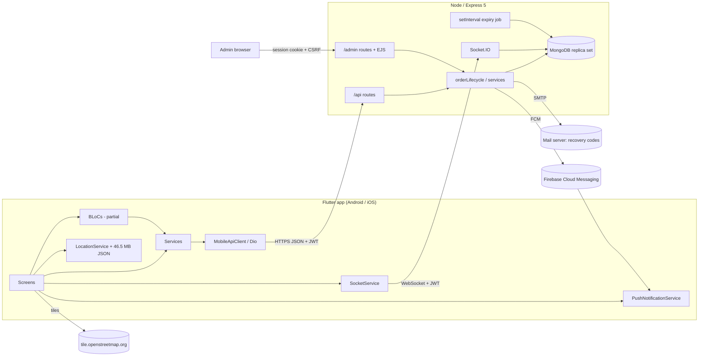
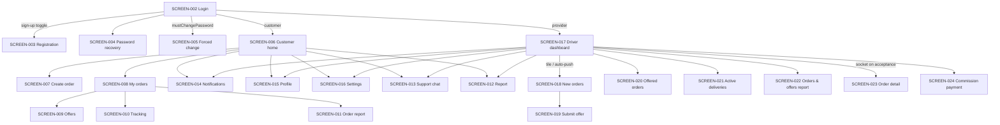
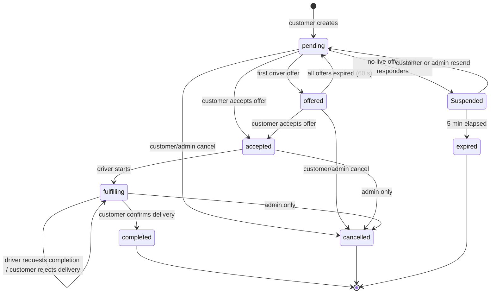
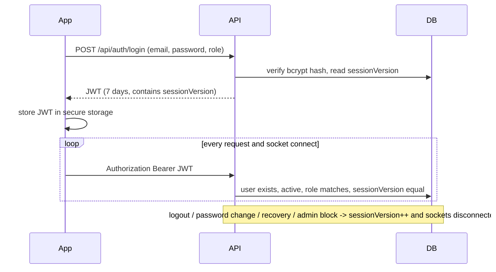

# Stars Delivery: Master Audit Report

| | |
|---|---|
| **Audit date** | 2026-11-13 |
| **Repository state** | `main` at `9b50ca3` ("Remove image uploads and enhance ad slider with countdown"). Documentation lives on branch `docs/stars-delivery-audit`. |
| **Scope** | Flutter mobile app (`lib/`), Node/Express backend + EJS admin dashboard (`swifora_backend/`), deployment configs, CI, tests |
| **Mode** | Read-only. No application source or runtime configuration was changed. Only `docs/stars-delivery-audit/` was added. |
| **Evidence rule** | Each claim comes from code reading (file:line), a command that was actually run, or a captured image. Anything unverified is labelled as such. |

This report is meant to be read without opening the code. Each section links to a supporting document with the full detail.

---

## Contents

1. [Executive summary](#1-executive-summary)
2. [Application purpose and user roles](#2-application-purpose-and-user-roles)
3. [Technology stack](#3-technology-stack)
4. [Repository organization](#4-repository-organization)
5. [Architecture overview](#5-architecture-overview)
6. [Feature inventory](#6-feature-inventory)
7. [Navigation overview](#7-navigation-overview)
8. [Business process summaries](#8-business-process-summaries)
9. [API and data architecture](#9-api-and-data-architecture)
10. [Authentication and security architecture](#10-authentication-and-security-architecture)
11. [Existing tests and execution results](#11-existing-tests-and-execution-results)
12. [Reliability findings](#12-reliability-findings)
13. [UI/UX findings](#13-uiux-findings)
14. [Screenshot inventory and capture coverage](#14-screenshot-inventory-and-capture-coverage)
15. [Coverage matrix](#15-coverage-matrix)
16. [Prioritized quality improvement roadmap](#16-prioritized-quality-improvement-roadmap)
17. [Open questions and unavailable evidence](#17-open-questions-and-unavailable-evidence)
18. [Supporting documents](#18-supporting-documents)

---

## 1. Executive summary

**Stars Delivery** is a bilingual (Arabic-first, English) on-demand delivery marketplace for Palestine. A **customer** posts a free-text request: a product pickup, people transport or goods transport. Nearby **drivers** (called "providers" in the code) answer with a price and an ETA within a 60-second offer window. The customer accepts one offer and the driver delivers. The customer then confirms delivery and rates the driver. The platform charges drivers a commission, which is settled manually. An **admin** web dashboard manages drivers, users, orders, commissions, ads, broadcasts, reports and support chat.

The system has two parts in one repository:

- a **Flutter app**, Android and iOS only, with about 18.7k lines of Dart. It uses BLoC for some features and `setState` for the rest, Dio for HTTP, Socket.IO for realtime updates, FCM for push and OpenStreetMap for tracking.
- a **Node.js 24 / Express 5 / MongoDB (Mongoose 8) backend** with Socket.IO and a server-rendered EJS admin dashboard.

**Overall assessment.** The backend's security engineering is noticeably mature:

- object-level authorization;
- transactional offer acceptance;
- session revocation through a per-user `sessionVersion`;
- CSRF protection, a strict CSP and optional TOTP 2FA on the admin dashboard;
- an origin allow-list and secret validation at startup.

The only Critical finding is a **dependency advisory**: `mongoose` 8.24.1 has critical npm advisories, and the project's own CI `npm audit` gate fails on it (RISK-051). None of the code-level findings is Critical. The main code weaknesses are in the **client**:

- startup blocks on a 46.5 MB JSON decode plus a GPS fix;
- errors are swallowed and shown as "empty" or "zero" data;
- localization is incomplete;
- God-widget screens.

The **test suite** is large: 613 tests ran and all passed. About 42% of it, though, asserts on source text rather than executing behaviour. The core order and offer journeys have no HTTP-level or end-to-end tests.

> **Update, 2026-11-13: device testing.** The real app was later run on an Android emulator against a local copy of the backend (throwaway database, synthetic accounts). The full order journey was confirmed working from both sides. The run also found two **High** defects, both now fixed in PR #4: (1) admins could not approve any new driver, and (2) any login after a logout in the same app session was signed out immediately (this confirms RISK-041). It also confirmed that earnings and commission are counted when an order is accepted rather than delivered. The owner confirmed this is intended. The run also recorded an ANR at startup. See [DEVICE_TEST_REPORT.md](DEVICE_TEST_REPORT.md).

**Headline numbers**

| Metric | Value | Basis |
|---|---|---|
| Mobile screens / dialogs / admin views | **24 / 15 / 28** (67 items) | [SCREEN_INVENTORY.md](SCREEN_INVENTORY.md) |
| Screenshot files / inventory items captured | **180 files / 49 of 67** | [DEVICE_TEST_REPORT.md](DEVICE_TEST_REPORT.md) | Android emulator run against a local backend: journeys, 29 device screenshots, findings D-1…D-7 |
| [SCREENSHOT_MANIFEST.md](SCREENSHOT_MANIFEST.md) |
| Confirmed features / features investigated and NOT FOUND | **23 / 14** | [APPLICATION_FLOWS.md §24](APPLICATION_FLOWS.md#24-confirmed-feature-list-and-not-found-list) |
| HTTP endpoints | **122** (57 mobile/public + 65 admin) | [API_INVENTORY.md §2.13](API_INVENTORY.md#213-endpoint-counts) |
| Socket.IO events / FCM push types | **15 / 11** | [API_INVENTORY.md](API_INVENTORY.md#3-socketio-events) |
| Tests executed | **613 passed, 0 failed**: Flutter 227, backend unit 382, backend integration 4 | §11 (actually run) |
| Flutter analyzer | **15 issues against CI baseline 12, so the CI gate fails** (also confirmed in GitHub Actions) | §11 (actually run) |
| Backend `npm audit` (CI) | **7 vulnerabilities (1 critical: `mongoose`), so the CI gate fails** | GitHub Actions run 43443180717 |
| Risk register | **51 findings: 1 Critical (dependency), 2 High, 16 Medium, 32 Low** | [QUALITY_RISK_REGISTER.md](QUALITY_RISK_REGISTER.md) |

**The five most important things to act on**

1. **Errors look like real data.** The driver dashboard can never show its error view: `ProviderError` is never emitted, so a failed load shows "ILS 0" earnings and commission. My Orders shows "No orders" on HTTP 500. Both are confirmed in screenshots (RISK-044, RISK-045).
2. **Startup and location performance.** `main()` waits for a location permission prompt, a GPS fix of up to 10 s and the decode of a **46.5 MB JSON asset** before the first frame. The same file is decoded again on every location sync, which happens every 30 s during a delivery (RISK-001 and RISK-002, both High).
3. **CI is red on both jobs.** The Flutter analyzer job requires exactly 12 issues, and HEAD has 15 (RISK-046). The backend `npm audit` gate fails on a critical `mongoose` advisory (RISK-051).
4. **Core journeys lack real tests.** Create order → offer → accept → deliver → rate is never exercised over HTTP or end-to-end. Many `*_ui_test.dart` files only check source text.
5. **Localization and accessibility gaps.** Profile, Report and Support chat stay Arabic in English mode. Order statuses show raw enums. The ad banner overflows at large text sizes. The admin dashboard is not usable on phones.

---

## 2. Application purpose and user roles

| Role | Where | Main capabilities | Gate |
|---|---|---|---|
| **Customer** (`customer`) | Mobile app | Register/login, create order (product / people / goods), receive and accept driver offers, track the driver, confirm or reject delivery, rate the driver, report a driver, support chat, notifications, profile | JWT; `requireRole('customer')` on customer routes |
| **Driver / provider** (`provider`) | Mobile app | Register (pending admin approval), toggle availability, see new orders in their area, submit price+ETA offers, start/complete delivery, view earnings and commission due, rejected/not-selected report, report a customer | JWT + `requireRole('provider')`; `status` must be active (approved) |
| **Admin** (`admin`) | Web dashboard `/admin` | Approve drivers, manage users/drivers, view and cancel orders, commissions and payouts, ads, broadcasts, reports and replies, support chat, areas, settings and 2FA | Server-side session cookie + CSRF + optional TOTP |
| **Guest** | Mobile login screen | Contact support before login, password recovery | Public endpoints, rate-limited |

Sources: [Order.js](../../swifora_backend/src/models/Order.js), [User.js:72](../../swifora_backend/src/models/User.js#L72), [APPLICATION_FLOWS.md](APPLICATION_FLOWS.md).

---

## 3. Technology stack

| Layer | Technology (resolved versions) |
|---|---|
| Mobile framework | Flutter 3.47.4 (CI-pinned; Dart 3.13.3), `sdk: ^3.12.2` |
| Mobile state | `flutter_bloc` 9.1.1 + `equatable`; many screens use `setState` |
| Mobile networking | `dio` 5.10.0 through `MobileApiClient`, `socket_io_client` 3.1.6 |
| Mobile platform | `geolocator`, `flutter_map` 8.3.2 + `latlong2` (OpenStreetMap public tiles), `firebase_core` / `firebase_messaging` 17, `flutter_secure_storage` (JWT), `shared_preferences` (theme/locale) |
| Targets | **Android and iOS** (configured). The `web/`, `windows/`, `macos/` and `linux/` folders are untouched templates, and web cannot run as written (`dart:io` `Platform` in `ApiConfig.init`). |
| Backend | Node 24.13.1 (CI), Express 5.2, Mongoose 8.24 (MongoDB, transactions require a replica set), Socket.IO 4.8, `jsonwebtoken`, `bcryptjs`, `helmet`, `express-rate-limit`, `express-session` + `connect-mongo`, `firebase-admin`, `nodemailer`, `multer`, EJS |
| Admin UI | Server-rendered EJS + one 3,972-line vanilla JS file (`src/public/js/main.js`) |
| Deployment | nginx reverse proxy + systemd unit ([deployment/](../../deployment/)), env template |
| CI | GitHub Actions ([ci.yml](../../.github/workflows/ci.yml)): backend `npm ci`/check/test/integration/audit, Flutter `pub get`/test/analyzer baseline. **No release builds and no CD.** |

Details: [ARCHITECTURE.md §1–§6](ARCHITECTURE.md#1-application-type-platforms-stack).

---

## 4. Repository organization

| Path | Responsibility |
|---|---|
| `lib/main.dart` | Entry point: `ApiConfig.init` → `LocationService.initialize` → theme/locale prefs → `SwiforaApp` (MultiBlocProvider, MaterialApp, `home: LoginScreen`) |
| `lib/screens/` (22 files) | All screens. The role shells are `home_screen.dart` (customer, 965 lines) and `provider_home_screen.dart` (driver, 1,534 lines). |
| `lib/bloc/` (7 blocs) | `auth`, `app` (theme/locale), `notification`, `offer`, `order`, `password_recovery`, `provider` |
| `lib/services/` (26 files) | HTTP services per domain, `mobile_api_client.dart` (Dio factory + session-failure hook), `api_config.dart` (server URL policy), `socket_service.dart`, `push_notification_service.dart`, `location_service.dart`, `localization_service.dart` (in-code ar/en string table), `theme_service.dart` (design tokens) |
| `lib/models/` | `OrderModel`, `OfferModel`, `UserModel`, `NotificationModel`, `AdModel`, `ProviderStats` (hand-written `fromJson`) |
| `lib/widgets/ui/` | Shared design-system components (status chips, state views, confirm dialog, action tile, ad carousel, notification bell) |
| `assets/countries+states+cities.json` | 46.5 MB global location catalog, decoded on device |
| `test/` | 49 Flutter test files + `mock_api_server.dart` + `ux03_screen_harness.dart` |
| `swifora_backend/src/` | `index.js` (boot, middleware, Socket.IO, scheduler), `routes/` (21 routers), `services/` (order lifecycle, commission ledger, sessions, push…), `models/` (17 Mongoose models), `security/`, `middleware/`, `views/admin/`, `public/`, `scripts/` (ops: admin bootstrap, backup/restore, audits) |
| `swifora_backend/test/`, `integration/` | 56 `node:test` files + 1 integration file |
| `deployment/`, `docs/` | nginx/systemd/env template; prior security, notification and UX docs |

Full map: [ARCHITECTURE.md §3](ARCHITECTURE.md#3-repository-map).

---

## 5. Architecture overview

**Pattern as implemented:** a pragmatic layered design, *screens → (some) BLoCs → concrete services → Dio*. There is no dependency injection: services are created inline, and the JWT is passed through constructors and added to each request's headers. On the backend, routes hold much of the business logic, while order and offer state changes go through `services/orderLifecycle.js` inside Mongo transactions. Realtime updates combine Socket.IO pushes with timed polling.

**Main architectural concerns** ([ARCHITECTURE.md §10](ARCHITECTURE.md#10-top-architecture--maintainability-concerns)):

1. Blocking, heavyweight startup (GPS + 46.5 MB decode).
2. Mixed state approaches, and God widgets that duplicate session bootstrap.
3. No DI, tokens passed through every layer, auth headers added per call.
4. Untyped `Map<String,dynamic>` throughout the UI and copy-pasted error mapping. Socket event names are duplicated as string literals, and the server event `rating_received` has no listener.
5. Fat backend routers (up to 1,406 lines), a monolithic admin JS file, and an in-process scheduler that is unsafe with more than one instance.

Component and data-flow diagrams: [ARCHITECTURE.md §9](ARCHITECTURE.md#9-diagrams).

---

## 6. Feature inventory

**Confirmed (23):**

- session restore and revocation;
- customer registration;
- driver registration with admin approval;
- login/logout;
- forced password change;
- e-mail-code password recovery;
- profile management (name, email, password, area, phones, governorate scope);
- free-text order creation (3 types);
- driver offers with a 60 s window and 60 s cooldown;
- customer accept / resend / cancel;
- 15-minute driver lock on acceptance;
- fulfilling plus two-step delivery confirmation;
- polling-based live driver location on a map;
- notifications (in-app, socket, push);
- customer ratings of drivers;
- abuse reports with admin replies;
- support chat and the guest contact form;
- admin-managed ads with countdown;
- driver availability toggle;
- the driver's rejected/delivered/not-selected report;
- commission calculation and manual settlement;
- the admin dashboard with TOTP 2FA;
- broadcasts to drivers and users.

**Investigated and NOT FOUND (14):** delivery fee calculation, online payment, customer rejection of one offer, customer cancel after acceptance, driver cancellation, driver rating of customers, driver document upload (removed in HEAD), map-based pickup/drop-off selection, push-tap navigation, offline queue / HTTP retry, refresh tokens, delivery auto-completion, commission enforcement, notification to an applicant when approved.

Detail per flow: [APPLICATION_FLOWS.md](APPLICATION_FLOWS.md).

---

## 7. Navigation overview

The app has **no named routes, no deep links and no push-tap routing**. All navigation is imperative `Navigator.push`/`pushAndRemoveUntil`. `MaterialApp.home` is always `LoginScreen`, which restores the session and replaces itself with the role's home. Socket events can **open screens by themselves**: on the customer side, Offers and delivery confirmation; on the driver side, New Orders whenever the pending list goes from empty to non-empty ([provider_home_screen.dart:503-530](../../lib/screens/provider_home_screen.dart#L503-L530), confirmed in [this screenshot](screenshots/SCREEN-018-autopushed-from-017-ar-light.png)).

Per-role graphs, including admin: [SCREEN_INVENTORY.md](SCREEN_INVENTORY.md).

---

## 8. Business process summaries

**Order state machine** (server enum `pending, offered, accepted, fulfilling, completed, cancelled, expired`):

"Suspended" is `status='pending'` with `offerSuspendedUntil` set. It is not an enum value.

| Process | Summary | Key risks |
|---|---|---|
| Launch and session restore | Stored JWT → `GET /auth/me` → role home. A `sessionVersion` mismatch signs the user out. | Startup blocked by GPS + 46.5 MB decode (RISK-001). A DB outage during socket auth can force a logout ([API_INVENTORY §5](API_INVENTORY.md#5-resilience-and-contract-analysis)). |
| Registration | Customer: immediate account. Driver: `status=pending` until an admin approves. Terms and Privacy dialogs gate submission. | A pending driver sees a red *error* snackbar on success (UX-05). The server does not validate name, phone or privacy flag (RISK-038). |
| Create order | Free-text description + phone + type + area. No map, no fee. | No in-flight guard on submit (RISK-016). |
| Offers | Drivers in the area submit price+ETA. Each offer lives 60 s, with a 60 s cooldown per driver. Accept runs in a transaction, and losers are notified. | An expired driver can never re-offer on the same order (confirmed in API_INVENTORY). A 409 conflict message is read from the wrong field, so users see generic errors. |
| Delivery | Driver: accepted → fulfilling → "complete" (sets `completionRequestedAt`). Customer approves (→ completed + rating prompt) or rejects (back to working). | The driver lock is 15 min and not tied to the order. There is no auto-complete. Live tracking only works in the foreground (RISK-003). |
| Commission | Calculated per completed order. The admin records manual settlements. | Not enforced. Errors show "ILS 0" as due (RISK-044). |
| Notifications | DB notifications + 15 socket events + 11 FCM types. | Push taps do not navigate. Push tokens survive logout (RISK-005). |
| Password recovery | E-mail code challenge (rate-limited, hashed), then reset → all sessions revoked. | Depends on SMTP. Covered by tests. |

Sequence diagrams (end-to-end order, login/session, password recovery): [APPLICATION_FLOWS.md](APPLICATION_FLOWS.md#23-end-to-end-sequence-create--offer--accept--deliver--rate).

---

## 9. API and data architecture

- **122 HTTP endpoints:** 57 under `/api` for the mobile app and public use (5 of them have no Flutter caller), plus 65 admin endpoints (session + CSRF). **15 Socket.IO server→client events**; clients emit no custom events. **11 FCM `data.type` values.** Full inventory: [API_INVENTORY.md](API_INVENTORY.md).
- **Client HTTP behaviour:** Dio with 30 s timeouts (8 s for chat). There are **no retries, no caching and no pagination**. Every 401/403 session failure goes to one session-failure hook, which logs the user out.
- **Contract mismatches (confirmed):**
  - Offers populate a `phone` field that doesn't exist on users (they have `phoneNumbers`), so customers never see the driver's phone. **Owner decision (2026-11-13): hiding the driver phone from customers is intended.**
  - 409 replies carry `message`, but the client reads `error`.
  - `OfferModel.orderId` becomes the `toString()` of a populated Map.
  - The server event `rating_received` has no client listener.
- **Persistence:**
  - Mobile: JWT in `flutter_secure_storage`; theme and locale in `shared_preferences`. No local database, cache or offline queue.
  - Server: MongoDB with 17 models. Provider documents live outside the web root. Legacy order images are still served publicly from `/uploads`.
  - There is no retention policy for GPS, chat or orders. Backups are unencrypted.
  - Details: [DATA_AND_SECURITY.md §2–§3](DATA_AND_SECURITY.md#2-persistence-flutter-client).

---

## 10. Authentication and security architecture

| Area | Implementation | Gaps |
|---|---|---|
| Mobile auth | 7-day JWT, no refresh token. `sessionVersion` is checked on each request and socket connection. | Logout signs out every device. Push tokens are not removed on logout (RISK-005). |
| Admin auth | Session cookie (httpOnly, SameSite=Lax, Secure in production, 24 h), CSRF on all routes, strict CSP, audit log kept 180 days, optional TOTP | 2FA is optional (RISK-010). Passwords are typed into unmasked `prompt()`. |
| Authorization | `requireRole` + server-side ownership checks. Prices and commissions are computed on the server. | A driver with no registered area sees every order (RISK-014). |
| Transport | App requires HTTPS outside Android debug. Origin allow-list rejects wildcards. nginx TLS. | Server binds `0.0.0.0:3000` with `trust proxy 1`, so rate limits can be bypassed if the port is reachable (RISK-007, needs a host check). |
| Rate limiting | Per-IP and per-account limiters on auth, recovery and order creation | In-memory store, reset on restart (RISK-028) |
| Secrets | Validated at startup. No secret files are tracked by git (checked with `git ls-files`). | Values were not inspected. The deployment template lists an unused `IMGBB_API_KEY`. |

Full analysis: [DATA_AND_SECURITY.md](DATA_AND_SECURITY.md).

---

## 11. Existing tests and execution results

**Inventory** (static count from source, [TEST_AUDIT.md](TEST_AUDIT.md)):
- Flutter: 49 files, 209 test blocks.
- Backend: 56 unit files with 382 tests, plus 1 integration file with 4 tests.
- iOS/macOS: 2 empty XCTest placeholders.
- About 42% of all test cases assert on **source text** with regex, not on behaviour.
- There are no golden tests, no `integration_test/`, no e2e, no coverage configuration, no `bloc_test` or mocktail, and no Socket.IO tests.

**Executed during this audit** (Windows 11, Flutter 3.47.4, Node 24.13.1, the same versions as CI):

| Command | Result |
|---|---|
| `npm test` (backend) | **382 passed / 0 failed / 0 skipped** (5.7 s) |
| `npm run test:integration` (backend, in-memory MongoDB 8.2.6) | **4 passed / 0 failed** |
| `flutter test` | **227 passed / 0 failed** (51 s) |
| `flutter analyze` | **15 issues** (3 `unused_import` warnings + 12 infos), exit 1. **CI requires exactly 12, so the gate fails** (RISK-046). |
| Coverage | **Not measured.** No configuration exists. Line coverage is unknown. |
| `npm audit` | Not run locally (it contacts the registry). **In CI** (GitHub Actions, PR #1): 7 vulnerabilities, 1 critical (`mongoose` 8.24.1), so the job fails (RISK-051). In the same CI run the backend tests passed (382 + 4) and the Flutter analyzer gate failed at 15 issues, matching the local results. |

Details and per-module coverage map: [TEST_AUDIT.md](TEST_AUDIT.md#execution-results). Future plan with 70 prioritized cases: [RECOMMENDED_TEST_PLAN.md](RECOMMENDED_TEST_PLAN.md).

---

## 12. Reliability findings

Full register: [QUALITY_RISK_REGISTER.md](QUALITY_RISK_REGISTER.md). **51 findings: 1 Critical, 2 High, 16 Medium, 32 Low.** By evidence: 24 confirmed defects, 4 strongly suspected, 19 potential risks, 4 that need runtime verification.

| ID | Sev | Evidence | Finding |
|---|---|---|---|
| RISK-051 | **Critical** | Potential risk (confirmed by CI) | `mongoose` 8.24.1 has critical npm advisories (prototype pollution, cast bypass); the CI `npm audit` gate fails |
| RISK-001 | High | Strongly suspected | Startup is blocked on the location prompt, a GPS fix (≤10 s) and a 46.5 MB JSON decode before the first frame |
| RISK-002 | High | Strongly suspected | The 46.5 MB JSON is decoded again on the UI isolate on every location sync (every 30 s while delivering, from 2 timers) |
| RISK-044 | Medium | **Confirmed (screenshot)** | The driver dashboard never shows its error state, so failures display zeroed earnings and commission as if real |
| RISK-045 | Medium | **Confirmed (screenshot)** | My Orders shows "No orders" on load failure |
| RISK-046 | Medium | **Confirmed (run)** | The CI analyzer gate fails (15 vs 12) |
| RISK-003 | Medium | Confirmed | Driver live tracking only works while the app is in the foreground |
| RISK-004 | Medium | Confirmed | `ProviderBloc` drops `offeredOrders`, so the Offered tile often does nothing |
| RISK-005 | Medium | Confirmed | Push tokens survive logout and revocation |
| RISK-006 | Medium | Confirmed | Heavy polling that continues in the background |
| RISK-007 | Medium | Needs runtime check | `0.0.0.0` bind + `trust proxy 1` allows rate-limit bypass if the port is exposed |
| RISK-047 | Low | **Confirmed (runtime)** | `MyOrdersScreen` calls `setState` after dispose |
| RISK-048 | Low | **Confirmed (screenshot)** | The ad banner overflows at 1.6× text scale |
| RISK-049 | Low | **Confirmed (screenshot)** | The admin dashboard is unusable at phone width |
| RISK-050 | Low | **Confirmed (screenshot)** | Cancelled and expired statuses show the raw English enum |

Also from the flows analysis ([API_INVENTORY §5.7](API_INVENTORY.md#57-contract-mismatches-client-model--server-response)): the driver phone is never shown to customers (intended, per the owner), conflict messages are lost, an expired driver can never re-offer, and the driver lock is not tied to the active order.

---

## 13. UI/UX findings

Full audit: [UI_UX_AUDIT.md](UI_UX_AUDIT.md). The design-token layer (Material 3, indigo/orange, semantic tones, spacing and radius scales) is solid, and shared components are used well. The issues are mostly behavioural.

| # | Finding | Basis |
|---|---|---|
| UX-06 / RISK-045 | Errors are shown as empty or zero data | **Visually confirmed** |
| UX-04 | Profile, Report, Support chat and the conflict dialog stay Arabic in English mode (about 61 hard-coded literals) | **Visually confirmed** |
| UX-07 | Dark-mode ad banner: white text on a pastel gradient, about 1.6:1 contrast | **Visually confirmed** |
| UX-09 | Screens open by themselves on socket events | **Visually confirmed** (driver) |
| UXV-01 | Raw status enum ("cancelled") in the Arabic UI | **Visually confirmed** |
| UXV-02 | The cancel-order dialog pairs "إلغاء" (dismiss) with "إلغاء الطلب" (cancel order), which is ambiguous | **Visually confirmed** |
| UXV-03 / UXV-04 | Text-scale overflow; admin layout not responsive | **Visually confirmed** |
| UX-02 / UX-03 | Notifications and offers flash to a full-screen spinner on every 15 s poll or socket update | Inferred from code |
| UX-05 | A successful driver registration (pending review) is shown as a red error | Inferred from code |
| UX-08 | Push notifications do not deep-link | Inferred from code |
| UX-18 | Text-field borders have 1.6–1.8:1 contrast (WCAG 1.4.11 needs 3:1) | Computed from tokens |

---

## 14. Screenshot inventory and capture coverage

Full manifest: [SCREENSHOT_MANIFEST.md](SCREENSHOT_MANIFEST.md). Images: [screenshots/](screenshots/).

- **No emulator, simulator or device was available**, and the app cannot run on web or Windows as configured: web fails because of `dart:io`, and Windows needs an HTTPS server URL. Two capture methods were used instead:
  - **Mobile (158 files):** the *real screen widgets* are rendered inside the Flutter test renderer against synthetic fixtures, through the project's own `MobileApiClient.testAdapter` hook, and the actual frame is rasterized. An Arabic-capable font was loaded so RTL text renders. **These are not device screenshots.** They have no status bar, the fonts differ, and map tiles do not load.
  - **Admin (22 files):** **real browser screenshots** taken with headless Edge against the real backend, running on a throwaway in-memory MongoDB with synthetic data.
- **Coverage: 49 of 67 inventory items captured.**
  - Mobile states: default/populated, loading, empty, error (HTTP 500), validation, dialogs, Arabic RTL and English LTR, light and dark, 1.6× text scale, and a 320 px-wide phone.
  - **Not captured (18):**
    - SCREEN-001 (transient session gate);
    - DIALOG-002/003/004 (terms flow needs a valid registration submit);
    - DIALOG-006, 010 and 014;
    - ADMIN modals 017–020 and 022–026;
    - ADMIN-027/028 (native browser dialogs).
  - Each has a reason and a reproducible procedure in the manifest.
- No image is synthetic or a mock-up. All fixture data is invented (names like "Driver Alpha", `example.test` emails, `0590000…` phones).

---

## 15. Coverage matrix

Legend:
- **Inspected / Documented:** read in code and written up.
- **Screenshot:** ✅ captured, ⚠️ partial (some states), ❌ not captured.
- **Automated tests**, per [TEST_AUDIT §5](TEST_AUDIT.md#5-coverage-map): **B** behavioural, **H** harness render only, **S** source-text assertion only, **—** none.

### Screens

| ID | Screen | Inspected | Documented | Screenshot | Automated tests |
|---|---|---|---|---|---|
| SCREEN-001 | App shell / session gate | ✅ | ✅ | ❌ | B (`widget_test`, session_lifecycle) |
| SCREEN-002 | Login | ✅ | ✅ | ✅ | B |
| SCREEN-003 | Registration | ✅ | ✅ | ✅ | B (ux01 dialogs/roles) |
| SCREEN-004 | Password recovery | ✅ | ✅ | ⚠️ step 1 only | S (bloc B) |
| SCREEN-005 | Forced password change | ✅ | ✅ | ✅ | S |
| SCREEN-006 | Customer home | ✅ | ✅ | ✅ | B (logout) + S |
| SCREEN-007 | Create order | ✅ | ✅ | ✅ | H + S |
| SCREEN-008 | My orders | ✅ | ✅ | ✅ | H + S |
| SCREEN-009 | Order offers | ✅ | ✅ | ✅ | H + S (accept not exercised) |
| SCREEN-010 | Tracking map | ✅ | ✅ | ⚠️ no tiles/marker | S |
| SCREEN-011 | Order report | ✅ | ✅ | ✅ | H + S |
| SCREEN-012 | Report driver/customer | ✅ | ✅ | ✅ | H |
| SCREEN-013 | Support chat | ✅ | ✅ | ✅ | H + S |
| SCREEN-014 | Notifications | ✅ | ✅ | ✅ | H + S |
| SCREEN-015 | Profile | ✅ | ✅ | ✅ | H + S |
| SCREEN-016 | Settings | ✅ | ✅ | ✅ | — |
| SCREEN-017 | Driver dashboard | ✅ | ✅ | ✅ | B |
| SCREEN-018 | New orders | ✅ | ✅ | ✅ | H + S |
| SCREEN-019 | Submit offer | ✅ | ✅ | ✅ | H + S |
| SCREEN-020 | Offered orders | ✅ | ✅ | ✅ | H + S |
| SCREEN-021 | Active deliveries | ✅ | ✅ | ✅ | H + S |
| SCREEN-022 | Orders & offers report | ✅ | ✅ | ✅ | H + S |
| SCREEN-023 | Order detail (driver) | ✅ | ✅ | ✅ | H + S |
| SCREEN-024 | Commission payment | ✅ | ✅ | ✅ | — |

Dialogs: 9 of 15 captured. Admin: 17 of 28 captured, and admin pages have **no browser tests at all**. See the manifest.

### Business flows

| Flow | Inspected | Documented | Screenshot evidence | Automated tests |
|---|---|---|---|---|
| Session restore / revocation | ✅ | ✅ | ❌ (transient) | B (backend + Flutter session tests) |
| Registration (customer/driver) | ✅ | ✅ | ✅ | B (integration: customer only) |
| Login / logout | ✅ | ✅ | ✅ | B (integration + widget) |
| Forced password change | ✅ | ✅ | ✅ | S + backend B |
| Password recovery | ✅ | ✅ | ⚠️ | B (backend) + bloc B |
| Create order | ✅ | ✅ | ✅ | S (Flutter); backend S |
| Offer submit / window / cooldown | ✅ | ✅ | ✅ | backend service B (stubbed Mongoose); Flutter S |
| Accept offer / conflict | ✅ | ✅ | ✅ | backend service B; Flutter S |
| Delivery start / complete / confirm / reject | ✅ | ✅ | ✅ | backend service B; Flutter S |
| Cancellation | ✅ | ✅ | ✅ | backend B; Flutter S |
| Rating | ✅ | ✅ | ✅ | S |
| Tracking | ✅ | ✅ | ⚠️ | S |
| Notifications / socket / push | ✅ | ✅ | ✅ (in-app) | S only; **no socket tests** |
| Commission | ✅ | ✅ | ✅ | backend B (ledger) |
| Reports / support chat | ✅ | ✅ | ✅ | S + partial B |
| Ads | ✅ | ✅ | ✅ | backend B + S |
| Admin operations | ✅ | ✅ | ✅ (17 views) | backend S/B; **no UI tests** |

---

## 16. Prioritized quality improvement roadmap

This is a recommendation only. Nothing here has been implemented.

| Priority | Item | Addresses |
|---|---|---|
| **P0 (now)** | Upgrade `mongoose` past the advisory range and run `npm audit fix`, then re-run the backend tests | RISK-051 |
| P0 | Make the Flutter CI gate pass, and change it to "0 errors, no new warnings" instead of an exact count | RISK-046 |
| P0 | Stop presenting errors as data: emit `ProviderError` and show retry views; add `mounted` guards after awaits | RISK-044, RISK-045, RISK-047 |
| P0 | Move the location catalog off the startup path: load it lazily in an isolate, shrink the asset (Palestine-only data already exists server-side), and stop blocking on GPS before the first frame | RISK-001, RISK-002 |
| P1 | Supertest + `MongoMemoryReplSet` suite for orders/offers/provider routes (the full create→offer→accept→deliver→rate path), plus Socket.IO event tests | Test gaps 1–4 |
| P1 | Fix contract mismatches: 409 `message`, `orderId` parsing, `rating_received` | API_INVENTORY §5.7 |
| P1 | Remove push tokens on logout before revoking the session; add push-tap deep links | RISK-005, UX-08 |
| P1 | Complete localization: move hard-coded Arabic into the string table, map all statuses, add a key-parity test | UX-04, RISK-050 |
| P2 | Flutter `integration_test` / Patrol e2e on an emulator against a seeded staging backend; golden tests for key screens in ar/en and light/dark | Visual regression for the redesign |
| P2 | Accessibility: field-border contrast, text-scale-safe ad banner, carousel pause, admin keyboard support and responsive sidebar | UX-18, RISK-048, RISK-049 |
| P2 | Ops: make admin 2FA mandatory, shared rate-limit store, encrypted backups, PII retention policy, single scheduler leader | RISK-010, 013, 015, 028 |
| P3 | Refactor: split God widgets, introduce DI and a typed API layer, and remove dead code (`axios`, `src/data/cities.js`, root `package-lock.json`) | ARCHITECTURE §10 |

---

## 17. Open questions and unavailable evidence

1. **Staging/production endpoints.** Is there an HTTPS staging backend, and what is the production `STARS_SERVER_URL`? Only placeholders are in the repo. *This is needed for device screenshots and end-to-end tests.*
2. **Test accounts.** Synthetic customer, driver and admin accounts on staging are needed for real device capture.
3. **Device access.** Is an Android emulator or device available? None was detected on the audit machine.
4. **Production MongoDB topology.** Order and offer flows require a replica set (transactions) and have no fallback.
5. **Is port 3000 exposed** on the production host (RISK-007)?
6. **Firebase.** Is FCM enabled in production? The config files are not in the repo, as expected.
7. **CI history.** On PR #1 both CI jobs fail: the analyzer count and `npm audit`. Neither is caused by the docs-only change, so `main` is very likely red too. `main`'s own run history was not checked.
8. **iOS.** Have iOS builds been produced? What are the signing team and provisioning setup?
9. **Product intent.**
   - Should customers be able to cancel after acceptance?
   - Should commission be enforced?
   - ~~When should earnings and commission be counted?~~ **Decided (2026-11-13): at acceptance, as currently implemented.**
   - Is the 15-minute driver lock intended?
   - Are the auto-opening screens intended?
10. **Unverified by runtime:** push notifications, background behaviour, real GPS and map tiles, socket reconnection, SMTP delivery, performance on low-end devices.

Not inspected: values of `.env`, `key.properties`, Firebase configs and any files under `swifora_backend/private/` or `uploads/`. This was deliberate, for secret and personal-data safety. Only their existence and whether git tracks them were checked.

---

## 18. Supporting documents

| Document | Contents |
|---|---|
| [ARCHITECTURE.md](ARCHITECTURE.md) | Stack, platforms, initialization, repository map, dependencies, configuration, native integrations, layering, dead code, CI, Mermaid diagrams |
| [APPLICATION_FLOWS.md](APPLICATION_FLOWS.md) | Order/offer state machines and 24 end-to-end journeys with sequence diagrams; confirmed and NOT FOUND features |
| [SCREEN_INVENTORY.md](SCREEN_INVENTORY.md) | All 24 screens, 15 dialogs and 28 admin views with entry points, controls, states, APIs, validation and capture status |
| [API_INVENTORY.md](API_INVENTORY.md) | 122 HTTP endpoints, 15 socket events, 11 push types, resilience and contract analysis |
| [DATA_AND_SECURITY.md](DATA_AND_SECURITY.md) | Persistence, authentication, authorization, logging, permissions, network security, privacy |
| [TEST_AUDIT.md](TEST_AUDIT.md) | Test inventory, classification, coverage map, **execution results** |
| [QUALITY_RISK_REGISTER.md](QUALITY_RISK_REGISTER.md) | 51 findings with severity, evidence class, location, reproduction and validation |
| [UI_UX_AUDIT.md](UI_UX_AUDIT.md) | Design tokens, contrast, accessibility, RTL, findings with visual-confirmation status |
| [RECOMMENDED_TEST_PLAN.md](RECOMMENDED_TEST_PLAN.md) | Layer-by-layer strategy, tooling, 70 prioritized test cases, CI changes |
| [SCREENSHOT_MANIFEST.md](SCREENSHOT_MANIFEST.md) | Capture method, coverage, not-captured procedures, file-by-file manifest |
| [screenshots/](screenshots/) | 180 PNG captures |
| [tooling/](tooling/) | The capture harnesses and admin demo scripts used (stored as `.txt` so they do not affect the analyzer or tests) |
